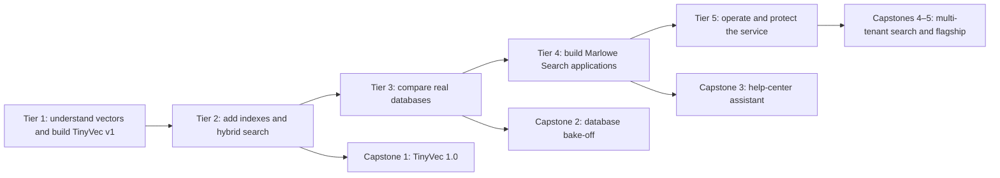

# Learning path

Build a small vector database, learn its trade-offs, then use the same marketplace workload to compare real databases and build applications. You need basic Python, a terminal, and basic Git. Linear algebra, SQL, Docker, and benchmarking are introduced before you need them.

**Tiers 1–5 are available.** Complete the [Tier 1](checkpoints/tier1/README.md), [Tier 2](checkpoints/tier2/README.md), [Tier 3](checkpoints/tier3/README.md), [Tier 4](checkpoints/tier4/README.md) and [Tier 5](checkpoints/tier5/README.md) checkpoints. The [Phase 7 report](docs/PHASE_7_REPORT.md) records operations and security evidence. The [Phase 8 report](docs/PHASE_8_REPORT.md) covers all four bonus modules and five complete capstone packages.

## Time, hardware, and how to study

The main route totals about **58 hours** including guided checkpoint work. Full capstones, optional comparisons, model downloads, installation troubleshooting, and long benchmark runs are additional. Treat estimates as a guide, not a deadline.

| Tier | Modules | Time | Hardware | Milestone |
|---|---|---:|---|---|
| 1: Foundations | 00–04 | 10 h | CPU, 8 GB RAM, no Docker | Exact TinyVec, measurements, Playground |
| 2: Indexes | 05–10 | 12 h | CPU, 8 GB RAM, no Docker | TinyVec v5, index tuning report |
| 3: Databases | 11–16 | 14 h | CPU, 16 GB recommended, Docker from module 12 | Four-database bake-off |
| 4: Applications | 17–20 | 12 h | CPU, 16 GB recommended, one chosen database | Marlowe Search v5 |
| 5: Production | 21–23 | 10 h | CPU, 16 GB recommended, one database plus optional monitoring | Seller-isolated Marlowe Search v6 |

Read the analogy, predict the experiment's outcome, run it, then explain any difference. Complete Practice before Apply; use Stretch when you can explain your baseline. Compare measurements only when hardware, data, embeddings, filters, and concurrency match. Save both failures and fixes.

Three routes will be supported: follow this path in order; use the feature map to jump to a topic after its prerequisites; or explore the Playground and follow its links back to the relevant lessons.

## Tier 1: Foundations — 10 hours

| Module / target path | Time | What you learn and build | Evidence |
|---|---:|---|---|
| 00 [setup](modules/00_setup/README.md) | 60 min | Environment, landscape, data tour, keyword failure and semantic mug-warmer search; explain libraries versus databases | Environment report and real fixed-query result |
| [01 project](capstones/01_tinyvec/README.md) [vectors similarity](modules/01_vectors_similarity/README.md) | 120 min | 2D/3D vectors, NumPy, dot/cosine/Euclidean, normalization, high-dimensional distance concentration; exact search | Identical neighbors to NumPy with tie rules; similar products from hand-built features |
| [02 project](capstones/02_database_bakeoff/README.md) [embeddings](modules/02_embeddings/README.md) | 150 min | Text/image embedding intuition, dimensions, query prefixes, batching/cache, PCA catalog map, separate model spaces | Batch time, cache hit/miss time, first semantic relevance scores; Marlowe Search v1 |
| [03 project](capstones/03_rag_assistant/README.md) [tinyvec](modules/03_tinyvec/README.md) | 150 min | IDs, storage, insert/upsert/delete, exact search, pre/post filtering, disk persistence, small API | CRUD/filter/round-trip contract; TinyVec v1 |
| [04 project](capstones/04_multitenant_search/README.md) [benchmarking](modules/04_benchmarking/README.md) | 120 min | ANN recall versus relevance; precision/MRR/nDCG, percentiles/QPS, build/RAM/disk, repeated trials and noise | Exact baseline, raw run file, leaderboard and plot |

Checkpoint: submit TinyVec v1, a search session in the first Playground, and a report explaining the exact-search baseline. Use the committed semantic vectors and cached demonstration queries to start without a model download; load the real text model for new query text.

You're ready for Tier 2 when you can:

- Explain what a vector coordinate and a similarity score represent without assuming a coordinate is a human-readable concept.
- Predict how normalization changes dot-product ranking and handle zero vectors explicitly.
- Upsert/delete a product and reload the store without changing its IDs.
- Distinguish ANN recall from relevance and reproduce a benchmark on your machine.
- Explain why a hashing fixture cannot establish semantic search quality.

## Tier 2: How indexes work — 12 hours

| Module / target path | Time | What you learn and build | Evidence |
|---|---:|---|---|
| [05 project](capstones/05_marlowe_search/README.md) [ann lsh](modules/05_ann_lsh/README.md) | 90 min | Exact scaling; trees/hash/graph/partition/compression families; curse of dimensionality; TinyVec LSH | Recall–speed–memory comparison against exact |
| 06 [ivf](modules/06_ivf/README.md) | 120 min | K-means, inverted lists, nlist/nprobe; TinyVec IVF and FAISS IVF | nprobe sweep; TinyVec v2 |
| 07 [hnsw](modules/07_hnsw/README.md) | 150 min | Navigable graphs, random layers, construction/search beams, M/efConstruction/efSearch, deletion and memory | TinyVec/FAISS/USearch curves and graph explorer; TinyVec v3; optional hnswlib |
| 08 [quantization](modules/08_quantization/README.md) | 150 min | Scalar/binary compression, PQ and IVF-PQ, Matryoshka on a suitable model, oversampling/rescoring, 10M-vector memory math | Measured memory/recall trade-offs; TinyVec v4 |
| 09 [disk scale](modules/09_disk_scale/README.md) | 90 min | DiskANN/Vamana intuition, mmap and bounded reads, SSD versus RAM, object-storage formats, partition/shard concepts | Million-product streamed experiment with memory budget; measured versus extrapolated results separated |
| 10 [filtering hybrid](modules/10_filtering_hybrid/README.md) | 120 min | Filter selectivity/indexing, pre/post/filter-aware search, BM25, sparse vectors, RRF, multi-vector MaxSim, reranking | Boots-under-budget workload; strict-filter failure/fix; TinyVec v5 |

Checkpoint: compare TinyVec's indexes with FAISS and USearch, optionally hnswlib; choose settings for one recall/latency target and justify them. The full TinyVec 1.0 capstone extends this work. Production library comparisons meet the early tiers' no-Docker rule; full server versions follow later.

You're ready for Tier 3 when you can:

- Explain why approximate search may miss a relevant or nearest item and distinguish those two failures.
- Explain and tune nprobe, M, efConstruction, and efSearch.
- Estimate vector payload size and describe graph/metadata/runtime overhead separately.
- Diagnose a selective-filter recall collapse and measure the fix.
- Explain why mmap is not itself DiskANN, and why truncating an arbitrary embedding is not Matryoshka training.
- Choose fusion and rescoring settings using held-out measurements.

## Tier 3: Real databases — 14 hours

Every database lesson teaches its native API before the shared adapter. The repeatable agenda is install/connect, model/schema, CRUD, indexes/settings, filters/hybrid/quantization where confirmed, persistence/backup/restore, strengths/limits, adapter, and standard workload. Local file backups are quiesced copies where no native snapshot API exists; their limits are stated.

| Module / target path | Time | Focus | Checkpoint contribution |
|---|---:|---|---|
| 11 [embedded](modules/11_embedded/README.md) | 150 min | Chroma and LanceDB in depth; SQLite/SQL primer, sqlite-vec, DuckDB exact/VSS; embedded trade-offs | Two embedded benchmark rows and restore checks |
| 12 [pgvector](modules/12_pgvector/README.md) | 180 min | Docker/SQL/transactions primer; vector/halfvec/bit, HNSW/IVFFlat/operators, joins, iterative filtered scans, full-text fusion; optional pgvectorscale | Postgres row and SQL workload |
| 13 [qdrant](modules/13_qdrant/README.md) | 150 min | Points/payload indexes, filters, named/sparse vectors, Query API hybrid retrieval, quantization, tenants/snapshots | Qdrant row and payload-selectivity sweep |
| 14 [weaviate](modules/14_weaviate/README.md) | 120 min | v4 client, collections, bring-your-own versus vectorizers, hybrid weighting, filters/tenants, local generative options | Weaviate row and hybrid sweep |
| 15 [milvus](modules/15_milvus/README.md) | 150 min | Standalone/Lite, schema, HNSW/IVF/disk indexes, partitions/keys, BM25/full-text, hybrid rerankers, consistency | Milvus row, consistency and index-readiness checks |
| 16 [landscape](modules/16_landscape/README.md) | 90 min | Elasticsearch, Redis Search, MongoDB local vector search, Vespa, FAISS service; optional managed SDKs; benchmark skepticism and terminology | Runnable local tours; evidence-based selection memo |

Checkpoint: run at least four databases on the same workload, one at a time. Recommend a system based on measured requirements rather than a universal winner. The full bake-off capstone requires at least three; this guided checkpoint deliberately uses four. Cloud services are optional reading and opt-in examples only. A service without a verified no-cost route gets an explanation, not a promised free-tier exercise.

You're ready for Tier 4 when you can:

- Create, update, filter, delete, back up, and restore records in your chosen database.
- Explain which features are native and which are implemented in the application.
- Diagnose connection, dimension, index-readiness, and selective-filter errors.
- Reproduce a fair database comparison and identify claims your measurements cannot support.
- Stop your profile and identify its disk resources without deleting unrelated work.

## Tier 4: Applications — 12 hours

| Module / target path | Time | Focus | Product increment |
|---|---:|---|---|
| 17 [Module 17](modules/17_product_search/README.md) | 180 min | Parse query constraints, hybrid/reranking, typo and multilingual evaluation, every query type | Marlowe Search v2: evaluated product search |
| 18 [Module 18](modules/18_rag/README.md) | 210 min | Chunking, passage metadata, retrieve/generate with Ollama, citations, passage recall and claim-support evaluation, ANN recall effects | v3: help-center assistant that can abstain |
| 19 [Module 19](modules/19_recommendations/README.md) | 180 min | Event-derived user vectors, item similarity, MMR diversity, duplicate threshold precision/recall, review clustering and outliers | v4: recommendations and duplicate detector |
| 20 [Module 20](modules/20_multimodal/README.md) | 150 min | Image/text encoders, photo search, named modality vectors, calibrated score fusion | v5: search by photo |

Checkpoint: serve the five application families on one chosen database and evaluate each. Synthetic drawings establish pipeline behavior; they do not establish accuracy on real customer photography. The RAG lesson links to deeper RAG study while keeping this course's focus on retrieval and its operational consequences.

You're ready for Tier 5 when you can:

- Separate query interpretation, retrieval, reranking, and generation failures.
- Explain and evaluate citations without equating a cited answer with a faithful one.
- Select a duplicate threshold on development data and report held-out precision/recall.
- Explain recommendation diversity and avoid event-history leakage across evaluation splits.
- Keep MiniLM and SigLIP embedding spaces separate while combining ranked evidence.

## Tier 5: Production — 10 hours

| Module / target path | Time | Focus | Evidence |
|---|---:|---|---|
| [21](modules/21_operations/README.md) · [results](modules/21_operations/results/README.md) | 210 min | Schema/collection choices, tenant layouts, IDs/idempotence, batching/backpressure, tombstones/compaction/rebuilds, model migration with blue/green collections and aliases, backup/restore | Replay, migration/rollback, restore and index-health experiments |
| [22](modules/22_performance/README.md) · [results](modules/22_performance/results/README.md) | 180 min | Capacity/memory math, target-driven tuning, sharding/replication/consistency, cache effects, Locust load, Prometheus/Grafana, self-host versus managed cost | Latency/error budget, capacity worksheet, recovery-under-load report |
| [23](modules/23_security_reliability/README.md) · [results](modules/23_security_reliability/results/README.md) | 210 min | Auth/RBAC/TLS/network isolation, trusted tenant identity, missing-filter leaks, PII/inversion overview, deletion across stores/backups/caches, audit logs, disaster recovery | Marlowe Search v6; negative isolation tests and restore/deletion drill |

Checkpoint: ship a local operational runbook and show it works. You are ready to extend the course when you can prove seller isolation with adversarial inputs; migrate and roll back a model; restore and reapply deletion tombstones; explain RPO/RTO; and defend a capacity/cost decision with measured assumptions.

## Four-week intensive schedule

| Week | Guided hours | Work |
|---|---:|---|
| 1 | 13.5 | Tier 1 (10 h), modules 05–06 (3.5 h); submit baseline |
| 2 | 14 | Modules 07–10 (8.5 h), modules 11–12 (5.5 h); finish TinyVec/index checkpoint |
| 3 | 15 | Modules 13–16 (8.5 h), modules 17–18 (6.5 h); finish database checkpoint |
| 4 | 15.5 | Modules 19–20 (5.5 h), Tier 5 (10 h); finish application and production checkpoints |

## Eight-week part-time schedule

| Week | Guided hours | Work |
|---|---:|---|
| 1 | 5.5 | Modules 00–02 |
| 2 | 6 | Modules 03–05; Tier 1 checkpoint |
| 3 | 7 | Modules 06–08 |
| 4 | 6 | Modules 09–11; Tier 2 checkpoint |
| 5 | 7.5 | Modules 12–14 |
| 6 | 7 | Modules 15–17; Tier 3 checkpoint |
| 7 | 9 | Modules 18–20; Tier 4 checkpoint |
| 8 | 10 | Modules 21–23; Tier 5 checkpoint |

Both schedules total 58 guided hours. The final weeks are heavier; extend to 9–10 weeks if your weekly limit is lower. Download models and container images ahead of the week that needs them.

## Optional bonus modules and capstones

| Bonus | Prerequisite | Outcome |
|---|---|---|
| [B1: Other languages](modules/bonus/B1_other_languages/README.md) | Tier 3; basic TypeScript | Core Marlowe tasks with official TypeScript clients and their own verified lockfile |
| [B2: TinyVec as a service](modules/bonus/B2_tinyvec_service/README.md) | Tier 5 | FastAPI wrapper, write-ahead log, concurrent reads, crash recovery |
| [B3: Research and benchmarks](modules/bonus/B3_research_benchmarks/README.md) | Tier 2 | Licensed public dataset subset, reproduced experiment, limits analysis |
| [B4: What's new](modules/bonus/B4_whats_new/README.md) | Relevant core module | Current method/feature demonstrated and measured, with verified support |

| Capstone | Entry point | Acceptance focus |
|---|---|---|
| [01 project](capstones/01_tinyvec/README.md) TinyVec 1.0 | After Tier 2 | HNSW/PQ/filters/persistence, contract and recall tests, FAISS comparison |
| [02 project](capstones/02_database_bakeoff/README.md) Database Bake-off | After Tier 3 | Three or more systems, same workload, reproducible report and recommendation |
| [03 project](capstones/03_rag_assistant/README.md) Help-Center RAG Assistant | After Tier 4 | Retrieval/citation/answer evaluation on chosen database |
| [04 project](capstones/04_multitenant_search/README.md) Multi-tenant Search | After Tier 5 | Seller isolation, alias migration/rollback, load test |
| [05 project](capstones/05_marlowe_search/README.md) Marlowe Search flagship | After Tier 5 | API/UI, hybrid/filtered/photo search, relevance, recommendations/deduplication, monitoring, backup/restore |

Each capstone includes user stories, acceptance criteria, Mermaid architecture, runnable starter, full solution, tests/evaluation, extensions, and a grading rubric. Capstones are substantial projects beyond the 58-hour guided route.
