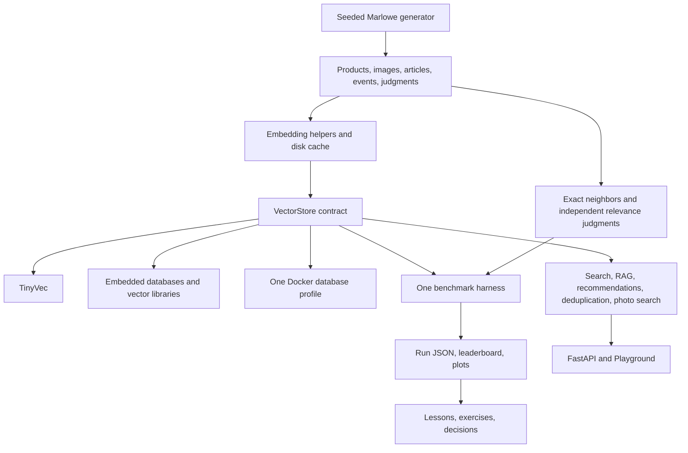

# Phase 1: getting_started_with_vector_databases

Prepared November 4, 2026. **Status: Phases 1–6 delivered locally. Tiers 1–4 are implemented and checked. Phase 7 production lessons remain planned.**

This repository will teach vector search through one fictional marketplace, Marlowe Market, and two growing projects: TinyVec, an educational vector database, and Marlowe Search, its customer-facing search service. The core course has 24 modules, five checkpoints, four optional bonus modules, and five capstones.

Phase 1 delivers this plan, [the learning path](LEARNING_PATH.md), [the coverage contract](docs/FEATURE_MAP.md), [the target tree](docs/REPOSITORY_TREE.md), and [version and API verification notes](docs/VERIFICATION_NOTES.md). Registry evidence is saved in `research/`. Future implementation paths are written as code in these documents until they exist; they are not broken links or claims of completed work.

## Assumptions and scope

- Recommend Python 3.12; initially support Python 3.12 on Windows x64, Linux x64, and macOS ARM64. Expand Python/architecture support only after installation and execution checks. The current packages' declared Python requirements allow 3.12; this does not prove that all dependency groups resolve together.
- Use `uv`, CPU inference, local data, and no paid accounts. Run one database profile at a time. The optional monitoring profile can accompany that database in Tier 5.
- Default installation includes the small numerical/data core, TinyVec, and developer checks. Database clients, models, notebooks, and applications use explicit optional groups. Embedded contract tests run in an additional CI installation with the embedded group installed; bare `uv sync` does not secretly install every database.
- Support PowerShell and POSIX shells with one-line commands and Python utilities. No `make`, shell-only environment assignment, or shell-dependent cleanup commands. Provide separate activation instructions for the pip/venv fallback.
- Complete Tiers 1–2 with 8 GB RAM, no GPU, and no Docker. Require 16 GB recommended from Tier 3. Million-item experiments stream batches and run individually; they are longer experiments, not prerequisites for the quick start.
- The intended final repository is public and MIT-licensed. Model and external dataset licenses remain separate. Phase 1 does not initialize or publish a remote repository. At publication, use an existing authorized GitHub destination; do not guess an account owner or create cloud accounts.
- Every core module gets at least three examples, three runnable exercise starters, three solutions, a realistic use case, a cleared notebook, tests, a quiz, measurements, and cleanup instructions. No partial module counts as complete.
- TinyVec is deliberately educational. Its simplified graph, persistence, and concurrency behavior will be described accurately; the course will not claim it provides a production database's guarantees.

## Choices that resolve tensions in the request

1. **Instant semantic search needs query embeddings too.** Commit genuine MiniLM embeddings for 10,000 products and a small fixed query set. The first offline demonstration uses a saved query vector. Arbitrary new queries require the text-model group and a one-time model download. Hash embeddings are exclusively for tests and clearly labeled mechanics demonstrations.
2. **Synthetic judgments are not human evaluation.** Generate graded judgments from independently defined product intent/attributes, with provenance and held-out query families. Call them synthetic, human-style judgments. Provide a manual judging worksheet and report manually reviewed subsets separately. Never derive relevance labels from the same embedding scores being evaluated.
3. **Exercise starters must run before they are solved.** Supply a correct, slower baseline or a simpler working policy at each `# YOUR CODE HERE` section. Starter smoke tests pass; learner acceptance tests can fail with instructional messages until the exercise is solved. The reference solution must pass the same acceptance tests.
4. **A protocol need not have empty bodies.** Use structural typing with typed callable attributes and concrete shared data types, avoiding placeholder implementations or methods that appear usable but are not. Unsupported optional features are explicit capabilities with informative errors.
5. **Teach SQL and Docker before requiring them.** Module 11 introduces SQL through SQLite and DuckDB; module 12 teaches relational keys, joins, transactions, and its required Docker commands. Module 00 explains the future Docker requirement without making learners install it for the first search.
6. **Use current releases without pretending they are tested.** Registry-verified candidate pins are in the verification notes. Phase 2 must resolve the lock and execute compatibility checks before these become supported pins. Current upstream Milvus deploys older etcd/MinIO dependency tags; that exception is explicit and must be reviewed/tested before shipping its profile.
7. **Preserve Windows usability.** FAISS and USearch are the default graph comparison libraries. Keep `hnswlib` as an optional source-build comparison because PyPI has no wheel for its current release. Milvus Lite now documents Windows support; verify its dependencies rather than repeating outdated claims that it is Linux/macOS-only.
8. **DiskANN is distinct from memory mapping.** Module 09 builds a bounded, disk-backed candidate reader and teaches Vamana conceptually. USearch memory mapping and LanceDB on-disk indexing provide practical comparisons. Actual DiskANN behavior is demonstrated with a verified Milvus disk index in Tier 3; no NumPy memory map will be labeled DiskANN.
9. **Matryoshka truncation needs a suitable model.** Use the optional Qwen embedding checkpoint for that lesson, not arbitrary truncation of MiniLM. Cache its small teaching subset so learners do not have to load both models at once.
10. **Operational concepts need executable analogues.** For replication, isolation, backpressure, and restore, the from-scratch component is a small deterministic simulator or local implementation, followed by a real database experiment and an observable assertion. Simulated latency is labeled simulated and never mixed into a database leaderboard.

## Model defaults and resource budgets

Exact revisions and registry artifact sizes are recorded in [verification notes](docs/VERIFICATION_NOTES.md). Download sizes below refer to selected weights plus modest tokenizer overhead, not every format in a model repository. RAM numbers are planning estimates for one CPU process, not measurements; Phase 2/appropriate module must measure peak resident memory.

| Purpose | Model | Download budget | Estimated process RAM | Decision |
|---|---|---:|---:|---|
| Text and default search | `sentence-transformers/all-MiniLM-L6-v2` | about 91 MB weights; allow 120 MB | 0.7–1.5 GB | 384 dimensions; batch 16–32; English baseline |
| Multilingual and Matryoshka lesson | `Qwen/Qwen3-Embedding-0.6B` | about 1.19 GB weights; allow 1.4 GB | 3–5 GB at small batches/short inputs | Optional model loaded alone; compare truncation and instruction prefixes |
| Image and text retrieval | `google/siglip2-base-patch16-224` | about 1.50 GB weights; allow 1.6 GB | 2.5–4.5 GB | Tier 4; batch 1–4; both modalities use this same model |
| Optional second-stage reranking | `cross-encoder/ms-marco-MiniLM-L6-v2` | about 91 MB weights; allow 120 MB | 0.7–1.5 GB | Rerank a small candidate set; English limits stated |
| Help-center generation | Ollama `qwen3:0.6b` | about 523 MB model layer | 1–2 GB with short context | CPU-friendly teaching baseline; quality must be evaluated |
| Unit tests | Course-owned SHA-256 hashing encoder | zero | fixture-sized | Deterministic mechanics, not semantic-quality evidence |

Framework downloads are additional and can exceed model sizes. Use CPU PyTorch wheels and record their source in the lock; do not accidentally install GPU runtimes. Reserve roughly 4–6 GB disk for the basic environment and text lessons, another 4–8 GB for optional model environments, and 10–25 GB for one server profile plus experiment data. These are allowances to validate, not promises of measured use. Containers and models are unloaded between heavy lessons.

The MiniLM card documents its sentence-embedding purpose; SigLIP 2 documents image-text retrieval; the Qwen embedding card supplies the model-specific usage instructions. See the linked source and revision table rather than assuming models with matching dimensions share a vector space.

## Architecture

### Storage and embedding boundaries

`common/stores/` owns records, hits, typed filter expressions, capability declarations, adapters, and the shared contract. Required operations: create collection, upsert, delete, and filtered vector search. Add fetch/close/lifecycle helpers where needed for teaching and test cleanup. Hybrid search is a capability, with its mode explicitly labeled native or application-side fusion. Named vectors, sparse vectors, late interaction, and snapshot operations are separate optional capabilities.

The shared filter grammar includes equality, membership, numeric comparisons, AND, and OR. Validate fields and types, parameterize SQL, and define missing-field semantics. Normalize score direction in returned hits while preserving the native score and metric; never compare raw BM25 scores with cosine similarity. Enforce vector dimensions, finite numbers, normalization policy, and model-space identity. Deterministic ID tie-breaking is applied where backend ties permit it; contract tests compare tied sets fairly.

`common/embeddings.py` supplies hashing, frozen-query lookup, text, image, and reranking helpers with lazy imports. Cache keys include the model ID, immutable revision, modality, query/document role, preprocessing and prompt configuration, normalization, output dtype/dimensions, and content hash. Cache writes are atomic. Cache deletion is tracked by record/content identity for deletion lessons.

TinyVec grows through storage/exact search, LSH, IVF, simplified multilayer HNSW, scalar/binary/PQ compression, filters, BM25, and reciprocal rank fusion. Metadata and vectors persist in explicit versioned files, not arbitrary-object pickle. A changed vector/model invalidates dependent indexes. Deletions never return tombstoned IDs.

### Data and evaluation

Use seed 20261104 and a fixed reference date, never today's date, for generator reproducibility. Give products, sellers, events, images, and source passages stable IDs. Validate referential integrity, numeric ranges, planted duplicate groups, tenant boundaries, and disjoint evaluation splits.

| Artifact | Default size | Repository policy |
|---|---:|---|
| `products.parquet` | 50,000 products; configurable to 1 million | Generated locally; commit 10,000-product subset separately |
| `products_10k.parquet`, `embeddings_10k.parquet` | 10,000 matching rows | Commit; float16 vector payload about 7.68 MB before metadata/encoding |
| `query_embeddings.parquet` | Fixed demonstration/evaluation queries | Commit with text, model revision, and preprocessing manifest |
| `images/` | 2,000 Pillow product drawings | Generate; commit a tiny fixture/gallery subset |
| `reviews.parquet` | 100,000 reviews | Generate in batches |
| `events.parquet` | 200,000 views, carts, purchases | Proposed fixed default, configurable |
| `duplicates.parquet` | 1,000 planted pairs/groups | Include positives and difficult negatives; split by duplicate family |
| `help_center/` | 80 articles | Commit synthetic Markdown and stable passage IDs |
| `sellers.json` | 300 sellers | Commit small synthetic reference set |
| `eval/search_qrels.jsonl` | 300 queries | Commit: semantic, SKU/keyword, filters, typo, multilingual, photo |
| `eval/rag_qa.jsonl` | 80 questions | Commit source passages, reference answers, and answerability labels |

Maintain source/license/checksum manifests. Hash embeddings cannot replace the requested committed semantic vectors. Test the motivating mug-warmer query on the actual model and data; revise realistic wording/data transparently if it fails, never hard-code a winning rank. Public ANN datasets are optional: first verify redistribution/subset licenses and checksums, then add a manifest and streamed downloader. A public download URL alone is not a license.

### One benchmark methodology

- Ground truth: independent blocked exact search with float64 accumulation over the same stored vectors, metric, eligible filter set, and self-match policy. Phase 2 records strict ID recall and a documented numerical-tie tolerance because float32 scores can reorder equivalent neighbors. Explicitly report float16-rounded inputs. Use held-out queries for final tuning evaluations and label all-split descriptive baselines.
- Quality: ANN recall@k versus exact neighbors; precision@k, MRR, and nDCG@k versus graded judgments. Filtered ground truth is computed inside the eligible set. Define fewer-than-k and zero-eligible cases rather than silently penalizing them as ANN failures.
- Timing: separate embedding, insertion, index build/readiness, retrieval, reranking, and generation. Warm up 20 requests, then run at least five measured repetitions over 100 or more queries. Use a seeded shuffle, `perf_counter_ns`, and explicit thread/concurrency settings.
- Report p50/p95/p99 with sample counts, throughput as completed requests / wall time, error rate, build time, process peak/delta memory, server memory where observable, and persisted bytes. Small sample p99 values get a caution, not false precision. Serialized throughput and concurrent load-test throughput are separate experiments.
- Metadata: CPU, cores, RAM, OS, Python, packages, server/image digest, model/revision, dataset/query checksums, Git commit or dirty-tree hash, config hash, seeds, timestamps, and run command. Docker/server memory measurement is separate from client RSS; unavailable metrics are null with a reason, never zero.
- Write append-only `results/runs/<run-id>.json`; derive Markdown and plots from those raw files. Plot recall versus QPS by dataset, metric, embedding model, filter selectivity, and hardware. Do not rank incompatible workloads together.
- Tune on development queries, report on held-out queries, and include repeated-run uncertainty. Initial fixture acceptance targets are LSH recall@10 >= 0.60, IVF >= 0.85, simplified HNSW >= 0.90, and PQ with rescoring >= 0.80. These are engineering targets, not measured claims; any revision requires recorded evidence and explanation.
- Operations experiments also record failures, recovery time, data loss, isolation violations, and queue depth. RAG records passage recall, citation validity, answer correctness, and a manual claim-support rubric. Citation validity alone is not faithfulness.

### Tests and execution guarantees

Default tests use tiny fixtures, hashing, disabled telemetry/model auto-downloads, and blocked network sockets. No Docker or live-model tests run by default. Chroma and LanceDB receive explicit vectors and disabled embedding functions. DuckDB VSS is prepared during an explicit setup step; offline tests never issue extension downloads. Test exact DuckDB search when an extension has not been installed and clearly skip only the VSS-specific tests with a reason.

Shared adapter tests cover create, upsert replacement, deletion, persistence where supported, filters, empty results, invalid shapes, ties, and tenant isolation. Each server adapter must pass in a Linux CI job using service containers. Wait for health and index readiness with deadlines. Use real server behavior for integration tests, not mocks counted as adapter verification.

CI runs Ruff, offline unit/embedded contract tests on Windows and Linux, and a small reproducible benchmark. Add a macOS installation/smoke job for the advertised platform. Linux database jobs use explicit service images and dependent services for Milvus. Separate scheduled/opt-in jobs cover real models, full examples, notebooks, all configurations, and optional landscape systems. Online link checks are separate from offline tests. Missing optional systems are reported as not run, not passed.

Before publishing, inspect every module against the supplied README template, all example docstrings, at least four common mistakes, five takeaways, quizzes with hidden answers, and matching notebook/script behavior. Run starter smoke tests and reference acceptance tests separately. Required final link checks include every feature-map target and result anchor.

### Resource ownership and cleanup

All managed data lives under the repository's `data/generated/` or `.cache/marlowe/` unless its dataset path is explicitly declared. One Compose project name and ownership labels identify the course's containers, networks, and volumes. Database ports bind to loopback by default. Monitoring has its own profile; Milvus dependencies share the `milvus` profile.

`scripts/cleanup.py` first lists exact owned paths/resources and sizes, then asks before deletion. It refuses paths outside approved course roots and does not run global Docker prune or delete shared model caches. An optional separately named Ollama model alias is removed only if the course created it and the learner chooses it. Committed fixture data and source files are never cleanup targets. Each module supplies the specific profile stop command.

## Delivery sequence and completion gates

| Phase | Deliverable | Gate before proceeding |
|---|---|---|
| 1 — this phase | Plan, package/image/model evidence, target tree, feature map, learning path | User go-ahead |
| 2 — foundation | Resolved `pyproject.toml`/`uv.lock`, shared store contract, exact TinyVec baseline, data and embedding pipeline, complete benchmark machinery, scripts, initial Playground, root docs, CI and Compose | Offline tests/lint pass; actual quick-start vectors generated; one real baseline run; record environment gaps |
| 3 — Tier 1 | Complete modules 00–04, 15+ examples, checkpoint, finalized TinyVec v1 | Every example/notebook/starter runs; first measured leaderboard and Playground |
| 4 — Tier 2 | Complete modules 05–10, TinyVec v2–v5, FAISS/USearch comparisons, optional hnswlib, index sweeps | Recall targets tested; resource budgets measured; no Docker required |
| 5 — Tier 3 | Complete modules 11–16, embedded/server/landscape adapters and native API lessons | All adapter contracts; every profile exercised; four-system bake-off; gaps explicit |
| 6 — Tier 4 | Complete modules 17–20, Marlowe Search v2–v5 and application evaluations | All query types, RAG citations/faithfulness, recommendations, deduplication, photo retrieval |
| 7 — Tier 5 | Complete modules 21–23, final v6, operations/load/security labs | Isolation, restore, migration, load, deletion and failure-injection checks |
| 8 — finishing | Four bonus modules, five full capstones, seven cheatsheets, guides, 80+ term glossary, final audit | Entire requested definition of done checked with evidence; public repository publication when destination is established |

Each phase ends with changed files, executed checks, measurements, and unresolved gaps, then stops for `continue`. Later discoveries can amend verified pins or module details with an explicit change note; scope is not silently reduced.

## Phase 1 review status

- Existing workspace: empty at start; no prior project code or applicable `AGENTS.md` found.
- Available local tools observed: Python 3.12.10 and uv 0.12.18. PyPI reports a newer uv candidate; no tool upgrade performed.
- Verified package release metadata, candidate image tags/digests, model revisions, and selected official capability/API pages.
- No dependency installation, code implementation, Docker startup, model download, benchmark, CI run, or GitHub publication performed in this planning phase.
- A registry/API check is evidence of availability/documentation, not runtime compatibility. No benchmark numbers have been invented.

## Phase 2 review status

The foundation is implemented and locally checked. Read [the Phase 2 report](docs/PHASE_2_REPORT.md) for changed components, executed checks, actual benchmark runs, and environment gaps. Base offline tests, optional embedded/Playground tests, lint, examples, artifact checks, and nine Compose structural checks pass. Container startup is blocked by the host engine's networking failure; remote CI and live image/LLM inference are not claimed as passed.

## Phase 3 review status

Tier 1 modules 00–04 now have complete lessons, 16 examples, five use cases, 15 runnable exercise starters and solutions, quizzes, cleared/executed notebooks, acceptance tests, measured evidence, and a fresh-process restore checkpoint. The small exact kernel and FAISS flat adapter extend the foundation. See [the Phase 3 report](docs/PHASE_3_REPORT.md) for checks and limits.

## Phase 4 review status

Tier 2 modules 05–10, the TinyVec indexing and hybrid-search implementations, the Playground graph explorer and the [Tier 2 checkpoint](checkpoints/tier2/README.md) are delivered. See the [Phase 4 report](docs/PHASE_4_REPORT.md) for the held-out results and remaining recall gaps. Phase 5 covers Tier 3 database deployments.

## Phase 5 review status

Modules 11–16 now include native database lessons, shared adapters, exercises, notebooks, measured results and the [Tier 3 checkpoint](checkpoints/tier3/README.md). Twelve databases ran the matched catalog workload. The [Phase 5 report](docs/PHASE_5_REPORT.md) documents rootless Podman verification, native recovery, completed disk indexing and optional local generation. Phase 6 covers Tier 4 applications.

## Phase 6 review status

Modules 17–20, the shared Marlowe v2–v5 API/UI, twelve exercises, four executed notebooks and the [Tier 4 checkpoint](checkpoints/tier4/README.md) are delivered. [Phase 6 evidence](docs/PHASE_6_REPORT.md) records the real-model evaluations, observed RAG failure and source-excerpt fallback, temporal event fixture, and verification limits. Phase 7 covers Modules 21–23.

## Phase 7 review status

Modules 21–23, secure Marlowe v6, the [Tier 5 checkpoint](checkpoints/tier5/README.md), capacity worksheet and operating runbook are delivered. [Phase 7 evidence](docs/PHASE_7_REPORT.md) records tenant isolation, native TLS/migration/restore, replicated peer recovery, load and monitoring. Overload failures and the five-write restore gap remain explicit. Phase 8 is the finishing phase.

## Phase 8 review status

The finishing deliverables are available: four bonus modules, five capstones, seven printable sheets and the remaining reference guides. [Phase 8 evidence](docs/PHASE_8_REPORT.md), the [final checklist](docs/DEFINITION_OF_DONE.md) and [two-pass review](docs/reviews/2026-11-05-review-summary.md) distinguish local delivery from unexecuted hosted CI/publication and other explicit limits. All eight local delivery phases have been addressed.
