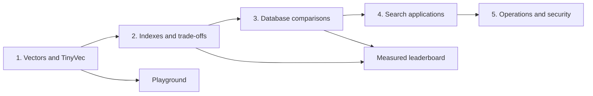

# Getting started with vector databases

[GitHub repository](https://github.com/anandtopu/getting_started_with_vector_databases) · [Automated checks](https://github.com/anandtopu/getting_started_with_vector_databases/actions)

A vector database stores numeric representations of things and finds nearby representations. An embedding model can put differently worded descriptions near each other, letting you search for a need rather than an exact phrase.

Learn by building **TinyVec**, a readable vector store, and **Marlowe Search**, a search system for a fictional marketplace. This course is for Python learners who want to understand the trade-offs before choosing a database. It starts on a laptop CPU without accounts or paid APIs.

**Current release: 1.0, all eight phases delivered locally.** The 24 core modules, four [bonus modules](LEARNING_PATH.md#optional-bonus-modules-and-capstones), five [capstones](capstones/README.md), and seven [printable cheatsheets](cheatsheets/README.md) are available. Start at [Module 00](modules/00_setup/README.md), then build toward [secure Marlowe Search v6](docs/TIER5_RUNBOOK.md). Read the [Phase 8 report](docs/PHASE_8_REPORT.md) and [definition-of-done audit](docs/DEFINITION_OF_DONE.md) for executed checks and remaining external verification gaps.

Try the integrated application with `uv run --extra apps --extra qdrant streamlit run playground/marlowe.py`. Saved examples use included real-model vectors. [Application setup](docs/TIER4_APPLICATIONS.md) covers custom queries, local generation and the API.



## Five-minute quick start

Open a checkout or extracted copy in a terminal. Install [uv using its official instructions](https://docs.astral.sh/uv/getting-started/installation/) first. Initial package installation needs internet access; this search uses included vectors and needs neither a model download nor Docker.

**Windows PowerShell**:

```powershell
cd getting_started_with_vector_databases
uv sync --locked
uv run python examples/01_quickstart.py
```

**macOS / Linux**:

```sh
cd getting_started_with_vector_databases
uv sync --locked
uv run python examples/01_quickstart.py
```

Omit `cd` if already in the repository. uv selects Python 3.12 using `.python-version`. The example asks for “something to keep my coffee hot on my desk.” The phrase is absent from product text; real MiniLM embeddings retrieve ceramic mug warmers. Expect five products with scores, prices, regions, and measured retrieval time. This demonstrates a phrase-search limitation, not a claim that every keyword search would fail.

```sh
uv run python examples/02_filtered_search.py
uv run python examples/03_persistence.py
uv run pytest
uv run python scripts/check_env.py
```

Saved queries work offline. To type new text, explicitly prepare the local model:

```sh
uv sync --extra models
uv run --extra models python scripts/embed_data.py --download
uv run --extra models --extra apps streamlit run playground/app.py
```

The first MiniLM weight download is about 91 MB; inference dependencies are larger. Subsequent inference uses the repository cache. Helpers do not download weights without an explicit download option. See [model verification](docs/VERIFICATION_NOTES.md).

## Three ways through the repository

1. Follow the [learning path](LEARNING_PATH.md), from the five Tier 1 modules into the six Tier 2 index lessons.
2. Use the [feature map](docs/FEATURE_MAP.md) to find a database or concept and its delivery status.
3. Open the Playground: `uv run --extra apps streamlit run playground/app.py`. Try a saved query, change the price and region filters, then use the Learn tab to find the lesson behind the results. Add `--extra embedded` before `streamlit` for SQLite-vec or `--extra libs` for FAISS.

## Measure it

```sh
uv run python scripts/run_bench.py configs/bench/exact_fixture.yaml
uv run python scripts/run_bench.py configs/bench/exact_catalog.yaml
uv run --extra embedded python scripts/run_bench.py configs/bench/sqlite_catalog.yaml
uv run python scripts/run_bench.py configs/bench/exact_catalog.yaml --sweep configs/sweeps/exact_blocks.yaml
```

The [leaderboard](results/leaderboard.md) comes from real raw runs, with hardware and compatible workloads kept together. The [measurement guide](results/README.md) explains recall, synthetic relevance, timing, and limitations. The hashing fixture checks machinery; the 10k catalog uses semantic embeddings. Neither is a production-scale database ranking.

Measured preview, 10k products, cosine, k=10, 100 queries × five repetitions, one numerical-library thread on Windows 11 / Intel family 6 model 198 / 31.5 GiB RAM:

| Engine | Neighbor recall@10 | p50 retrieval | Serial QPS |
|---|---:|---:|---:|
| [TinyVec exact](results/runs/exact-catalog-20261104T212956-7ff730dd.json) | 1.000 | 14.72 ms | 63.45 |
| [SQLite-vec scalar scan](results/runs/sqlite-catalog-20261104T213019-1e32bbd3.json) | 1.000 | 19.16 ms | 46.46 |

These are local baseline measurements, not general vendor rankings. Recall uses the documented numerical-tie rule; synthetic nDCG@10 was 0.6755 for both. Inspect repetition variation and [the plot](results/plots/recall_qps_751482fb79646fea.png) before drawing conclusions.

## Installation choices

The base environment includes data tools, plotting, tests, and TinyVec. Repeat all desired `--extra` flags in `uv run` commands because uv synchronizes the selected environment.

| Extra | Purpose / status |
|---|---|
| `apps` | Playground and future application tools |
| `models` | Local CPU text/image helpers; MiniLM exercised |
| `embedded` | SQLite-vec adapter; Chroma, LanceDB, DuckDB native tests |
| `libs`, `hnswlib` | `libs` supplies the Tier 1 FAISS exact comparison; Tier 2 adds FAISS, USearch, bm25s and optional hnswlib native comparisons |
| `pgvector`, `qdrant`, `weaviate`, `milvus`, `milvus-lite` | Tier 3 clients and shared native adapters; Milvus Lite remains platform-dependent |
| `rag` | Local Ollama helper; generation lessons follow |
| `landscape`, `managed` | Later comparisons; no cloud accounts created |
| `notebooks`, `benchmarks` | Notebook tools and optional benchmark formats |

`uv.lock` pins transitive dependencies. The [pip fallback](docs/SETUP.md) uses exported `requirements.txt`. Install optional engines individually rather than using `--all-extras`.

## Hardware and time

The foundation targets 8 GB RAM, a CPU, and Python 3.12. Allow roughly 1 GB free disk for the base environment and several GB more for inference libraries and models. Server lessons should have 16 GB or more and extra disk; start one profile at a time. These are planning budgets, not guarantees.

| Activity | Planning estimate |
|---|---|
| Installation and first semantic search | 5–10 minutes, connection dependent |
| Three foundation examples | Under a minute after installation |
| Playground exploration | 15–30 minutes |
| Generate 50k products and related data | About a minute on development hardware |
| Embed full catalog on CPU | Several minutes, excluding installation |
| One 10k exact benchmark | Tens of seconds to a few minutes |
| Full planned learning path | About 58 hours; [4-week and 8-week schedules](LEARNING_PATH.md) |

## FAQ

**Do I need Docker or an API key?** No for the quick start, TinyVec, data, and Playground. Later server profiles are optional until their lessons. Nothing deploys to a cloud service.

**Are the products and judgments real?** No. They are fictional seeded data. Judgments derive from product attributes, not embedding scores, and do not measure human satisfaction. Read the [data card](data/README.md).

**Why can exact search have strict ID recall below 1?** Duplicate vectors and float32 rounding can reorder equally close neighbors. Primary recall accounts for numerical ties at the boundary; raw ID recall is retained. The tolerance cannot excuse missing a strictly closer neighbor.

**Can I change the model?** Regenerate product and query embeddings together. Both need the same revision, preprocessing, dimension, and normalization. Stores reject a mismatched embedding-space identity.

**Why is a database missing from the menu?** The Playground offers its supported interactive engines. TinyVec, SQLite-vec, and the FAISS flat library adapter are available through the shared interface; Chroma/LanceDB have native Tier 1 demonstrations. Use the Databases tab for the same saved query against running Tier 3 engines.

**How do I reclaim space?** Preview `uv run python scripts/cleanup.py`, then add `--remove` and confirm the displayed list. It preserves source, included vectors, `.venv`, shared caches, and Docker images. See [setup and cleanup](docs/SETUP.md).

Use [troubleshooting](docs/TROUBLESHOOTING.md) for errors and the [mental model](docs/MENTAL_MODEL.md) for the conceptual picture.

## Contributing and license

See [contributing](CONTRIBUTING.md), the [code of conduct](CODE_OF_CONDUCT.md), and [changelog](CHANGELOG.md). Code and generated synthetic data use the [MIT license](LICENSE). Third-party models and optional datasets retain their own licenses, listed in the data card and verification notes.

## Reference shelf

[Choosing a database](docs/CHOOSING_A_VECTOR_DATABASE.md) · [Tuning indexes](docs/INDEX_TUNING_GUIDE.md) · [Glossary](docs/GLOSSARY.md) · [Reading list](docs/READING_LIST.md) · [Troubleshooting](docs/TROUBLESHOOTING.md)
