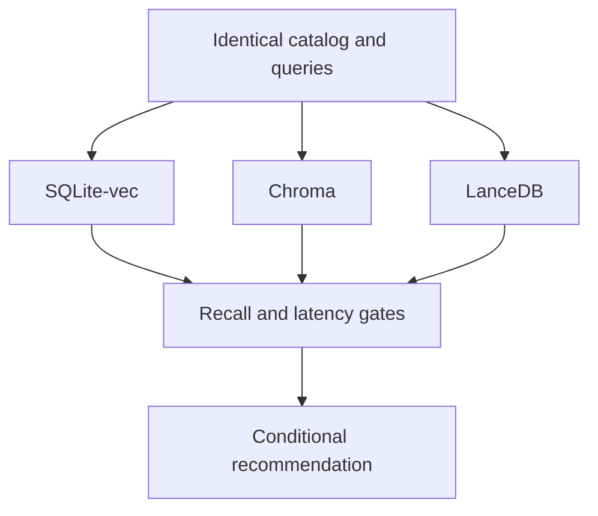

# Architecture

The reference composes the tested shared implementations instead of maintaining a second copy. The learner owns the project contract; shared adapters own vector validation, filter translation and cleanup. IDs and model-space metadata must survive every boundary. Capture the exact command and environment with every measurement.

## Failure boundaries

All three runs are local, 500 rows and 30 queries with three repetitions. Database setup/build costs are separate. This sample cannot predict networked service latency, concurrent write behavior or million-row costs.

A failed assertion stops the run. Do not count incomplete runs as successful measurements. Database collections and temporary files belong to one session; source fixtures remain unchanged. Optional native operations require explicit setup and credentials from the ignored course cache.
