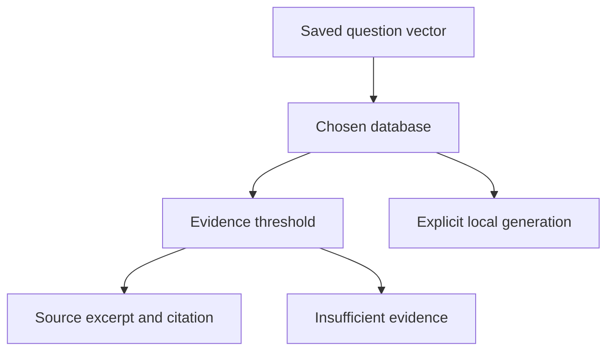

# Architecture

The reference composes the tested shared implementations instead of maintaining a second copy. The learner owns the project contract; shared adapters own vector validation, filter translation and cleanup. IDs and model-space metadata must survive every boundary. Capture the exact command and environment with every measurement.

## Failure boundaries

The default is an extractive answer, not an LLM completion. A correct citation may cite the wrong policy. The 0.35 threshold is illustrative and needs development-set calibration. --generate explicitly uses local Ollama and the pinned model; see the Tier 4 guide.

A failed assertion stops the run. Do not count incomplete runs as successful measurements. Database collections and temporary files belong to one session; source fixtures remain unchanged. Optional native operations require explicit setup and credentials from the ignored course cache.
