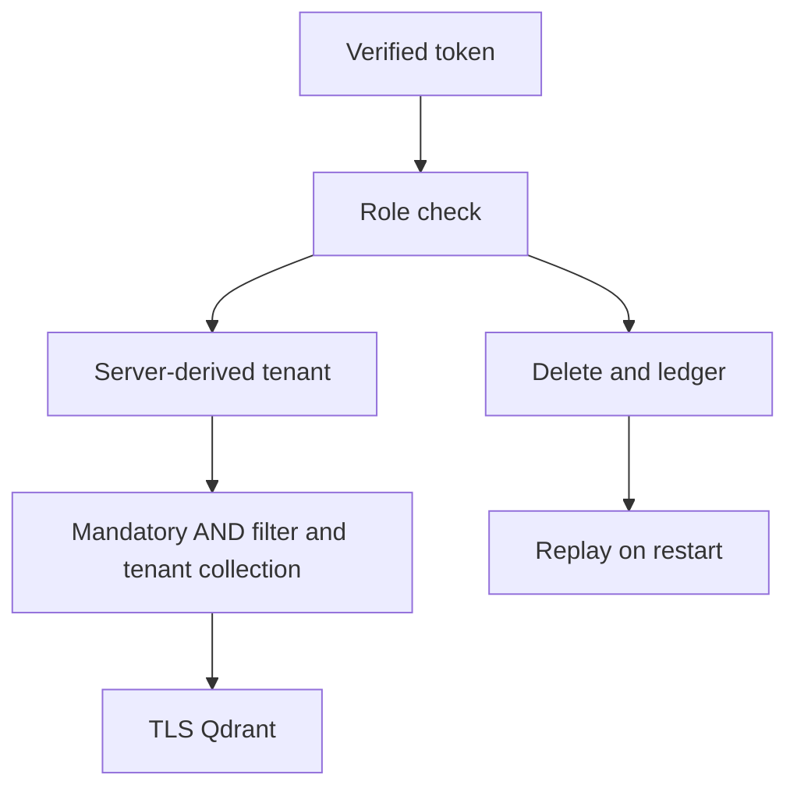

# Architecture

The reference composes the tested shared implementations instead of maintaining a second copy. The learner owns the project contract; shared adapters own vector validation, filter translation and cleanup. IDs and model-space metadata must survive every boundary. Capture the exact command and environment with every measurement.

## Failure boundaries

The test role is assigned by the server; request parameters cannot establish identity. The load drill intentionally includes process failure and uses TinyVec behind the TLS API; the native migration drill separately uses TLS Qdrant. Neither proves distributed transaction isolation.

A failed assertion stops the run. Do not count incomplete runs as successful measurements. Database collections and temporary files belong to one session; source fixtures remain unchanged. Optional native operations require explicit setup and credentials from the ignored course cache.
