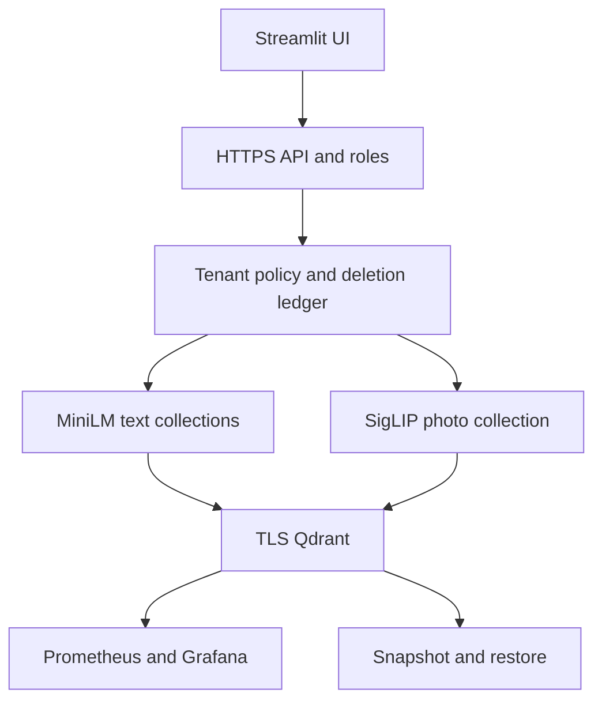

# Architecture

The reference composes the tested shared implementations instead of maintaining a second copy. The learner owns the project contract; shared adapters own vector validation, filter translation and cleanup. IDs and model-space metadata must survive every boundary. Capture the exact command and environment with every measurement.

## Failure boundaries

The demo rebuilds owned derived collections from immutable course fixtures when a session starts and removes its collections on close. It is not a persistent live-catalog ingestion service. Help articles are shared public fixtures. Backup scopes and the deletion ledger are explained in the Tier 5 runbook.

A failed assertion stops the run. Do not count incomplete runs as successful measurements. Database collections and temporary files belong to one session; source fixtures remain unchanged. Optional native operations require explicit setup and credentials from the ignored course cache.
