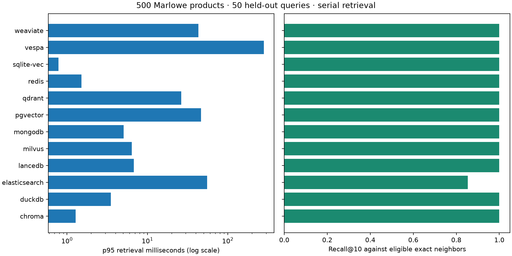

# Reference database comparison

The workload is fixed across twelve engines. The Windows client uses Python 3.12.13 and Intel64 Family 6 Model 198 Stepping 2, GenuineIntel. The local WSL server VM and container image digests are recorded separately. All engines search the same 500 MiniLM product vectors and 50 test queries at k=10. Twenty warm-ups precede five repetitions.

| Engine / raw run | Recall@10 | nDCG@10 | p50 / p95 ms | Serial QPS ± SD | Client peak MiB | Logical export MiB |
|---|---:|---:|---:|---:|---:|---:|
| [chroma](../../../results/runs/tier3-chroma-20261105T001122-70b19ef3.json) | 1.000 | 0.750 | 0.479 / 1.281 | 1609.2 ± 78.7 | 270.5 | 1.05 |
| [duckdb](../../../results/runs/tier3-duckdb-20261105T001141-ce734dc5.json) | 1.000 | 0.750 | 1.540 / 3.503 | 511.0 ± 50.2 | 385.4 | 1.05 |
| [elasticsearch](../../../results/runs/tier3-elasticsearch-20261105T001238-da1266c7.json) | 0.854 | 0.750 | 49.508 / 55.323 | 19.8 ± 0.2 | 241.3 | 1.05 |
| [lancedb](../../../results/runs/tier3-lancedb-20261105T001132-09e2cc31.json) | 1.000 | 0.750 | 3.339 / 6.757 | 250.5 ± 8.7 | 314.2 | 1.05 |
| [milvus](../../../results/runs/tier3-milvus-20261105T001302-95d082cf.json) | 1.000 | 0.750 | 4.312 / 6.387 | 219.4 ± 11.2 | 216.2 | 1.05 |
| [mongodb](../../../results/runs/tier3-mongodb-20261105T001301-610cef0a.json) | 1.000 | 0.750 | 2.523 / 5.053 | 351.8 ± 32.8 | 225.7 | 1.05 |
| [pgvector](../../../results/runs/tier3-pgvector-20261105T001147-d30658f5.json) | 1.000 | 0.750 | 2.175 / 46.665 | 92.9 ± 1.1 | 362.7 | 1.05 |
| [qdrant](../../../results/runs/tier3-qdrant-20261105T001155-ea7545a5.json) | 1.000 | 0.750 | 10.108 / 26.429 | 87.7 ± 7.3 | 413.0 | 1.05 |
| [redis](../../../results/runs/tier3-redis-20261105T001210-01916bdb.json) | 1.000 | 0.750 | 0.598 / 1.516 | 1357.9 ± 165.0 | 217.5 | 1.05 |
| [sqlite-vec](../../../results/runs/tier3-sqlite-vec-20261105T001135-3eb8990a.json) | 1.000 | 0.750 | 0.374 / 0.784 | 2194.1 ± 108.2 | 327.3 | 1.00 |
| [vespa](../../../results/runs/tier3-vespa-20261105T001412-38a9ccd6.json) | 1.000 | 0.750 | 50.630 / 280.644 | 12.7 ± 0.6 | 210.9 | 1.05 |
| [weaviate](../../../results/runs/tier3-weaviate-20261105T001200-a06d764c.json) | 1.000 | 0.750 | 1.017 / 43.265 | 264.0 ± 130.8 | 453.3 | 1.05 |

## Recommendation

For an offline, single-process catalog with recall at least 0.95 and p95 at most 20 ms, SQLite-vec meets both limits on this workload and has the smallest measured retrieval p95. Chroma, DuckDB and LanceDB also qualify. Choose among them according to SQL joins, columnar history, vector collection features and application packaging. A larger or concurrent workload needs another comparison.

The initial Elasticsearch approximate configuration reached 0.854 recall. The other eleven reached 1.000 on this small catalog. Exact agreement here does not settle future scale, relevance quality or write behavior. PostgreSQL, Qdrant, Weaviate, Milvus, Redis, Atlas Local and Vespa supply different service and data-model capabilities. A relational transaction or required native hybrid feature can outweigh a latency difference.

The adapters validate metadata predicates in a session catalog and push eligible IDs into native retrieval. They retain an application-side metadata copy and a packed export payload. The benchmark includes this adapter overhead. Native field filters, query plans, hybrid weighting and consistency are demonstrated separately in each module.

## Recovery and readiness

The shared contract checks created, updated, filtered, deleted and logically restored records through all eleven new adapters. Existing SQLite-vec contracts cover the twelfth database. Native Qdrant snapshots and Weaviate filesystem backups restored the expected IDs. PostgreSQL pg_dump/pg_restore recovered a nearest-neighbor query in a different database. Milvus reported all 4,096 disk-index rows covered before the query. Atlas Local waits for the indexed revision of each changed batch and excludes retired keys from later searches.

## Timing and memory boundaries

Client RSS includes Python and loaded libraries. Server memory samples are post-run container usage, with Milvus dependencies listed separately. Snapshot size describes the portable export, not a server's full on-disk footprint. The runs were serial, while other course servers could remain idle in the VM. Networking and host scheduling are part of the local result. Hosted CI and a production load test are separate verification steps.

[Runtime evidence](../../../research/phase5-local-runtime.json) · [Full leaderboard](../../../results/leaderboard.md) · [Benchmark method](../../../results/README.md).

The latest [script execution record](../../../results/tier3/execution-df533956.json) contains 43 passes, 0 failures and 0 explicit skips.
