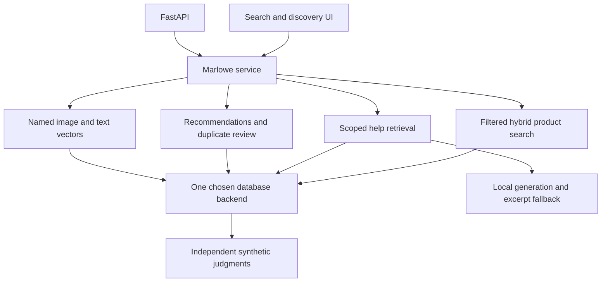

# Tier 4 checkpoint: Marlowe Search v5

Build and evaluate product search, a help-center assistant, recommendations, duplicate review and photo search on one database backend.

## Delivered reference

- [Shared application](../../common/apps/marlowe.py)
- [Local FastAPI service](../../common/apps/marlowe_api.py)
- [Streamlit UI](../../playground/marlowe.py)
- [Setup and commands](../../docs/TIER4_APPLICATIONS.md)
- [Measured application comparisons](results/README.md)
- [RAG claim-support review](../../docs/RAG_REVIEW.md)



## Run it

```text
uv sync --extra apps --extra qdrant
uv run --no-sync streamlit run playground/marlowe.py
uv run --no-sync python scripts/checkpoint_tier4.py --backend qdrant-local
```

The default checkpoint includes actual database queries and frozen real-model embeddings. Add the models/rag extras, prepare cached models, and use `--rerank --generate` for live inference. Any supported backend may be selected, with its required extra/profile. The delivered end-to-end reference is verified on Qdrant local. TinyVec supports the offline path; SQLite is covered by application integration tests. Server-backed variants require the Tier 3 service setup and are not claimed as Phase 6 server benchmarks.

## Acceptance criteria

1. Every text query type has held-out relevance rows and filters cannot leak through either ranking branch.
2. The help assistant shows source passages, records raw drafts separately and provides cited excerpts or abstention. Citation validity and factual support are evaluated separately.
3. User profiles exclude future events. Recommendations omit seen IDs and report diversity. Duplicate thresholds are selected on development families and frozen on disjoint test families.
4. Text-to-image and image-to-image retrieval share a declared model space. Queries exclude their own gallery image. Named vectors are native on Qdrant and explicitly emulated with separate collections elsewhere.
5. The API and UI use the shared application service. Default tests make no model downloads or external calls.
6. Raw results include outputs, hardware, package/source identity and artifact hashes. A result with no eligible evaluation users is explicitly reported and retained, not averaged into a fabricated success.

## Try your own extension

Use the module exercises as the working starter. Select one backend, add independent judgments for ten new query families, and rerun only the affected evaluation. Record query coverage and negative cases before tuning. Compare the new result with the [reference tables](results/README.md). Do not replace the held-out labels with nearest-neighbor outputs.

## Known boundaries

This is a completed teaching checkpoint, not a validated commercial marketplace. It uses synthetic products, policy articles, event preferences, duplicate pairs and drawings. The original event generator is unsuitable for the audited unseen-purchase evaluation, so a separate temporal fixture is labeled and reproducible. The local generation model produced an actual unsupported claim, which motivates conservative excerpt delivery. Image results do not establish real-photo quality. Only 50 held-out text queries are available for repeated retrieval timing. Hosted CI and production service behavior remain unverified locally.

Continue with Phase 7's Modules 21–23 for data modeling, operations, performance, security and reliability.
