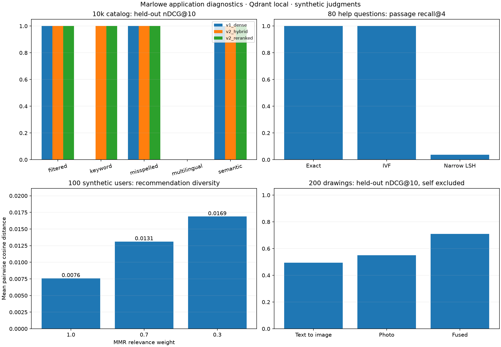

# Tier 4 results

- [search raw evidence](../../../results/tier4/search-f18a966d.json)
- [multilingual raw evidence](../../../results/tier4/multilingual-31cad7d1.json)
- [rag raw evidence](../../../results/tier4/rag-ede10bad.json)
- [recommendations raw evidence](../../../results/tier4/recommendations-f7e95363.json)
- [photo raw evidence](../../../results/tier4/photo-2e6b43a8.json)

Each panel uses its own stated dataset and metric. This is an application diagnostic, not a vendor ranking. See the module result pages for tables and limitations.
