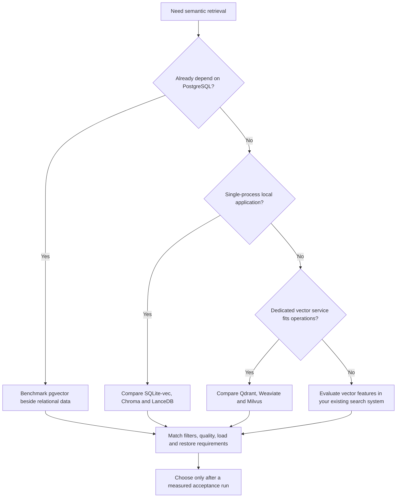

# Choosing a vector database

Start with the data you must preserve and the service you can operate. Treat this as a shortlist for an experiment, not a product ranking. Package versions and server images are pinned in this repository; product documentation was checked on 2026-11-05.

## What the course actually compared

| Option | Why include it | Decision-changing caveat | Evidence |
|---|---|---|---|
| TinyVec | Read the algorithms and failure paths | Educational, single-process implementation; not a production database | [Tier 2 checkpoint](../checkpoints/tier2/README.md) |
| FAISS / USearch / hnswlib | Measure index kernels without a server | Application must supply metadata, lifecycle and service boundaries | [Index comparisons](PHASE_4_REPORT.md) |
| SQLite-vec | Small local application with SQL and explicit vectors | Course workload is exact search; do not infer an ANN scaling curve | [Capstone 02](../capstones/02_database_bakeoff/README.md), [official extension](https://github.com/asg017/sqlite-vec) |
| Chroma / LanceDB | Compare embedded retrieval workflows | Explicit embeddings and local persistence differ from managed deployments | [Tier 3 results](PHASE_5_REPORT.md), [LanceDB vector search](https://docs.lancedb.com/search/vector-search) |
| pgvector | Keep vectors with PostgreSQL relational data | Index choice and selective filters need joint tuning | [Official pgvector guide](https://github.com/pgvector/pgvector) |
| Qdrant | Dedicated service, payload filters and native recovery exercises | Client success is not proof of replication availability or low tail latency | [Native operations](PHASE_7_REPORT.md) |
| Weaviate | Explicit-vector collections and native retrieval/generation lessons | Model/provider configuration is separate from database correctness | [TypeScript lesson](../modules/bonus/B1_other_languages/README.md) |
| Milvus | Service-oriented indexing and disk-index comparison | More service dependencies and readiness stages to operate | [Native runtime evidence](TIER3_RUNTIME.md) |
| Elasticsearch / Redis / MongoDB / Vespa | Test vector retrieval in broader data/search systems | Supported behavior depends on the tested local edition and pinned version | [Landscape module](../modules/16_landscape/README.md) |
| Managed services | Evaluate when outsourced operations are a requirement | No paid deployment was made here; accounts, regions, limits and costs need separate checks | [Managed-service setup](MANAGED_DATABASES.md) |

The capstone's three-system, 500-row run selected SQLite-vec after a recall floor and zero-error gate. That is evidence for that local workload, not an endorsement for a large multi-tenant service. The earlier twelve-system measurements use their own recorded configurations; never join rows with different corpus sizes, query sets, metric, hardware or timing scope into one ranking.

## Write the acceptance brief first

Specify corpus size now and at the expected horizon, vector dimension/model, update/deletion rate, filter selectivity, query concurrency, freshness, latency percentiles, recall/relevance floor and recovery objectives. State whether transactions with ordinary records are essential. Include the engineering cost of backups, upgrades, monitoring and access control.

Run an exact baseline, tune only on development queries, and compare the finalists on untouched queries. Measure ingest/readiness separately from steady-state search. Inject a server restart and restore a real snapshot. Report unavailable server memory as unavailable, rather than substituting client RSS. [Benchmark methodology](../PLAN.md#one-benchmark-methodology) and [tuning guide](INDEX_TUNING_GUIDE.md) make the decision reproducible.

## A useful decision record

Record the chosen system/version, workload checksum, hard acceptance gates, measured runs, rejected alternatives, expected operating cost and the condition that would trigger reconsideration. For example: “This local catalog fits our measured exact-search budget; reevaluate when selective filters plus concurrent updates exceed the agreed p95.” Avoid predicting a break-even row count from one small run.
