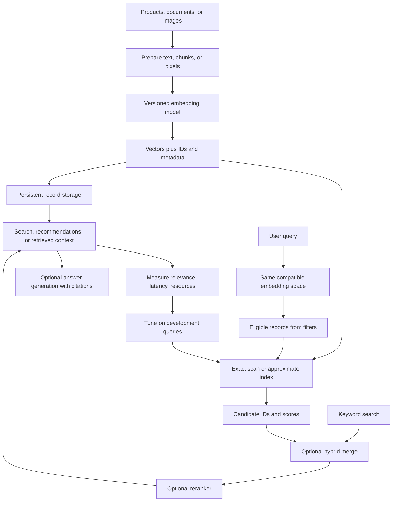

# A mental model of vector search

An embedding is a list of numbers that a model assigns to an input. Similarity is a rule for comparing two lists. An index is a shortcut for finding good candidates. A database adds durable records, updates, filters, and operational behavior. These are separate choices.

The foundation implements preparation, cached text embeddings, exact scans, storage, filters, and measurement. Hybrid retrieval, reranking, approximate indexes, and full answer evaluation are later lessons.

Three questions keep the layers straight: **Did the index find the model's nearest neighbors?** Measure neighbor recall. **Were those neighbors useful answers?** Measure relevance with independent judgments. **Was the result fast and affordable enough?** Measure latency, throughput, memory, and disk on the intended workload.

A filter changes which records are eligible. Exact filtered ground truth must search that same eligible set. A two-dimensional plot loses information and cannot replace distance calculation in the full vector space. A different model revision or preprocessing recipe creates a different space even if the vector length stays the same.
