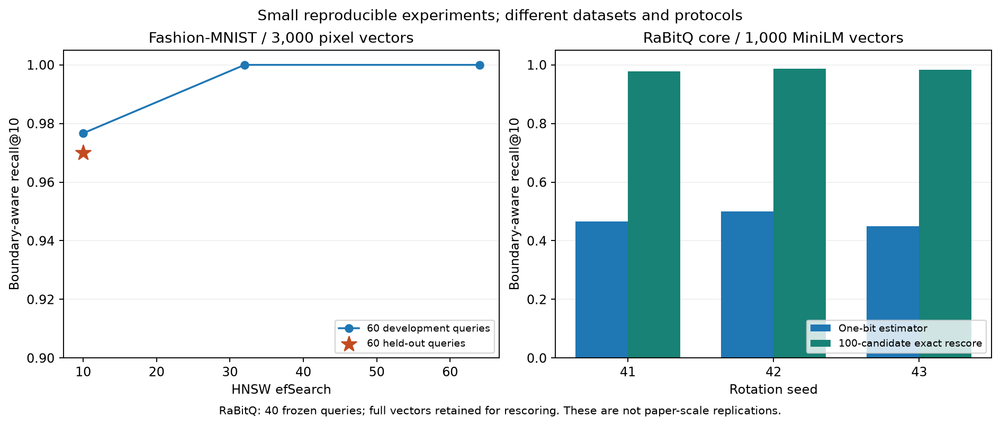

# Phase 8: finishing deliverables

Date: 2026-11-05. Release: 1.0.0. All eight local delivery phases are addressed. This is a verified teaching repository, not a production-service certification or a published GitHub release. The [definition-of-done checklist](DEFINITION_OF_DONE.md) keeps external and environment-specific gaps unchecked.

## Delivered

Four bonus modules add official TypeScript clients, a durable single-writer TinyVec service, public-data benchmark reproduction and RaBitQ. Each has the 17-section lesson, distinct examples, a use case, three exercises and reference solutions, five hidden quiz answers, acceptance tests, a cleared notebook and result links. There are 13 bonus examples and four use-case scripts; all 17 executed. The four notebooks executed 21 code cells with the native profiles enabled.

Five [capstone packages](../capstones/README.md) include user stories, acceptance criteria, Mermaid architecture, runnable starters, complete references, acceptance checks, evaluation configuration, scored rubrics, extensions and evidence. The flagship reuses the authenticated API/UI and now runs its chosen database connection through verified TLS Qdrant.

The reference shelf adds a [choosing guide](CHOOSING_A_VECTOR_DATABASE.md), [tuning guide](INDEX_TUNING_GUIDE.md), [118-term glossary](GLOSSARY.md), [research reading list](READING_LIST.md), expanded troubleshooting, and seven [one-page PDF/Markdown cheatsheets](../cheatsheets/README.md). All seven PDFs were rendered and visually inspected. The versioned lock still resolves 276 Python packages; TypeScript has its own real npm lock.

## Measured bonus results

| Experiment | Observation | Boundary |
|---|---|---|
| TypeScript Qdrant and Weaviate | 200 real MiniLM vectors; replacement, scoped retrieval and deletion assertions pass | Official clients and real local servers; not a throughput comparison |
| Durable service | Four callers acknowledged 20 writes and recovered sequence 20 | Serialized storage lock; HTTP test transport; process-crash tests separately cover abrupt exit |
| Fashion-MNIST HNSW | efSearch=10 selected on development queries; held-out recall@10 0.970 | 3,000 pixel vectors, 60 development and 60 held-out queries; three timing repetitions |
| Scratch RaBitQ | Raw recall 0.450–0.500; 100-candidate rescoring 0.9775–0.9875 across three seeds | 1,000 MiniLM vectors, 40 frozen queries; full vectors retained |
| Native FAISS RaBitQ | Flat recall 1.000, one-bit 0.490, four-bit 0.8375 | Different kernel/timing scope from the readable scratch estimator |

The scratch quantizer retains 651,360 bytes of codes, corrections, center and rotation, plus 1,536,000 bytes of full vectors for rescoring. Reporting only packed sign bits would conceal most of this small experiment's memory. [Raw record index](../results/bonus/README.md) and [plot source records](../results/plots/bonus_research.json) identify the measurements.

An early RaBitQ timing read precomputed reference distances during rescoring. It was corrected to compute candidate distances inside the timed step. Earlier raw files are retained and explicitly superseded for timing in the result index; recall observations are unchanged. No optimized-paper implementation, theoretical-bound replication or full-scale paper table is claimed.

## Capstone evidence

1. **TinyVec:** HNSW, rescored PQ and FAISS flat each reached recall 1.000 on the matched 500-vector, 30-query comparison. [HNSW run](../results/runs/capstone-tinyvec-hnsw-20261105T200538-2b2383fb.json), [PQ run](../results/runs/capstone-tinyvec-pq-20261105T200541-84fea829.json), [FAISS run](../results/runs/capstone-tinyvec-faiss-flat-20261105T200543-2e100b2d.json). The mutable/filter/snapshot acceptance contract also passed. These small results do not replace the earlier held-out index experiments.
2. **Database bake-off:** SQLite-vec, Chroma and LanceDB completed the same small workload. SQLite-vec had the lowest observed p95 among qualifying runs. The final selector rejects errors as well as recall below 0.95. [Decision and run IDs](../results/bonus/capstone-bakeoff-ae191d97.json). This is a conditional local choice, not a general product ranking.
3. **Help assistant:** SQLite-vec completed all 80 saved synthetic questions, with exact and the selected IVF passage recall@4 of 1.000. The deliberately weak LSH configuration scored 0.0375. The sample returned a cited source excerpt; empty evidence abstained. [Raw result](../results/bonus/capstone-rag-e22797c1.json). Live generation was not rerun in Phase 8; the earlier [generation review](RAG_REVIEW.md) remains the evidence for that optional path.
4. **Tenant search:** TLS Qdrant preserved two-seller isolation, reader denial, deletion across restart, alias migration/rollback and a 499-row snapshot restore. [Raw result](../results/bonus/capstone-tenants-c427a48d.json). The separate [Locust drill](../results/tier5/load-68510bb3/report.json) used the TLS API with TinyVec: 1 user had 0/290 failures; 8 users had 9/270 failures; 32 users had p95 15 seconds; injected failure produced 28/289 failures and about 4.69 seconds recovery. These are observed limits, not passing SLOs.
5. **Flagship:** All application evaluations completed against TLS Qdrant, including the 10k product catalog and native photo vectors. Search timing covered 50 held-out queries repeated five times after 20 warmups: p95 113.25 ms, with embedding and reranking excluded. Authentication returned 401 without a key, the read key could read but received 403 on write, and an untrusted CA was rejected. Native migration restored 499 rows in about 0.67 seconds. The separate source snapshot drill deliberately lost five acknowledged writes and resurrected zero deletions. [Full record](../results/bonus/capstone-flagship-6f5c96dc.json).

The [five UI flows](../results/bonus/flagship-ui-15d6dc28.json) passed through an owned HTTPS API connected to TLS Qdrant. [Prometheus/Grafana evidence](../results/tier5/monitoring-9d4bf7ff.json) verifies a real TLS scrape and dashboard provisioning in an owned pod. It does not claim rendered Grafana interaction or cross-VM API scraping.

## Defects found and corrected

The first full native upload exceeded Qdrant's 32 MiB request limit with a roughly 150 MB JSON request. Text and named-photo uploads now use 128-record batches and wait for acknowledgement; a failed photo upload also removes its owned collection. The final complete native run passed. Individual oversized records still require an application size policy.

The client disables keepalive for loopback by default. Combined with this host's roughly two-second localhost connection fallback, that made each query needlessly slow. The TLS client now explicitly allows eight persistent connections and uses an SSL context. The corrected complete evaluation is the published flagship record; the interrupted slow run has no published performance result.

The UI's default second comparison listing belonged to another seller and was correctly rejected by the API. It now defaults to seller-000's p0000300. Tests still reject foreign listing IDs. TypeScript missing-fixture errors now explain setup and respect the configured fixture path. RaBitQ rejects zero-dimensional matrices. Final provenance includes capstone source, TypeScript source and npm manifests; earlier raw records retain their original narrower source inventory.

## Verification

- Full installed offline suite: **259 passed, 12 native/live checks deselected**.
- Base-only locked offline installation: **191 passed, 68 optional-package skips, 12 deselected**.
- Native TLS API regression: **1 passed**, covering all routes, adversarial tenant filters, authorization, backup/deletion and restart.
- Affected database/application regressions: **29 passed**, 8 native checks deselected.
- All available offline examples: **115 passed, 37 explicit optional skips, 0 failed**; all 17 bonus scripts separately ran with their requirements enabled.
- TypeScript strict compilation and **2 Node tests passed**; both native clients executed.
- **337 included artifacts** verified; all 28 lesson structures and cleared source notebooks pass; all five capstone contracts pass.
- Ruff lint and formatting pass. Flagship Compose configuration parses. The [delivery inventory](../results/bonus/delivery-inventory.json) reconciles 72 diagnostic feature profiles plus ten linked retrieval configurations with existing raw evidence.

The [validation record](../results/bonus/validation.json) and retained logs identify commands and outcomes. Previous tiers' native results remain historical evidence; every database profile was not restarted again in this finishing phase. [Two-pass review](reviews/2026-11-05-review-summary.md) records file-level and integration findings.

## Remaining boundaries

Hosted Linux/Windows/macOS CI has not run because this workspace has no Git repository or remote destination. Workflow definitions are supplied, including the new native TypeScript and TLS regression steps. Docker Desktop remains unavailable; pinned local services ran under rootless Podman. No account, paid service, cloud deployment or public repository was created.

Nine public URLs returned HTTP 403 to the direct checker (publisher/Milvus access denials); two earlier Vespa DNS failures resolved on retry. These are retained in the [reachability record](../results/bonus/online-links.json), not declared broken or passing. Local links are checked separately. The 8 GB minimum-machine claim and fresh-machine installation under ten minutes are not independently verified on this 31.5 GiB host.

TinyVec service requests are serialized and its WAL/checkpoints retain data; there is no power-cut, distributed-worker or retention-compliance guarantee. The flagship builds disposable derived collections from immutable fixtures and is not an arbitrary live-catalog ingestion service. Generated cache, installed toolchains and shared model caches remain available. Verification containers are removed by exact ownership checks; cleanup scope is recorded in the final validation file.
