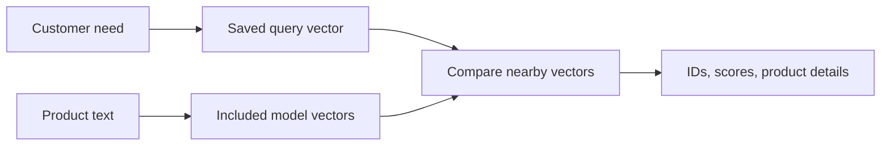

# Module 00: Setup and orientation
> After this module you can run an offline semantic search and explain where the model and database fit.

**Time:** ~60 min · **Level:** Beginner · **Needs:** 8 GB system RAM, ~1 GB base environment disk (several GB with optional models), Docker: No · **Downloads:** none for included vectors; initial packages need network; optional MiniLM weights ~91 MB in Module 02.

**TinyVec and Marlowe Search version 0 → 1 preview:** Run an offline semantic search and explain where the model and database fit. Executed diagnostics and matching retrieval baselines are linked in [this module’s measured results](results/README.md).

## Prerequisites

[Repository quick start](../../README.md). Use the [Tier 1 vocabulary card](../TIER1_TERMS.md) for unfamiliar terms. Know basic Python functions, lists, dictionaries, and terminal commands. All commands below run from the repository root on PowerShell, macOS, and Linux. Core examples use the base installation. The native comparison uses `--extra embedded`; install packages once while online, then repeat the same extra flags with `--offline` when disconnected. No database server is started.

## Learning objectives

- Identify the difference between a model, a library, and a database.
- Inspect product IDs, text, and metadata in the shared catalog.
- Run a saved semantic query without Docker or a model download.
- Explain what the motivating example does and does not prove.

## The big idea

Imagine a shop assistant hearing “something to keep my coffee hot on my desk.” The customer has described a need, not a product name. A phrase matcher checks characters. A semantic search first represents the request as numbers and compares that representation with product representations. “Ceramic mug warmer” can then be a useful answer even though the complete phrase never appears in its description.

The model creates the representation; the search procedure compares it; storage keeps the product attached to its ID. A vector database combines storage and retrieval, often with metadata filters and update APIs. You can begin with a library and files. A server is a deployment choice, not a prerequisite for understanding similarity.

## How it works



The included MiniLM artifacts contain a 384-number row for each product and each saved query. You do not need to interpret the coordinates yet. An ID joins a vector to its product. Price, stock, and region are metadata: ordinary attributes attached to the row. The example uses a saved query to avoid loading an inference framework on your first run. A new arbitrary sentence needs the same model and preprocessing.

Landscape: a **library** such as FAISS lives inside your program and focuses on search; an **embedded database** such as Chroma keeps records locally; a **Postgres extension** adds vector operations to an existing relational system; a **dedicated server** such as Qdrant exposes a network API; a **search engine** can combine text and vector retrieval; a **managed service** delegates operations to a provider. None is universally best. The later tiers compare them using the same workload. A **RAG** application retrieves passages before generating an answer; recommendations, duplicate detection, and image retrieval also reuse “find similar representations,” with different quality tests.

## Build it yourself

Read `examples/01_from_scratch.py` in order. `load_products(limit=1000)` loads a small local table. Selecting columns makes each record inspectable. `literal_ids` loops over records, normalizes capitalization with `casefold`, and tests whether the entire query occurs in the description. The returned IDs keep matching separate from presentation. The final count is zero for the motivating phrase. This is an intentionally narrow baseline: a more capable keyword engine could match individual words and still retrieve useful items.

Run `uv sync --locked` from the repository root, then `uv run python scripts/check_env.py`. See [root setup](../../docs/SETUP.md) for uv installation, checkout instructions, Windows/POSIX commands, and the pip fallback. Docker can wait until Tier 3; it is not used by this module.

## Now in a real database

The native Chroma example creates an ephemeral collection and passes `embedding_function=None`, so the engine cannot silently choose or download a model. It inserts the exact included vectors and retrieves IDs plus cosine distances. Converting distance to similarity makes score direction consistent for display. Chroma adds collection lifecycle and record storage; its indexed retrieval need not reproduce TinyVec’s exact ordering at every tied boundary. This single-query comparison is not a vendor ranking.

## Walkthrough

### 01 from_scratch

[Read the script](examples/01_from_scratch.py), predict the output, then run:

```sh
uv run python modules/00_setup/examples/01_from_scratch.py
```

Expected: `Rows: 1,000; phrase matches: 0`. Values involving time are measured, not fixed assertions.
### 02 production

[Read the script](examples/02_production.py), predict the output, then run:

```sh
uv run --extra embedded python modules/00_setup/examples/02_production.py
```

Expected: `Five ceramic mug-warmer products with similarity scores`. Values involving time are measured, not fixed assertions.
### 03 measure

[Read the script](examples/03_measure.py), predict the output, then run:

```sh
uv run python modules/00_setup/examples/03_measure.py
```

Expected: `0 phrase matches; 5 useful hits; evidence JSON`. Values involving time are measured, not fixed assertions.

The [notebook](notebook.ipynb) mirrors these scripts, with prediction prompts and a small editable experiment. Launch with `uv run --extra notebooks --extra libs --extra embedded jupyter lab`. It starts cleared and runs top to bottom with local artifacts. Native cells clearly skip when their extra is missing; complete comparisons require installing the stated extras. No notebook cell silently downloads a model.

## Measure it

The orientation diagnostic records the exact phrase count, five useful hits, and five repeated saved-search calls after warm-up. This wrapper timing includes loading the saved query, so it is not directly comparable with retrieval-only benchmark latency. The `orientation.yaml` benchmark separately measures retrieval on 1,000 real embedded products. Its baseline is the same workload used throughout this tier; the older 10k Phase 2 rows have a different size and cannot establish a speedup here.

See [module evidence](results/README.md), [the generated leaderboard](../../results/leaderboard.md), and [metric definitions and limitations](../../results/README.md). Hardware, exact run IDs, repeats, and source identities are in the linked JSON. All measurements here are on the documented development machine; an 8 GB target is a budget, not a claim that this machine had only 8 GB.

## When to use it, and when not to

> Use semantic discovery for needs and paraphrases. Keep exact lookup for known IDs and SKUs. Start with the smallest architecture that satisfies required updates and clients.

## Real-world use case

A marketplace can offer “describe what you need” as a discovery entry point while keeping exact SKU lookup for precise purchases. The use case displays five mug warmers and asserts that the motivating query succeeds. It does not infer that all requests will succeed. A real team would gather varied requests and independent judgments before shipping; Module 04 introduces that evaluation.

```sh
uv run python modules/00_setup/use_case/marlowe_search.py
```

Sample outcome: `five mug warmers`. Read [the use-case code](use_case/marlowe_search.py) and explain which product decision follows from its assertion.

## Common mistakes

| Symptom | Fix |
|---|---|
| Import fails or a file cannot be found | Run from the checkout root and install the editable project using uv. |
| A custom query says the model is missing | Start with saved queries; explicitly prepare the cached model in Module 02. |
| Zero phrase matches are read as proof keyword search is useless | This baseline tests a whole phrase, not a token-based ranker. |
| A Docker error appears in environment inspection | Ignore Docker for Tier 1; fix the host only before server lessons. |
| A score is interpreted as a purchase probability | It is a similarity value, not a calibrated confidence. |

## Exercises

### Practice: Make phrase matching case-insensitive.

[Starter](exercises/01_practice.py) · [reference solution](solutions/01_practice.py). Acceptance: Return only matching IDs; “mug” must match “Warm MUG”; absent words return an empty list.

```sh
uv run python modules/00_setup/exercises/01_practice.py
uv run python scripts/check_exercise.py modules/00_setup/exercises/01_practice.py
```

The starter is a working simpler policy and may fail acceptance until edited. Add `--smoke` to check only that it runs; replace `exercises` with `solutions` to verify the reference against the same cases.
### Apply: Audit duplicate IDs in a catalog.

[Starter](exercises/02_apply.py) · [reference solution](solutions/02_apply.py). Acceptance: Report both row count and distinct ID count; three rows with IDs a,a,b have two unique IDs.

```sh
uv run python modules/00_setup/exercises/02_apply.py
uv run python scripts/check_exercise.py modules/00_setup/exercises/02_apply.py
```

The starter is a working simpler policy and may fail acceptance until edited. Add `--smoke` to check only that it runs; replace `exercises` with `solutions` to verify the reference against the same cases.
### Stretch: Choose a minimal teaching architecture.

[Starter](exercises/03_stretch.py) · [reference solution](solutions/03_stretch.py). Acceptance: For this exercise: fixed local data → library; local updates → embedded; concurrent remote clients → server. Do not infer a universal row-count cutoff.

```sh
uv run python modules/00_setup/exercises/03_stretch.py
uv run python scripts/check_exercise.py modules/00_setup/exercises/03_stretch.py
```

The starter is a working simpler policy and may fail acceptance until edited. Add `--smoke` to check only that it runs; replace `exercises` with `solutions` to verify the reference against the same cases.

Run all reference acceptance and starter smoke tests for this module with `uv run pytest modules/00_setup/tests`. Passing smoke means a starter runs; it does not mean it meets the exercise objective. The tests intentionally keep those claims separate.

## Quiz

**1. Why does the phrase baseline return zero?**

<details>
<summary>Answer</summary>

It requires the complete character sequence; it does not infer the customer’s intent.

</details>

**2. What component creates an embedding?**

<details>
<summary>Answer</summary>

The embedding model. The database can store and search vectors supplied by an application.

</details>

**3. Why does the first query work offline?**

<details>
<summary>Answer</summary>

Its real query vector and product vectors are included; model inference is not performed.

</details>

**4. Is a vector library a durable multi-user database?**

<details>
<summary>Answer</summary>

Not by itself. Persistence, metadata, concurrency, and service operations are separate responsibilities.

</details>

**5. Does one good result justify launching semantic search?**

<details>
<summary>Answer</summary>

No. Evaluate varied queries with independent relevance judgments and resource measurements.

</details>

**6. When is Docker first required on the main path?**

<details>
<summary>Answer</summary>

Tier 3 server lessons; it is not required in this tier.

</details>

## Key takeaways

- A need can differ from the words in a product title.
- Representations, retrieval, and storage are separate components.
- IDs connect numeric rows to meaningful records.
- Saved real vectors enable an immediate offline start.
- The first successful query is motivation, not comprehensive evaluation.

## Clean up

This module starts no containers, so there is no container stop command to run. Stop the Playground or Jupyter with Ctrl+C if you opened them. Temporary exercise snapshots clean themselves up. Native database files, figures, and exploratory evidence under `.cache/marlowe/tier1` are course-owned.

```sh
uv run python scripts/cleanup.py
uv run python scripts/cleanup.py --remove
```

Read the preview before confirming: the second command can remove **all** generated course resources, including cached models and full generated data, not just this module. It preserves included vectors and published results. See [cleanup boundaries](../../docs/SETUP.md).

## Go deeper

- [Chroma Python client](https://docs.trychroma.com/reference/python/client)
- [uv installation](https://docs.astral.sh/uv/getting-started/installation/)

## Next: Module 01

[Module 01](../01_vectors_similarity/README.md)
