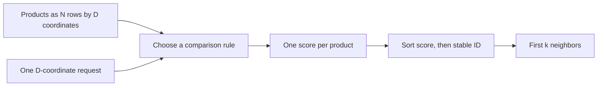

# Module 01: Vectors and similarity
> After this module you can implement exact neighbor search and predict how metric and normalization change ranking.

**Time:** ~120 min · **Level:** Beginner · **Needs:** 8 GB system RAM, ~1 GB base environment disk (several GB with optional models), Docker: No · **Downloads:** none for included vectors; initial packages need network; optional MiniLM weights ~91 MB in Module 02.

**TinyVec and Marlowe Search version 1: exact geometry:** Implement exact neighbor search and predict how metric and normalization change ranking. Executed diagnostics and matching retrieval baselines are linked in [this module’s measured results](results/README.md).

## Prerequisites

[Module 00](../00_setup/README.md). Use the [Tier 1 vocabulary card](../TIER1_TERMS.md) for unfamiliar terms. Know basic Python functions, lists, dictionaries, and terminal commands. All commands below run from the repository root on PowerShell, macOS, and Linux. Core examples use the base installation. The native comparison uses `--extra libs`; install packages once while online, then repeat the same extra flags with `--offline` when disconnected. No database server is started.

## Learning objectives

- Read a vector’s shape, coordinates, and numeric type.
- Calculate dot, cosine, and Euclidean scores.
- Normalize rows and reject zero vectors for cosine.
- Implement exact top-k with a deterministic ID tie-break.
- Measure distance spread and library agreement.

## The big idea

Think of products as points on a map. On our first map, one coordinate means warmth and another means portability. A third can describe desk footprint. Close points share the properties we chose. Changing units or choosing poor properties changes what “near” means.

A dot product rewards aligned direction and vector length. Cosine compares direction after removing length. Euclidean distance measures straight-line separation. None knows what makes a good product. In a learned embedding the coordinates are not generally named properties; the model chooses a representation during training. Start with a tiny map you can inspect, then carry the same operations to hundreds of coordinates.

## How it works



In NumPy, `matrix.shape == (N, D)` means N products and D coordinates. `matrix[0]` selects one vector; `matrix[:, 0]` selects one feature across products. `float32` stores each coordinate in four bytes. An operation on the whole array is vectorized: compiled numerical routines do the inner loops.

For two arrows a and b, the dot product sums matching-coordinate products. A vector’s length is the square root of its squared coordinates’ sum. Cosine is dot divided by both lengths. L2 is the length of the difference. TinyVec reports negative L2 so a larger score always means a closer item. With unit-length vectors, cosine and dot agree; squared L2 is `2 - 2*cosine`, so it gives the same ranking. Zero has no direction, so cosine must reject it.

The geometry figure shows 2D and 3D hand features. The random-normal experiment is explicitly a math demonstration: relative distance spread tends to shrink as independent dimensions increase. Real learned vectors can have lower effective dimension. A KDTree partitions coordinate space; its pruning advantage can shrink with dimension. The measured timings show this workload only, not a universal boundary.

## Build it yourself

Open [tinyvec/exact.py](../../tinyvec/exact.py). First, convert inputs to numeric arrays; then require an N×D table, a D-vector query, unique IDs, finite values, and positive k. Reject cosine zero vectors before division. `scores(...)` computes one value per row using [the three metric definitions](../../tinyvec/metrics.py). Zip scores back to IDs. Sort by negative score so larger similarities come first, then by string ID to make equal scores deterministic. Slice the first k; if fewer records exist, return those records.

The lesson script inspects shape/dtype, runs all three metrics, scales the flask vector, and normalizes rows. Scaling changes dot ranking but leaves cosine direction unchanged. The storage lesson later adds metadata and persistence around this same computation.

## Now in a real database

FAISS `IndexFlatL2` performs exact L2 scoring in a compiled library. It accepts contiguous float32 rows, stores them in an index, and returns positions plus **squared** distances. The native example converts those distances before comparing with TinyVec’s negative L2 scores. FAISS adds optimized implementations, but its flat index does not manage our string IDs and metadata. The course adapter keeps those in application-owned records. The scikit-learn KDTree/brute comparison is a separate measurement of how dimension affects two exact search strategies.

## Walkthrough

### 01 from_scratch

[Read the script](examples/01_from_scratch.py), predict the output, then run:

```sh
uv run python modules/01_vectors_similarity/examples/01_from_scratch.py
```

Expected: `Cosine favors mug-warmer; rescaling changes dot ranking`. Values involving time are measured, not fixed assertions.
### 02 production

[Read the script](examples/02_production.py), predict the output, then run:

```sh
uv run --extra libs python modules/01_vectors_similarity/examples/02_production.py
```

Expected: `Agreement on all four L2 neighbors`. Values involving time are measured, not fixed assertions.
### 03 measure

[Read the script](examples/03_measure.py), predict the output, then run:

```sh
uv run python modules/01_vectors_similarity/examples/03_measure.py
```

Expected: `Relative spread shrinks; brute and KDTree timings are printed`. Values involving time are measured, not fixed assertions.

The [notebook](notebook.ipynb) mirrors these scripts, with prediction prompts and a small editable experiment. Launch with `uv run --extra notebooks --extra libs --extra embedded jupyter lab`. It starts cleared and runs top to bottom with local artifacts. Native cells clearly skip when their extra is missing; complete comparisons require installing the stated extras. No notebook cell silently downloads a model.

## Measure it

Run the geometry script as a fourth example: `uv run python modules/01_vectors_similarity/examples/04_geometry.py`. It writes `.cache/marlowe/tier1/geometry.png`. The dimensions diagnostic records independent standard-normal data at 2, 8, 32, 128, and 512 dimensions, plus five-repeat query timings. Do not compare these math timings with semantic catalog QPS. On catalog vectors, `vectors.yaml` uses FAISS with L2 distance and `exact_search.yaml` uses TinyVec with cosine similarity. For a matched 1k cosine comparison, use `faiss_exact.yaml` and `benchmark_method.yaml`. The separate `dimensions.yaml` hashing/L2 run measures retrieval mechanics, not the random-normal experiment.

See [module evidence](results/README.md), [the generated leaderboard](../../results/leaderboard.md), and [metric definitions and limitations](../../results/README.md). Hardware, exact run IDs, repeats, and source identities are in the linked JSON. All measurements here are on the documented development machine; an 8 GB target is a budget, not a claim that this machine had only 8 GB.

## When to use it, and when not to

> Use exact search as a correctness reference and for small catalogs. Use hand features when their meaning and units match the task. Do not use cosine just because it is common, or extrapolate a random-space experiment to every dataset.

## Real-world use case

Marlowe tries recommendations from warmth and portability. The use case excludes the selected mug warmer itself, then discovers that cosine favors a reading chair: the chair’s small nonzero warmth and zero portability point in a similar direction. The feature design omitted heating technology. That failure is the lesson. Adding more coordinates blindly will not repair an unsuitable representation; revisit the intended similarity or use a trained embedding.

```sh
uv run python modules/01_vectors_similarity/use_case/marlowe_search.py
```

Sample outcome: `a surprising chair recommendation exposes the feature design`. Read [the use-case code](use_case/marlowe_search.py) and explain which product decision follows from its assertion.

## Common mistakes

| Symptom | Fix |
|---|---|
| Dot scores change when a vector is scaled | Choose cosine or normalize only if magnitude should not matter. |
| NaN appears when dividing by length | Reject zero vectors rather than assigning them a direction. |
| The query has shape (1,D) where a D-vector is required | Use one row or reshape deliberately; inspect shape before scoring. |
| FAISS and TinyVec distances look different | FAISS L2 is squared; TinyVec exposes negative ordinary distance. |
| Hand features produce absurd recommendations | Check units, feature meaning, and whether direction alone matches the product need. |

## Exercises

### Practice: Implement cosine from dot and length.

[Starter](exercises/01_practice.py) · [reference solution](solutions/01_practice.py). Acceptance: Parallel nonzero vectors score 1; perpendicular vectors score 0; zero raises ValueError.

```sh
uv run python modules/01_vectors_similarity/exercises/01_practice.py
uv run python scripts/check_exercise.py modules/01_vectors_similarity/exercises/01_practice.py
```

The starter is a working simpler policy and may fail acceptance until edited. Add `--smoke` to check only that it runs; replace `exercises` with `solutions` to verify the reference against the same cases.
### Apply: Build exact top-k ranking.

[Starter](exercises/02_apply.py) · [reference solution](solutions/02_apply.py). Acceptance: Sort by similarity and then string ID; equal a/b neighbors return a before b; k larger than the catalog returns all.

```sh
uv run python modules/01_vectors_similarity/exercises/02_apply.py
uv run python scripts/check_exercise.py modules/01_vectors_similarity/exercises/02_apply.py
```

The starter is a working simpler policy and may fail acceptance until edited. Add `--smoke` to check only that it runs; replace `exercises` with `solutions` to verify the reference against the same cases.
### Stretch: Normalize a batch while preserving direction.

[Starter](exercises/03_stretch.py) · [reference solution](solutions/03_stretch.py). Acceptance: Every nonzero output row has length 1; [3,4] becomes [0.6,0.8]; reject a zero row.

```sh
uv run python modules/01_vectors_similarity/exercises/03_stretch.py
uv run python scripts/check_exercise.py modules/01_vectors_similarity/exercises/03_stretch.py
```

The starter is a working simpler policy and may fail acceptance until edited. Add `--smoke` to check only that it runs; replace `exercises` with `solutions` to verify the reference against the same cases.

Run all reference acceptance and starter smoke tests for this module with `uv run pytest modules/01_vectors_similarity/tests`. Passing smoke means a starter runs; it does not mean it meets the exercise objective. The tests intentionally keep those claims separate.

## Quiz

**1. What does shape (1000,384) mean?**

<details>
<summary>Answer</summary>

One thousand vectors, each with 384 coordinates.

</details>

**2. Can cosine distinguish [1,0] from [10,0]?**

<details>
<summary>Answer</summary>

No. Their directions are the same, so both have cosine 1 with [1,0].

</details>

**3. Why reject zero for cosine?**

<details>
<summary>Answer</summary>

Its length is zero and it has no direction; the cosine formula would divide by zero.

</details>

**4. When do dot and cosine rank alike?**

<details>
<summary>Answer</summary>

When both sides are appropriately normalized to unit length.

</details>

**5. Does shrinking relative distance spread prove semantic search fails?**

<details>
<summary>Answer</summary>

No. The experiment assumes independent random coordinates; learned data has structure.

</details>

**6. Why sort equal scores by ID?**

<details>
<summary>Answer</summary>

It gives reproducible order, although another library can have different legitimate tie behavior.

</details>

## Key takeaways

- Coordinates and their units define the geometry.
- Cosine ignores magnitude; dot product does not.
- Higher-is-better score conversion must be explicit.
- Exact search is a useful correctness reference.
- A mathematically correct result can expose a poor feature design.

## Clean up

This module starts no containers, so there is no container stop command to run. Stop the Playground or Jupyter with Ctrl+C if you opened them. Temporary exercise snapshots clean themselves up. Native database files, figures, and exploratory evidence under `.cache/marlowe/tier1` are course-owned.

```sh
uv run python scripts/cleanup.py
uv run python scripts/cleanup.py --remove
```

Read the preview before confirming: the second command can remove **all** generated course resources, including cached models and full generated data, not just this module. It preserves included vectors and published results. See [cleanup boundaries](../../docs/SETUP.md).

## Go deeper

- [NumPy vector norm](https://numpy.org/doc/stable/reference/generated/numpy.linalg.norm.html)
- [FAISS getting started](https://github.com/facebookresearch/faiss/wiki/Getting-started)
- [scikit-learn nearest neighbors](https://scikit-learn.org/stable/modules/neighbors.html)

## Next: Module 02

[Module 02](../02_embeddings/README.md)
