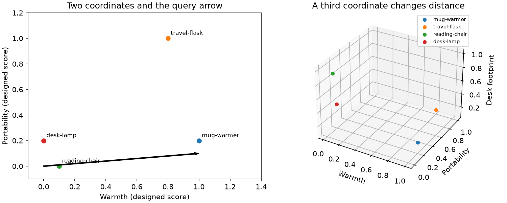

# Module 01: measured results

These are executed measurements on Windows 11, Python 3.12.13, Intel family 6 model 198, 24 reported cores, 31.46 GiB RAM. Timings are local observations, not targets for another laptop. Teaching diagnostics are separated from shared-harness retrieval results. Raw files contain hardware, versions, code identity, timestamp, and measurements.

## Lesson observations

Random-normal math demonstration: relative distance spread (standard deviation / mean) fell from 0.486 at 2 dimensions to 0.029 at 512. KDTree and brute times in the raw file use 20 queries per call; this is distribution-specific. [Raw diagnostic](dimensions-70757e63.json).

## Shared retrieval baselines

Each configuration uses 20 warm-ups and five repetitions over 100 queries, with one numerical-library thread and serial concurrency. Input sizes, query types, metrics, and models can differ across these rows; compare only matching groups in the central leaderboard. Cache and PCA labels designate accompanying retrieval workloads, not inference/PCA timing.

| Configuration / raw run | Records | Recall@10 | nDCG@10 | p50 ms | p95 ms | QPS ± SD |
|---|---:|---:|---:|---:|---:|---:|
| [vectors](../../../results/runs/vectors-20261104T223858-d0b78420.json) | 1,000 | 1.0000 | 0.8402 | 0.486 | 1.066 | 1611.9 ± 39.1 |
| [dimensions](../../../results/runs/dimensions-20261104T223901-2a63d880.json) | 1,000 | 1.0000 | 0.4249 | 0.389 | 0.993 | 1893.9 ± 29.1 |
| [exact_search](../../../results/runs/exact-search-20261104T223921-0ecc921f.json) | 1,000 | 1.0000 | 0.8402 | 0.475 | 1.090 | 1556.9 ± 39.9 |
| [faiss_exact](../../../results/runs/faiss-exact-20261104T223936-4644c6de.json) | 1,000 | 1.0000 | 0.8402 | 0.360 | 1.059 | 1928.2 ± 51.1 |

[Recall/QPS plot for the first row](../../../results/plots/recall_qps_d19fbaa4e0120615.png) · [Full leaderboard](../../../results/leaderboard.md) · [Method and limitations](../../../results/README.md).

There was no previous tested version on this exact lesson workload before Phase 3. Earlier 10k catalog and hashing-fixture runs are retained in their own groups; their timings cannot establish an improvement on this workload.
