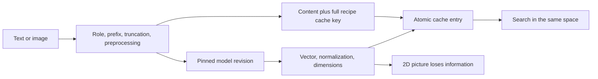

# Module 02: Embeddings
> After this module you can reuse compatible model vectors, batch and cache inference, and explain a catalog projection.

**Time:** ~150 min · **Level:** Beginner · **Needs:** 8 GB system RAM, ~1 GB base environment disk (several GB with optional models), Docker: No · **Downloads:** none for included vectors; initial packages need network; optional MiniLM weights ~91 MB in Module 02.

**TinyVec and Marlowe Search version 1: semantic search with NumPy:** Reuse compatible model vectors, batch and cache inference, and explain a catalog projection. Executed diagnostics and matching retrieval baselines are linked in [this module’s measured results](results/README.md).

## Prerequisites

[Module 01](../01_vectors_similarity/README.md). Use the [Tier 1 vocabulary card](../TIER1_TERMS.md) for unfamiliar terms. Know basic Python functions, lists, dictionaries, and terminal commands. All commands below run from the repository root on PowerShell, macOS, and Linux. Core examples use the base installation. The native comparison uses `--extra embedded`; install packages once while online, then repeat the same extra flags with `--offline` when disconnected. No database server is started.

## Learning objectives

- Distinguish learned coordinates from hand-designed features.
- Identify model revision, dimensions, role, and preprocessing as a vector-space contract.
- Batch inference and measure cache misses versus hits.
- Project embeddings to two dimensions without mistaking the picture for the search space.
- Build semantic retrieval directly over included real vectors.

## The big idea

An embedding model is like a mapmaker trained from many examples. It places inputs so that useful relationships become easier to retrieve. Text models can place a need near a related description; joint image/text models can place a photo near its caption. The training objective determines which relationships are preserved.

Two mapmakers can rotate or rearrange their maps. Equal coordinate counts do not make the maps interchangeable. Store the model revision and preparation recipe with the vectors. A cache is a labeled shelf: reusing a box is safe only when its label names both the content and the recipe that produced it.

## How it works



MiniLM produces 384 coordinates for text. The included product and query vectors are genuine outputs rounded to float16 for storage and promoted to float32 for search. Sentence Transformers loads only when the optional encoder is used. Batching groups inputs so a model processes them together; its ideal size depends on memory and implementation. Startup, inference, disk cache access, and retrieval are different costs.

Some models require different query/document prefixes. The helper uses the prefix configured for the role; MiniLM defaults to empty prefixes. Do not invent a prefix because another model uses one. Cache keys include content, immutable revision, role, prefixes, maximum length, dimensions, normalization, modality, and dtype. An identical-dimensional vector from another recipe must be rejected rather than compared.

PCA first subtracts the mean vector, then finds directions explaining the most variation. The example uses NumPy’s singular-value decomposition to obtain those directions and checks its projection against scikit-learn PCA. Signs can flip without changing pairwise distances. A two-dimensional projection discards information, so proximity on the screen is only a clue. Images need their own preparation and a compatible joint encoder; MiniLM text vectors cannot be compared directly with SigLIP image vectors. Actual photo retrieval arrives in Tier 4.

## Build it yourself

Follow `01_from_scratch.py`: load 500 aligned real vectors; center each column; ask `np.linalg.svd` for principal directions; multiply centered vectors by the first two directions; compare projected distances with the library result; report retained variance and save a category-colored figure. This implements the projection procedure without claiming to implement numerical SVD itself.

Then inspect `EmbeddingCache.encode` in [common/embeddings.py](../../common/embeddings.py). It computes complete keys, checks existing arrays, deduplicates missing contents, encodes only misses, validates shape/finiteness, writes temporary files, atomically replaces entries, and returns rows in original order. The use case calls the exact kernel directly: no database is needed to search 1k stored embeddings.

## Now in a real database

The native example routes already computed MiniLM vectors through the cache and then into Chroma. Its provider is explicitly a frozen-vector lookup, not live model inference; an assertion verifies that the second cache call does not invoke it again. Chroma receives `embedding_function=None` and keeps retrieval separate from modeling.

For actual inference, run `uv run --extra models python scripts/embed_data.py --download` once, then `uv run --extra models python modules/02_embeddings/examples/03_measure.py --live`. The latter loads only the cached pinned model, measures startup separately, compares input batch sizes, and measures a new temporary cache. The no-flag script uses hashing for mechanics only. MiniLM is the small English baseline, not a promise of multilingual quality; choose a different model only after an independent judged comparison and rebuild both sides.

## Walkthrough

### 01 from_scratch

[Read the script](examples/01_from_scratch.py), predict the output, then run:

```sh
uv run python modules/02_embeddings/examples/01_from_scratch.py
```

Expected: `(500, 2), retained variance, and catalog_map.png`. Values involving time are measured, not fixed assertions.
### 02 production

[Read the script](examples/02_production.py), predict the output, then run:

```sh
uv run --extra embedded python modules/02_embeddings/examples/02_production.py
```

Expected: `One provider call across two cache passes; useful Chroma hits`. Values involving time are measured, not fixed assertions.
### 03 measure

[Read the script](examples/03_measure.py), predict the output, then run:

```sh
uv run python modules/02_embeddings/examples/03_measure.py
```

Expected: `Measured batch and miss/hit times; distinct role/prefix keys`. Values involving time are measured, not fixed assertions.

The [notebook](notebook.ipynb) mirrors these scripts, with prediction prompts and a small editable experiment. Launch with `uv run --extra notebooks --extra libs --extra embedded jupyter lab`. It starts cleared and runs top to bottom with local artifacts. Native cells clearly skip when their extra is missing; complete comparisons require installing the stated extras. No notebook cell silently downloads a model.

## Measure it

The `catalog_map` diagnostic reports retained variance; `embedding_cache` is hashing-only; `embedding_cache_live` records real cached MiniLM startup and batch/cache times. The actual live run is included in this phase’s evidence. Cache hits can be slower than computing a tiny hash, so correctness and avoided model calls matter more than an assumed speedup. `text_embeddings.yaml`, `embedding_cache.yaml`, and `catalog_map.yaml` are the corresponding **retrieval baselines**, not inference or projection speed claims. The diagnostic reports measure those distinct operations.

See [module evidence](results/README.md), [the generated leaderboard](../../results/leaderboard.md), and [metric definitions and limitations](../../results/README.md). Hardware, exact run IDs, repeats, and source identities are in the linked JSON. All measurements here are on the documented development machine; an 8 GB target is a budget, not a claim that this machine had only 8 GB.

## When to use it, and when not to

> Use a cache when inputs and the model recipe repeat, and batches when memory permits. Use PCA for exploration. Do not reuse vectors across incompatible models or infer retrieval quality from a pretty map.

## Real-world use case

Marlowe Search v1 loads product vectors and a compatible saved query, computes exact cosine scores with NumPy, and returns product metadata. A real catalog service would embed a new query with the same recipe, cache reusable work, and invalidate vectors when product text changes. It would also evaluate new languages and domains before adopting a model just because it has a smaller vector dimension.

```sh
uv run python modules/02_embeddings/use_case/marlowe_search.py
```

Sample outcome: `five ranked semantic products`. Read [the use-case code](use_case/marlowe_search.py) and explain which product decision follows from its assertion.

## Common mistakes

| Symptom | Fix |
|---|---|
| Different models have the same dimensions, so results seem plausible but irrelevant | Compare full space identities and regenerate both sides together. |
| Changing a prefix appears to reuse old answers | Include role and preprocessing in cache keys; do not reuse stale arrays. |
| A PCA cluster is treated as proof of semantic quality | Inspect retained variance and evaluate retrieval in all original dimensions. |
| Timing includes initial model loading | Separate startup, inference, cache access, and search. |
| The hashing demonstration is called semantic search | Hashing is a deterministic test fixture; real quality uses trained vectors and independent judgments. |

## Exercises

### Practice: Construct a complete cache key.

[Starter](exercises/01_practice.py) · [reference solution](solutions/01_practice.py). Acceptance: Changing model revision or role changes the key; dictionary insertion order does not.

```sh
uv run python modules/02_embeddings/exercises/01_practice.py
uv run python scripts/check_exercise.py modules/02_embeddings/exercises/01_practice.py
```

The starter is a working simpler policy and may fail acceptance until edited. Add `--smoke` to check only that it runs; replace `exercises` with `solutions` to verify the reference against the same cases.
### Apply: Batch a list without dropping or reordering inputs.

[Starter](exercises/02_apply.py) · [reference solution](solutions/02_apply.py). Acceptance: Five inputs at size two produce batches 2,2,1; empty input is empty; size zero raises ValueError.

```sh
uv run python modules/02_embeddings/exercises/02_apply.py
uv run python scripts/check_exercise.py modules/02_embeddings/exercises/02_apply.py
```

The starter is a working simpler policy and may fail acceptance until edited. Add `--smoke` to check only that it runs; replace `exercises` with `solutions` to verify the reference against the same cases.
### Stretch: Validate compatible embedding spaces.

[Starter](exercises/03_stretch.py) · [reference solution](solutions/03_stretch.py). Acceptance: Equal dimensions alone are insufficient; a revision or prefix change must make the spaces incompatible.

```sh
uv run python modules/02_embeddings/exercises/03_stretch.py
uv run python scripts/check_exercise.py modules/02_embeddings/exercises/03_stretch.py
```

The starter is a working simpler policy and may fail acceptance until edited. Add `--smoke` to check only that it runs; replace `exercises` with `solutions` to verify the reference against the same cases.

Run all reference acceptance and starter smoke tests for this module with `uv run pytest modules/02_embeddings/tests`. Passing smoke means a starter runs; it does not mean it meets the exercise objective. The tests intentionally keep those claims separate.

## Quiz

**1. Do learned coordinates have names like warmth and price?**

<details>
<summary>Answer</summary>

Usually not. They jointly encode patterns learned by the model.

</details>

**2. Why can equal-dimensional models be incompatible?**

<details>
<summary>Answer</summary>

Their coordinate systems and training objectives differ; coordinates need a shared recipe.

</details>

**3. Which costs should be separated when timing inference?**

<details>
<summary>Answer</summary>

Model startup, preprocessing/inference, cache access, and retrieval.

</details>

**4. Why include query/document role in a cache key?**

<details>
<summary>Answer</summary>

Some models use different prompts or encoders by role; accidental reuse changes semantics.

</details>

**5. What does PCA preserve?**

<details>
<summary>Answer</summary>

Directions with high variance under its linear projection, not all neighbors or relevance.

</details>

**6. Can a MiniLM query search SigLIP image vectors?**

<details>
<summary>Answer</summary>

No. Use a compatible joint image/text model for both sides.

</details>

## Key takeaways

- A model’s objective determines useful similarity.
- Full space identity matters more than dimension count.
- Batching trades memory for throughput.
- Cache correctness needs content and recipe identity.
- A 2D map is an explanation aid, not the search index.

## Clean up

This module starts no containers, so there is no container stop command to run. Stop the Playground or Jupyter with Ctrl+C if you opened them. Temporary exercise snapshots clean themselves up. Native database files, figures, and exploratory evidence under `.cache/marlowe/tier1` are course-owned.

```sh
uv run python scripts/cleanup.py
uv run python scripts/cleanup.py --remove
```

Read the preview before confirming: the second command can remove **all** generated course resources, including cached models and full generated data, not just this module. It preserves included vectors and published results. See [cleanup boundaries](../../docs/SETUP.md).

## Go deeper

- [MiniLM model card](https://huggingface.co/sentence-transformers/all-MiniLM-L6-v2)
- [SentenceTransformer API](https://www.sbert.net/docs/package_reference/sentence_transformer/model.html)
- [PCA API](https://scikit-learn.org/stable/modules/generated/sklearn.decomposition.PCA.html)

## Next: Module 03

[Module 03](../03_tinyvec/README.md)
