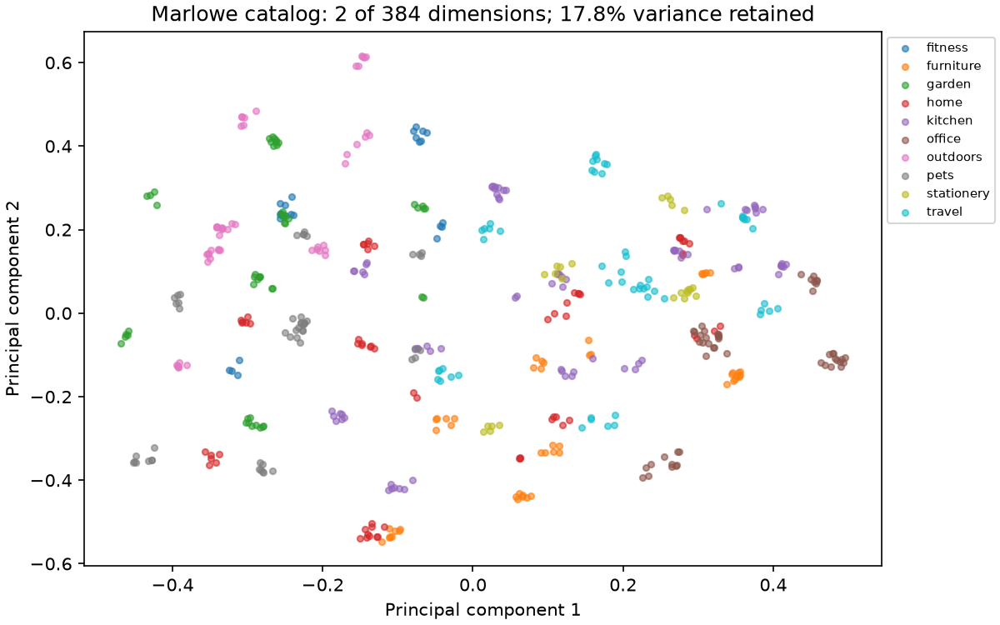

# Module 02: measured results

These are executed measurements on Windows 11, Python 3.12.13, Intel family 6 model 198, 24 reported cores, 31.46 GiB RAM. Timings are local observations, not targets for another laptop. Teaching diagnostics are separated from shared-harness retrieval results. Raw files contain hardware, versions, code identity, timestamp, and measurements.

## Lesson observations

PCA retained **17.8%** of variance in two coordinates over 500 products. The remaining information is absent from the picture. [Raw diagnostic](catalog_map-f24a632c.json).

hash mechanics only; no semantic-quality claim: first cache pass 109.34 ms; median of subsequent cache hits 30.73 ms. Startup 0.00 s is separate. Median seconds for the same 64 texts at batch sizes 1 / 16 / 32: 0.003, 0.003, 0.003. Sampled peak process RSS: 541.8 MiB, including loaded libraries (10 ms sampling interval). [Raw diagnostic](embedding_cache-241243b2.json).

real cached MiniLM: first cache pass 401.80 ms; median of subsequent cache hits 18.79 ms. Startup 6.44 s is separate. Median seconds for the same 64 texts at batch sizes 1 / 16 / 32: 0.595, 0.340, 0.330. Sampled peak process RSS: 670.6 MiB, including loaded libraries (10 ms sampling interval). [Raw diagnostic](embedding_cache_live-7099b0eb.json).

## Shared retrieval baselines

Each configuration uses 20 warm-ups and five repetitions over 100 queries, with one numerical-library thread and serial concurrency. Input sizes, query types, metrics, and models can differ across these rows; compare only matching groups in the central leaderboard. Cache and PCA labels designate accompanying retrieval workloads, not inference/PCA timing.

| Configuration / raw run | Records | Recall@10 | nDCG@10 | p50 ms | p95 ms | QPS ± SD |
|---|---:|---:|---:|---:|---:|---:|
| [text_embeddings](../../../results/runs/text-embeddings-20261104T223905-f7d69b43.json) | 1,000 | 1.0000 | 0.6534 | 0.479 | 0.520 | 2052.1 ± 15.9 |
| [embedding_cache](../../../results/runs/embedding-cache-20261104T223908-17f920f8.json) | 64 | 1.0000 | 0.8562 | 0.070 | 0.116 | 12005.8 ± 1043.6 |
| [catalog_map](../../../results/runs/catalog-map-20261104T223912-83328bb2.json) | 500 | 1.0000 | 0.8432 | 0.256 | 0.533 | 3075.4 ± 115.6 |

[Recall/QPS plot for the first row](../../../results/plots/recall_qps_7d4eb82677170fd3.png) · [Full leaderboard](../../../results/leaderboard.md) · [Method and limitations](../../../results/README.md).

There was no previous tested version on this exact lesson workload before Phase 3. Earlier 10k catalog and hashing-fixture runs are retained in their own groups; their timings cannot establish an improvement on this workload.
