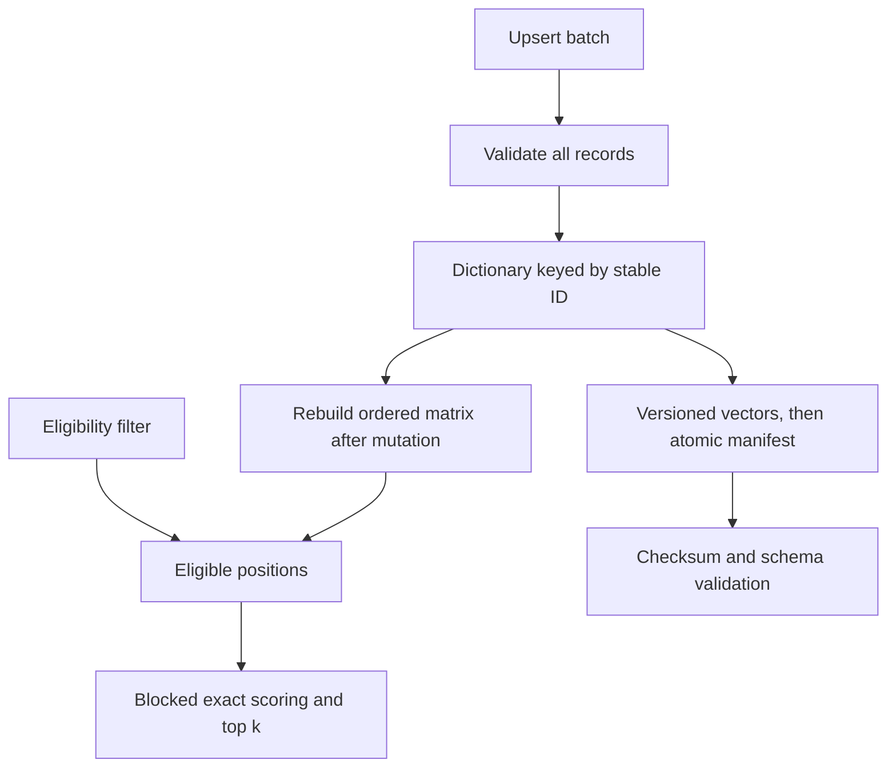

# Module 03: TinyVec, part 1: your own vector store
> After this module you can update, filter, save, and reload a small exact vector store without losing IDs.

**Time:** ~150 min · **Level:** Beginner · **Needs:** 8 GB system RAM, ~1 GB base environment disk (several GB with optional models), Docker: No · **Downloads:** none for included vectors; initial packages need network; optional MiniLM weights ~91 MB in Module 02.

**TinyVec and Marlowe Search version 1: durable exact store:** Update, filter, save, and reload a small exact vector store without losing ids. Executed diagnostics and matching retrieval baselines are linked in [this module’s measured results](results/README.md).

## Prerequisites

[Module 02](../02_embeddings/README.md). Use the [Tier 1 vocabulary card](../TIER1_TERMS.md) for unfamiliar terms. Know basic Python functions, lists, dictionaries, and terminal commands. All commands below run from the repository root on PowerShell, macOS, and Linux. Core examples use the base installation. The native comparison uses `--extra embedded`; install packages once while online, then repeat the same extra flags with `--offline` when disconnected. No database server is started.

## Learning objectives

- Create a collection with dimensions, metric, and space identity.
- Upsert and delete records by stable ID.
- Explain a selective-filter failure and fix it.
- Save and restore a complete snapshot.
- State the concurrency and durability limits of this teaching store.

## The big idea

Think of a vector store as a stockroom with a numbered bin for each listing. The vector describes what is in the bin; metadata tells you its price and availability. Updating a listing should replace the contents of the same bin, not create an extra one.

Filtering resembles asking an assistant to search only the available stock. If the assistant first chooses one unavailable item and then discards it, the customer gets nothing even when another good item is available. Search the eligible stock first. A snapshot is a labeled inventory copy: it needs IDs, metadata, vectors, and the comparison recipe together.

## How it works



TinyVec stores copied `Record` objects in a dictionary keyed by string ID. Its collection schema fixes dimensions, metric, and embedding space. An upsert validates the entire batch before changing records, then marks the scoring matrix stale. A deletion also invalidates that matrix. Search rebuilds it lazily, filters eligible rows, scores bounded blocks, and merges only each block’s best k candidates. That retains the global exact top k without building a query-by-catalog matrix.

Filters support equality, membership, numeric ranges, AND, and OR. Missing fields never match a comparison; equality distinguishes booleans, integers, and floats, while numeric ranges compare numbers. The database does not decide authorization: a trusted caller must enforce tenant restrictions. A user-provided filter is not a security boundary.

Saving writes a versioned NumPy array, flushes it, and publishes a JSON manifest last. Loading checks format, path containment, checksum, row count, and schema; no pickle executes arbitrary objects. Keeping old array files makes interrupted replacement safer, but this is not a transactional, concurrent, replicated server. The library expects one owner to coordinate mutations and snapshots.

## Build it yourself

Trace [tinyvec/store.py](../../tinyvec/store.py) in this order. `create_collection` accepts an identical schema but rejects a different one. `checked_record` validates and copies inputs. `upsert` replaces entries by ID only after all validation succeeds. `delete` removes keys and invalidates the matrix. `build` sorts IDs and stacks vectors in that order. `search` validates the query and space, computes eligible positions, calls the metric kernel block by block, and resolves ties by ID. `save` writes vector bytes before the manifest. `load` checks those bytes before reconstructing records.

`insert` rejects existing IDs or duplicates within its input and leaves the entire batch unapplied. Use `upsert` when replacement is intended. The first example inserts a mug, then updates its price under the same ID, verifies that only one record exists, and deletes it. The filter experiment deliberately loses an eligible item with top-one postfiltering, then fixes the order. The use case saves a real 1k subset and compares eligible IDs after reload.

## Now in a real database

The native Chroma persistent example uses the same concepts: create a collection, supply embeddings, upsert stable IDs, attach metadata, query with a filter, delete, and reopen. It retains local files under the course cache. The reopen in that example is explicitly same-process; the Tier 1 checkpoint separately verifies TinyVec restoration in a fresh process. Full Chroma backup and operational behavior belong to its database module.

The common VectorStore interface supports portable examples while native APIs remain visible. The FAISS flat adapter shares TinyVec’s records and snapshot format, uses compiled scoring, and rebuilds an eligible flat index per filtered request. It retrieves all eligible scores for stable ID ties, so its overhead is not a minimal FAISS top-k benchmark.

## Walkthrough

### 01 from_scratch

[Read the script](examples/01_from_scratch.py), predict the output, then run:

```sh
uv run python modules/03_tinyvec/examples/01_from_scratch.py
```

Expected: `One updated product; deleted ID absent`. Values involving time are measured, not fixed assertions.
### 02 production

[Read the script](examples/02_production.py), predict the output, then run:

```sh
uv run --extra embedded python modules/03_tinyvec/examples/02_production.py
```

Expected: `Filtered result and reopened count: 1`. Values involving time are measured, not fixed assertions.
### 03 measure

[Read the script](examples/03_measure.py), predict the output, then run:

```sh
uv run python modules/03_tinyvec/examples/03_measure.py
```

Expected: `postfilter returns 0; prefilter returns 1`. Values involving time are measured, not fixed assertions.

The [notebook](notebook.ipynb) mirrors these scripts, with prediction prompts and a small editable experiment. Launch with `uv run --extra notebooks --extra libs --extra embedded jupyter lab`. It starts cleared and runs top to bottom with local artifacts. Native cells clearly skip when their extra is missing; complete comparisons require installing the stated extras. No notebook cell silently downloads a model.

## Measure it

The controlled filter diagnostic uses two explicit vectors and records both counts and repeated prefilter timings. The shared `storage_crud.yaml` retrieval baseline checks quality after building the store; it is not a transaction benchmark. Contract tests independently verify CRUD, whole-batch validation, ties, copies, filters, and persistence. Use the real catalog run for retrieval costs and the correctness checks for data lifecycle; do not replace one with the other.

See [module evidence](results/README.md), [the generated leaderboard](../../results/leaderboard.md), and [metric definitions and limitations](../../results/README.md). Hardware, exact run IDs, repeats, and source identities are in the linked JSON. All measurements here are on the documented development machine; an 8 GB target is a budget, not a claim that this machine had only 8 GB.

## When to use it, and when not to

> Use TinyVec for learning, local experiments, and an exact baseline. Use an engine with documented transactions and concurrency when multiple writers or service guarantees are required. Filters alone do not enforce authorization.

## Real-world use case

A buyer asks for an item that is in stock and costs at most $30. Marlowe Search applies those constraints before scoring the eligible subset, displays the hits, saves a snapshot, reloads it, and verifies the same IDs. A production service would also need coordinated writers, authentication, recovery procedures, and storage durability guarantees. TinyVec v1 is a readable reference and local experiment store.

```sh
uv run python modules/03_tinyvec/use_case/marlowe_search.py
```

Sample outcome: `same eligible IDs before and after reload`. Read [the use-case code](use_case/marlowe_search.py) and explain which product decision follows from its assertion.

## Common mistakes

| Symptom | Fix |
|---|---|
| Updating a product creates duplicate results | Keep a stable ID and use replacement semantics, not append-only insertion. |
| Deleted items return after a previous search | Invalidate the matrix/index whenever records change. |
| A filter returns no hits although valid products exist | Check whether top k was selected before filtering; prefilter for an exact eligible baseline. |
| Reloaded vectors have the wrong descriptions | Persist aligned IDs/metadata and schema together; validate row count and checksums. |
| Two processes write the same snapshot directory | TinyVec does not coordinate writers; use one owner or a database with documented transactions. |

## Exercises

### Practice: Implement replacement without mutating caller-owned dictionaries.

[Starter](exercises/01_practice.py) · [reference solution](solutions/01_practice.py). Acceptance: An existing mug’s price changes from 30 to 20; changing the input metadata afterward must not alter stored data.

```sh
uv run python modules/03_tinyvec/exercises/01_practice.py
uv run python scripts/check_exercise.py modules/03_tinyvec/exercises/01_practice.py
```

The starter is a working simpler policy and may fail acceptance until edited. Add `--smoke` to check only that it runs; replace `exercises` with `solutions` to verify the reference against the same cases.
### Apply: Fix top-k filtering.

[Starter](exercises/02_apply.py) · [reference solution](solutions/02_apply.py). Acceptance: Discard unavailable records before ranking; ties sort by ID; an empty catalog returns empty.

```sh
uv run python modules/03_tinyvec/exercises/02_apply.py
uv run python scripts/check_exercise.py modules/03_tinyvec/exercises/02_apply.py
```

The starter is a working simpler policy and may fail acceptance until edited. Add `--smoke` to check only that it runs; replace `exercises` with `solutions` to verify the reference against the same cases.
### Stretch: Persist a complete store.

[Starter](exercises/03_stretch.py) · [reference solution](solutions/03_stretch.py). Acceptance: Write a TinyVec snapshot that reloads ID, vector, metadata, and text. The baseline saves only IDs and deliberately fails the complete-snapshot check.

```sh
uv run python modules/03_tinyvec/exercises/03_stretch.py
uv run python scripts/check_exercise.py modules/03_tinyvec/exercises/03_stretch.py
```

The starter is a working simpler policy and may fail acceptance until edited. Add `--smoke` to check only that it runs; replace `exercises` with `solutions` to verify the reference against the same cases.

Run all reference acceptance and starter smoke tests for this module with `uv run pytest modules/03_tinyvec/tests`. Passing smoke means a starter runs; it does not mean it meets the exercise objective. The tests intentionally keep those claims separate.

## Quiz

**1. How is upsert different from append?**

<details>
<summary>Answer</summary>

It replaces the record with an existing ID, or inserts it if absent.

</details>

**2. Why validate the whole batch before mutation?**

<details>
<summary>Answer</summary>

A later invalid record should not leave earlier records partially updated.

</details>

**3. Why can postfiltering return fewer than k valid results?**

<details>
<summary>Answer</summary>

The initial candidate set can be occupied by ineligible records; valid ones outside it were never considered.

</details>

**4. Does exact filtered ground truth use all products?**

<details>
<summary>Answer</summary>

It searches only the same eligible filter set.

</details>

**5. Why publish the manifest after the vector file?**

<details>
<summary>Answer</summary>

Readers should not observe a new manifest pointing at incomplete vector bytes.

</details>

**6. Is TinyVec safe as an uncoordinated multiwriter service?**

<details>
<summary>Answer</summary>

No. It has no transaction or writer-lock protocol; use it as an educational single-owner store.

</details>

## Key takeaways

- Stable IDs define replacement and deletion.
- Mutations must invalidate derived search structures.
- Filters change the nearest-neighbor question.
- Snapshots need vectors, records, schema, and validation.
- A small correct library is not a production database guarantee.

## Clean up

This module starts no containers, so there is no container stop command to run. Stop the Playground or Jupyter with Ctrl+C if you opened them. Temporary exercise snapshots clean themselves up. Native database files, figures, and exploratory evidence under `.cache/marlowe/tier1` are course-owned.

```sh
uv run python scripts/cleanup.py
uv run python scripts/cleanup.py --remove
```

Read the preview before confirming: the second command can remove **all** generated course resources, including cached models and full generated data, not just this module. It preserves included vectors and published results. See [cleanup boundaries](../../docs/SETUP.md).

## Go deeper

- [Chroma client API](https://docs.trychroma.com/reference/python/client)
- [NumPy save](https://numpy.org/doc/stable/reference/generated/numpy.save.html)

## Next: Module 04

[Module 04](../04_benchmarking/README.md)
