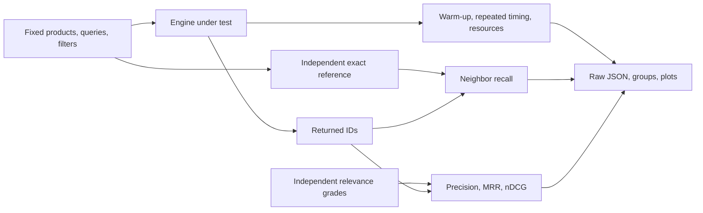

# Module 04: Measuring vector search
> After this module you can produce a reproducible report that separates nearest-neighbor accuracy, usefulness, and speed.

**Time:** ~120 min · **Level:** Beginner · **Needs:** 8 GB system RAM, ~1 GB base environment disk (several GB with optional models), Docker: No · **Downloads:** none for included vectors; initial packages need network; optional MiniLM weights ~91 MB in Module 02.

**TinyVec and Marlowe Search version 1: measured baseline:** Produce a reproducible report that separates nearest-neighbor accuracy, usefulness, and speed. Executed diagnostics and matching retrieval baselines are linked in [this module’s measured results](results/README.md).

## Prerequisites

[Module 03](../03_tinyvec/README.md). Use the [Tier 1 vocabulary card](../TIER1_TERMS.md) for unfamiliar terms. Know basic Python functions, lists, dictionaries, and terminal commands. All commands below run from the repository root on PowerShell, macOS, and Linux. Core examples use the base installation. The native comparison uses `--extra embedded`; install packages once while online, then repeat the same extra flags with `--offline` when disconnected. No database server is started.

## Learning objectives

- Compute recall, precision, MRR, and nDCG from small examples.
- Explain why exact search can still have poor relevance.
- Measure percentiles and serial throughput with explicit timing boundaries.
- Record warm-ups, repetitions, hardware, memory, disk, and provenance.
- Reject comparisons with mismatched workloads or unsupported claims.

## The big idea

An assistant can follow a map perfectly and still visit the wrong shops because the map describes the wrong need. Neighbor recall asks whether search followed the map: did it retrieve the exact closest vectors? Relevance asks whether the returned products help the customer. Speed and resource use form a third question.

Benchmarking resembles weighing ingredients on the same scale. Keep the recipe, quantities, and units fixed; repeat the measurement; record what changed. A fast implementation with wrong answers is not a win, and a small timing difference inside normal variation is not a reliable ranking.

## How it works



Recall@k is the number of returned exact neighbors divided by the number of available exact neighbors up to k. Empty eligible sets have undefined recall and are excluded from its mean. Precision@k is the number of unique relevant returned IDs divided by requested k. Reciprocal rank is one divided by the first relevant rank, or zero if absent; MRR averages it over queries. nDCG rewards high grades near the top: sum `(2**grade - 1) / log2(rank + 1)`, then divide by the best possible ordering’s sum. No relevant judgments means nDCG is undefined here. These conventions matter when reproducing results.

Percentiles describe ordered latency observations. The implementation uses linear interpolation, so p95 can lie between samples. QPS is completed requests divided by wall seconds; reciprocal mean request time is equivalent only in a strictly serial loop with no gaps. Warm-ups reduce first-call effects. Five repetitions expose variation but do not eliminate CPU scheduling, caching, or measurement bias. Standard deviation across repeated QPS is not a confidence interval.

The harness separates insertion and build, excludes embedding/loading/quality evaluation from request timing, samples process RSS every 10 ms, and counts snapshot bytes. RSS includes Python and libraries and can miss short peaks. Independent exact scoring uses float64 accumulation over the stored float16-rounded values. A boundary tie tolerance accommodates numeric ordering differences but cannot excuse missing a strictly closer neighbor. Strict ID recall remains visible.

## Build it yourself

Read [common/bench/metrics.py](../../common/bench/metrics.py) with the hand example open. `recall_at_k` forms sets to prevent repeated credit. `precision_at_k` deduplicates returned IDs and divides by requested k. `reciprocal_rank` enumerates ranks starting at one. `ndcg_at_k` computes discounted gains and an ideal ordering, preserving rank positions while suppressing duplicate credit. `latency_summary` calls NumPy’s percentile calculation.

Then trace the runner: create a fixed workload; instantiate the engine; measure insertion/build separately; warm requests; shuffle query order using seeded repetitions; record each retrieval call; save a snapshot; compute quality outside timed intervals; attach configuration, hardware, package versions, and source hashes. Inspect one raw JSON before trusting the generated table.

## Now in a real database

The LanceDB example builds a table from explicit vectors and performs an unindexed cosine scan for q000. The same product IDs, independent exact reference, and relevance judgments produce recall and usefulness metrics. That one query’s result is a diagnostic, not an engine-wide leaderboard. The FAISS flat adapter additionally runs the full shared harness. Its records/persistence/tie-sorting overhead is included and stated; native IndexFlat-only timing would be a different experiment.

## Walkthrough

### 01 from_scratch

[Read the script](examples/01_from_scratch.py), predict the output, then run:

```sh
uv run python modules/04_benchmarking/examples/01_from_scratch.py
```

Expected: `recall 0.5; precision 0.5; MRR 0.5; graded nDCG`. Values involving time are measured, not fixed assertions.
### 02 production

[Read the script](examples/02_production.py), predict the output, then run:

```sh
uv run --extra embedded python modules/04_benchmarking/examples/02_production.py
```

Expected: `LanceDB q000 metrics and product results`. Values involving time are measured, not fixed assertions.
### 03 measure

[Read the script](examples/03_measure.py), predict the output, then run:

```sh
uv run python modules/04_benchmarking/examples/03_measure.py
```

Expected: `500 measured requests and a saved raw benchmark`. Values involving time are measured, not fixed assertions.

The [notebook](notebook.ipynb) mirrors these scripts, with prediction prompts and a small editable experiment. Launch with `uv run --extra notebooks --extra libs --extra embedded jupyter lab`. It starts cleared and runs top to bottom with local artifacts. Native cells clearly skip when their extra is missing; complete comparisons require installing the stated extras. No notebook cell silently downloads a model.

## Measure it

Run `uv run python scripts/run_bench.py configs/bench/benchmark_method.yaml`, then `uv run --extra libs python scripts/run_bench.py configs/bench/faiss_exact.yaml`. Compare only the matching 1k catalog/query/hardware group. All initial Tier 1 configs use `split: all` for descriptive teaching coverage. They do not justify selecting a parameter on test data and calling the result held out. Later tuning must use development queries and evaluate an untouched test split.

Synthetic judgments are attribute rules, not human review. Judge real user requests independently before making business claims. The local table and plot are produced from executed runs; retained Phase 2 rows are not directly comparable when sizes or judgments differ. A faster result that loses useful hits is illustrated in the use case.

See [module evidence](results/README.md), [the generated leaderboard](../../results/leaderboard.md), and [metric definitions and limitations](../../results/README.md). Hardware, exact run IDs, repeats, and source identities are in the linked JSON. All measurements here are on the documented development machine; an 8 GB target is a budget, not a claim that this machine had only 8 GB.

## When to use it, and when not to

> Use the harness to compare compatible workloads and detect regressions. Use independent relevance review for product decisions. Do not rank vendors from mismatched workloads, a single query, or unstable tail timings.

## Real-world use case

Marlowe considers a very fast policy that always returns the first five IDs. It requires almost no retrieval work, but ignores the query. The use case compares its precision with exact semantic search and measures both under the same wrapper. The first-five policy loses useful hits and is rejected. A real team would define a relevance floor and latency budget, then examine repeated measurements and failure cases together.

```sh
uv run python modules/04_benchmarking/use_case/marlowe_search.py
```

Sample outcome: `exact precision 1.0 versus first-five precision 0.2`. Read [the use-case code](use_case/marlowe_search.py) and explain which product decision follows from its assertion.

## Common mistakes

| Symptom | Fix |
|---|---|
| Recall is perfect, so the product is declared useful | Neighbor accuracy and relevance have different reference sets; report both. |
| p99 is quoted from five requests | Collect enough requests and show sample count; tail estimates remain unstable. |
| QPS is computed from summed latencies despite idle gaps | Count completed requests over the measured wall interval. |
| A new model appears faster because embedding time was excluded | State the timing boundary and measure inference separately. |
| A 1k run is compared with a 10k run as a vendor winner | Match data, queries, precision, filters, hardware, threads, and concurrency first. |

## Exercises

### Practice: Compute precision without rewarding duplicate results.

[Starter](exercises/01_practice.py) · [reference solution](solutions/01_practice.py). Acceptance: Returning mug,mug at k=2 with one relevant mug scores 0.5; k=0 raises ValueError.

```sh
uv run python modules/04_benchmarking/exercises/01_practice.py
uv run python scripts/check_exercise.py modules/04_benchmarking/exercises/01_practice.py
```

The starter is a working simpler policy and may fail acceptance until edited. Add `--smoke` to check only that it runs; replace `exercises` with `solutions` to verify the reference against the same cases.
### Apply: Implement a linear-interpolated percentile.

[Starter](exercises/02_apply.py) · [reference solution](solutions/02_apply.py). Acceptance: For 1,2,3,4,100, p95 is 80.8; one observation returns itself; reject empty input.

```sh
uv run python modules/04_benchmarking/exercises/02_apply.py
uv run python scripts/check_exercise.py modules/04_benchmarking/exercises/02_apply.py
```

The starter is a working simpler policy and may fail acceptance until edited. Add `--smoke` to check only that it runs; replace `exercises` with `solutions` to verify the reference against the same cases.
### Stretch: Measure throughput using wall time.

[Starter](exercises/03_stretch.py) · [reference solution](solutions/03_stretch.py). Acceptance: Two completions in one second mean 2 QPS even if each request took 10 ms; reject nonpositive duration.

```sh
uv run python modules/04_benchmarking/exercises/03_stretch.py
uv run python scripts/check_exercise.py modules/04_benchmarking/exercises/03_stretch.py
```

The starter is a working simpler policy and may fail acceptance until edited. Add `--smoke` to check only that it runs; replace `exercises` with `solutions` to verify the reference against the same cases.

Run all reference acceptance and starter smoke tests for this module with `uv run pytest modules/04_benchmarking/tests`. Passing smoke means a starter runs; it does not mean it meets the exercise objective. The tests intentionally keep those claims separate.

## Quiz

**1. Can exact search have recall 1 and relevance 0?**

<details>
<summary>Answer</summary>

Yes. It can faithfully retrieve nearest vectors that do not satisfy the customer’s intent.

</details>

**2. How does precision differ from recall in this course?**

<details>
<summary>Answer</summary>

Precision uses independent useful-item judgments; ANN recall uses exact vector neighbors.

</details>

**3. What is MRR for a first relevant result at rank four?**

<details>
<summary>Answer</summary>

0.25 for that query; average reciprocal rank across queries for MRR.

</details>

**4. Does standard deviation across repetitions prove a speed difference is significant?**

<details>
<summary>Answer</summary>

No. It describes observed variation, not a complete statistical comparison or confidence interval.

</details>

**5. Why compute quality outside the timed loop?**

<details>
<summary>Answer</summary>

The retrieval latency should not include the evaluator’s work unless that is the explicitly chosen workload.

</details>

**6. Why retain strict ID recall beside tie-aware recall?**

<details>
<summary>Answer</summary>

It exposes ordering differences while the primary metric fairly handles equivalent cutoff neighbors.

</details>

## Key takeaways

- Neighbor recall and relevance answer different questions.
- Metric conventions must be written down.
- Timings need clear boundaries and repeated observations.
- Hardware and workload identity are part of a result.
- A trustworthy report includes limitations and raw evidence.

## Clean up

This module starts no containers, so there is no container stop command to run. Stop the Playground or Jupyter with Ctrl+C if you opened them. Temporary exercise snapshots clean themselves up. Native database files, figures, and exploratory evidence under `.cache/marlowe/tier1` are course-owned.

```sh
uv run python scripts/cleanup.py
uv run python scripts/cleanup.py --remove
```

Read the preview before confirming: the second command can remove **all** generated course resources, including cached models and full generated data, not just this module. It preserves included vectors and published results. See [cleanup boundaries](../../docs/SETUP.md).

## Go deeper

- [nDCG original paper](https://doi.org/10.1145/582415.582418)
- [ANN-Benchmarks methodology and code](https://github.com/erikbern/ann-benchmarks)
- [LanceDB Python API](https://lancedb.github.io/lancedb/python/python/)

## Next: Module 05

[Tier 1 checkpoint](../../checkpoints/tier1/README.md), then [Module 05](../05_ann_lsh/README.md).
