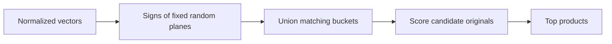

# Module 05 · Approximate nearest neighbors

> Choose a candidate budget and explain which true neighbors it loses.

**Time** 90 minutes · **Level** Intermediate · **Needs** Python 3.12, local CPU and the included catalog. Allow about 8 GB system RAM for the teaching environment. Install the library extra for the native comparison. Docker and online inference are unnecessary. 

**TinyVec and Marlowe Search version 1 + hash buckets.** Choose a candidate budget and explain which true neighbors it loses. [Measurements and raw evidence](results/README.md).

## Prerequisites

Complete [Module 04](../04_benchmarking/README.md). Run commands from the repository root. The [Tier 2 vocabulary](../TIER2_TERMS.md) defines terms used across these lessons. Install once with `uv sync --locked --extra libs`. Use `--extra embedded` for sqlite-vec and LanceDB, or `--extra hnswlib` for the optional compiled graph library. The [setup guide](../../docs/SETUP.md) includes the base environment instructions.

## Learning objectives

- Choose a candidate budget and explain which true neighbors it loses.
- Trace the candidate IDs through the diagram and identify where an eligible neighbor can be lost.
- Reproduce the measured experiment and distinguish the observed resource cost from an estimate.
- Explain the product decision in the use case using a specific result.

## The big idea

If a shop has ten products, looking at every one is cheap. At a million products, scoring every vector for each request consumes bandwidth even when the customer wants just ten results. An approximate nearest-neighbor index first proposes a smaller set of candidates. Exact scoring inside that set can correct its order. An item excluded from the set is already lost.

## How it works



Imagine drawing a line through the origin of a map. Each product is on one side or the other. A random hyperplane does this in many dimensions. Record the sign of its dot product with the product vector as one bit. Several planes form a bucket key. Nearby directions tend to agree on those signs. More bits narrow each bucket. More independent tables give a pair additional chances to collide. The union prevents an item from receiving extra credit for repeated collisions.

A k-d tree divides space with axis-aligned cuts. At high dimension many regions touch the search radius, so pruning saves little work. Graphs route through neighboring products, partitions share a representative center, and quantizers replace coordinates with shorter codes. Those choices change recall, search time, build time and memory in different ways.

## Build it yourself

Inspect the signs before packing them. Each table owns a different seeded set of planes. During lookup collect its matching bucket, then deduplicate across tables. The same planes must encode the query and catalog. Keep the exact scorer from Module 04 as your oracle. [TinyVec implementation](../../tinyvec/lsh.py) · [Scratch example](examples/01_from_scratch.py).

```sh
uv run python modules/05_ann_lsh/examples/01_from_scratch.py
```

## Now in a real database

FAISS IndexLSH encodes binary signatures and searches by Hamming distance, the number of differing bits. TinyVec uses collisions to avoid looking at most buckets. The two implementations therefore answer different candidate-generation questions even when both say LSH. [Native example](examples/02_production.py). 

```sh
uv run --extra libs python modules/05_ann_lsh/examples/02_production.py
```

## Walkthrough

Try two tables and then twelve. Count candidates before scoring and check how many of the exact top ten survived. An empty bucket is a legitimate outcome. Returning exact results behind the scenes would hide the miss you are trying to measure. Open [the notebook](notebook.ipynb), predict the outcome of its last code cell, then change one input and explain what changed. The notebook mirrors the scripts so you can compare each result with a terminal run.

## Measure it

```sh
uv run python modules/05_ann_lsh/examples/03_measure.py
uv run --extra libs python scripts/run_bench.py configs/bench/tier2/lsh.yaml --sweep configs/bench/tier2/sweeps/lsh.yaml
```

The first command isolates one lesson observation. The shared catalog benchmark warms up, repeats shuffled queries five times and scores against independently computed eligible neighbors. Compare query sets, k, hardware and embedding space before comparing QPS. [Module results](results/README.md) · [Benchmark methodology](../../results/README.md).

## When to use it, and when not to

Try hashing when the index is cheap to rebuild and you can tolerate misses. Prefer an exact scan for small catalogs or when an audit requires every duplicate above a threshold.

## Real-world use case

A catalog moderator wants possible duplicate listings. Query one listing, exclude its own ID and pass a shortlist to review. A missed neighbor cannot be recovered by the reviewer, so check coverage before choosing a low table count. [Run the use case](use_case/duplicate_candidates.py).

```sh
uv run python modules/05_ann_lsh/use_case/duplicate_candidates.py
```

## Common mistakes

- Using fresh planes per query changes bucket identity.
- Adding bits shrinks the bucket and may reduce recall.
- Adding tables spends both build time and memory.
- Equal hash codes do not establish duplicate identity.

## Exercises

### Practice · Signature bits

Return one Boolean per component, treating zero as nonnegative. For inputs `[[-1,0,2]]`, expect `[false,true,true]` (JSON notation). Start with the [starter](exercises/01_practice.py) and check your answer with this command. Compare with the [reference solution](solutions/01_practice.py) after trying it.

```sh
uv run python scripts/check_exercise.py modules/05_ann_lsh/exercises/01_practice.py
```

### Apply · Union candidate buckets

Union all buckets, remove duplicate rows, and return sorted IDs. For inputs `[[[3,2],[2,1]]]`, expect `[1,2,3]` (JSON notation). Start with the [starter](exercises/02_apply.py) and check your answer with this command. Compare with the [reference solution](solutions/02_apply.py) after trying it.

```sh
uv run python scripts/check_exercise.py modules/05_ann_lsh/exercises/02_apply.py
```

### Stretch · Measure candidate coverage

Return distinct recovered neighbors divided by distinct expected neighbors. Use None when there is no truth. For inputs `[[1,2],[1,1]]`, expect `0.5` (JSON notation). Start with the [starter](exercises/03_stretch.py) and check your answer with this command. Compare with the [reference solution](solutions/03_stretch.py) after trying it.

```sh
uv run python scripts/check_exercise.py modules/05_ann_lsh/exercises/03_stretch.py
```

## Quiz

1. Why does a collision help?

<details><summary>Answer</summary>

It proposes items on the same sides of several planes.

</details>

2. Why use several tables?

<details><summary>Answer</summary>

Independent signatures give a close pair another chance to collide.

</details>

3. What does doubling bits do?

<details><summary>Answer</summary>

It usually reduces bucket occupancy and may remove true neighbors.

</details>

4. When can reranking recover a miss?

<details><summary>Answer</summary>

Only when the missed item was still in the candidate set.

</details>

5. Why compare with exact search?

<details><summary>Answer</summary>

It supplies true nearest neighbors on the same inputs.

</details>

6. What does Hamming distance count?

<details><summary>Answer</summary>

Bit positions where two equal-length codes differ.

</details>

## Key takeaways

- Choose a candidate budget and explain which true neighbors it loses.
- It proposes items on the same sides of several planes.
- It usually reduces bucket occupancy and may remove true neighbors.
- Only when the missed item was still in the candidate set.
- Bit positions where two equal-length codes differ.

## Clean up

Examples use temporary directories for native stores and mappings. Stop Jupyter or the Playground with Ctrl+C. Diagnostic reports live under `.cache/marlowe/tier2`. To inspect course-owned cleanup paths, run `uv run python scripts/cleanup.py`. The measured evidence linked from this lesson is retained in the repository.

## Go deeper

Read the [primary reference](https://github.com/facebookresearch/faiss/wiki/Faiss-indexes) alongside the [recorded results](results/README.md). 

## Next: Module 06

Continue with [Inverted files and clustering](../06_ivf/README.md).
