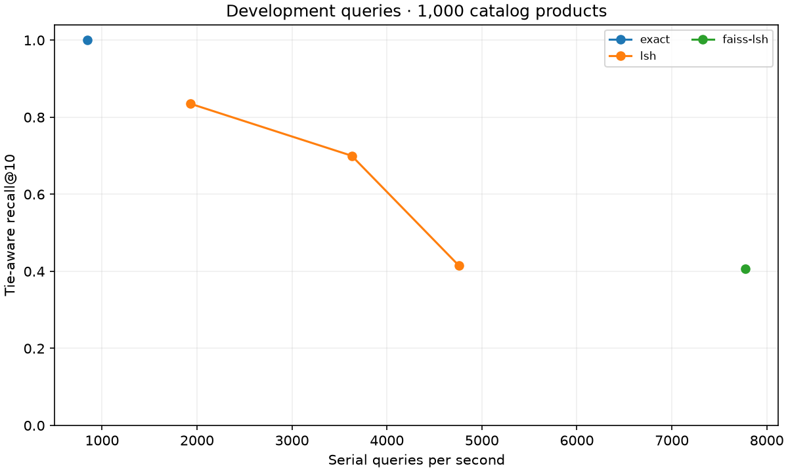

# 05_ann_lsh · measured results

Windows-11-10.0.26300-SP0, Python 3.12.13, Intel64 Family 6 Model 198 Stepping 2, GenuineIntel. The catalog benchmarks use stored MiniLM vectors, one numerical thread, and independently computed eligible neighbors.

| Family / raw held-out run | Recall@10 | nDCG@10 | p50 / p95 ms | Serial QPS ± SD | Index payload bytes |
|---|---:|---:|---:|---:|---:|
| [exact](../../../results/runs/tier2-exact-test-20261104T230422-f02515ab.json) | 1.000 | 0.732 | 1.197 / 1.718 | 790.1 ± 55.6 | — |
| [lsh](../../../results/runs/tier2-lsh-test-20261104T230938-8cb5fa48.json) | 0.544 | 0.672 | 0.285 / 0.776 | 3000.4 ± 813.3 | 117,031 |
| [faiss-lsh](../../../results/runs/tier2-faiss-lsh-test-20261104T230440-67ff2075.json) | 0.342 | 0.719 | 0.058 / 0.339 | 8822.1 ± 244.5 | 106,397 |

The plot uses development queries. The table uses the separate test split with parameters frozen after development. Each raw file identifies the query count, split, hardware, dependency versions, source hashes, warm-ups, repeated latencies, insertion/build time and sampled RSS. Native payloads use serialized index sizes. Scratch payloads count algorithm-specific data structures, excluding interpreter overhead and the retained original vectors. The saved snapshot contains records and the build recipe; reload rebuilds the index.

| Development run | Parameters | Recall@10 | Serial QPS |
|---|---|---:|---:|
| [exact](../../../results/runs/tier2-exact-20261104T230420-d5c337d7.json) | defaults | 1.000 | 847.0 |
| [lsh](../../../results/runs/tier2-lsh-000-20261104T230931-a71c3d1e.json) | bits=5, tables=2 | 0.415 | 4757.1 |
| [lsh](../../../results/runs/tier2-lsh-001-20261104T230933-81ac7442.json) | bits=5, tables=10 | 0.700 | 3628.8 |
| [lsh](../../../results/runs/tier2-lsh-002-20261104T230936-109bfe81.json) | bits=5, tables=20 | 0.835 | 1930.5 |
| [faiss-lsh](../../../results/runs/tier2-faiss-lsh-20261104T230439-643adfce.json) | bits=64 | 0.407 | 7776.4 |

[Raw lesson observation](lesson-05_ann_lsh-b398691b.json)

- For q000, {'tables': 1, 'bits': 6}: recall 0.00, index payload 10,849 bytes, median retrieval 0.024 ms.
- For q000, {'tables': 4, 'bits': 6}: recall 0.50, index payload 43,402 bytes, median retrieval 0.063 ms.
- For q000, {'tables': 12, 'bits': 6}: recall 0.50, index payload 130,195 bytes, median retrieval 0.211 ms.

[Central leaderboard](../../../results/leaderboard.md) · [Tier 2 checkpoint analysis](../../../checkpoints/tier2/results/README.md).
