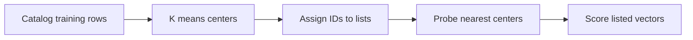

# Module 06 · Inverted files and clustering

> Train an inverted file and choose how many lists a query should visit.

**Time** 120 minutes · **Level** Intermediate · **Needs** Python 3.12, local CPU and the included catalog. Allow about 8 GB system RAM for the teaching environment. Install the library extra for the native comparison. Docker and online inference are unnecessary. 

**TinyVec and Marlowe Search version 2.** Train an inverted file and choose how many lists a query should visit. [Measurements and raw evidence](results/README.md).

## Prerequisites

Complete [Module 05](../05_ann_lsh/README.md). Run commands from the repository root. The [Tier 2 vocabulary](../TIER2_TERMS.md) defines terms used across these lessons. Install once with `uv sync --locked --extra libs`. Use `--extra embedded` for sqlite-vec and LanceDB, or `--extra hnswlib` for the optional compiled graph library. The [setup guide](../../docs/SETUP.md) includes the base environment instructions.

## Learning objectives

- Train an inverted file and choose how many lists a query should visit.
- Trace the candidate IDs through the diagram and identify where an eligible neighbor can be lost.
- Reproduce the measured experiment and distinguish the observed resource cost from an estimate.
- Explain the product decision in the use case using a specific result.

## The big idea

Picture a stockroom arranged by representative products. A query visits the most promising aisles first. An inverted file, or IVF, assigns each product to the nearest representative and stores a list of row IDs for that representative. A product just across an aisle boundary can still be an excellent match.

## How it works



K-means alternates two steps. Assign each vector to the closest center. Move each center to the average of its assigned vectors. TinyVec keeps the previous center when a cluster is empty and stops when centers barely move or its iteration budget runs out. The assignment used here minimizes squared Euclidean distance on normalized vectors. At query time it sorts center distances and scores original vectors from the selected lists.

The number of centers is nlist. The query budget is nprobe. Increasing nlist makes lists shorter but adds training and center comparisons. Increasing nprobe visits more lists. Probing all lists with full-vector scoring recovers the exact neighbors under the same normalization and tie policy.

## Build it yourself

Follow the centroid update in tinyvec/ivf.py. On paper assign 0, 1, 9, 10 to centers 0 and 10. The updated centers are 0.5 and 9.5. Now put a query near 5. Its nearest products can lie on opposite sides of the assignment boundary. [TinyVec implementation](../../tinyvec/ivf.py) · [Scratch example](examples/01_from_scratch.py).

```sh
uv run python modules/06_ivf/examples/01_from_scratch.py
```

## Now in a real database

FAISS IndexIVFFlat needs training before add. It uses a coarse quantizer to assign list IDs, then searches original vectors. A representative sample of catalog documents can train the index. Keep evaluation queries out of parameter selection until you have chosen a setting on development data. [Native example](examples/02_production.py). 

```sh
uv run --extra libs python modules/06_ivf/examples/02_production.py
```

## Walkthrough

Run the scratch script and inspect the unequal list sizes. Change nprobe from one to all eight. The larger candidate union covers every row; requesting a fixed k still returns only that many winners. Compare wall time as well as recall because scanning highly uneven lists costs different amounts. Open [the notebook](notebook.ipynb), predict the outcome of its last code cell, then change one input and explain what changed. The notebook mirrors the scripts so you can compare each result with a terminal run.

## Measure it

```sh
uv run python modules/06_ivf/examples/03_measure.py
uv run --extra libs python scripts/run_bench.py configs/bench/tier2/ivf.yaml --sweep configs/bench/tier2/sweeps/ivf.yaml
```

The first command isolates one lesson observation. The shared catalog benchmark warms up, repeats shuffled queries five times and scores against independently computed eligible neighbors. Compare query sets, k, hardware and embedding space before comparing QPS. [Module results](results/README.md) · [Benchmark methodology](../../results/README.md).

## When to use it, and when not to

Use this index when a representative training sample and fairly stable catalog are available. Recheck assignment quality after catalog drift. For tiny collections the bookkeeping can cost more than a scan.

## Real-world use case

Marlowe Search needs a probe budget for catalog retrieval. Find the lowest number of probes meeting a single saved-query target, then use the development sweep to see whether the choice survives other intents. [Run the use case](use_case/choose_probes.py).

```sh
uv run python modules/06_ivf/use_case/choose_probes.py
```

## Common mistakes

- Training on evaluation queries leaks information.
- A larger nlist can create nearly empty lists.
- One probe can miss a neighbor across a boundary.
- Matching QPS on different query sets cannot establish a winner.

## Exercises

### Practice · Assign to a centroid

Return the closest center's position. Resolve an equal distance with the first position. For inputs `[8,[1,9]]`, expect `1` (JSON notation). Start with the [starter](exercises/01_practice.py) and check your answer with this command. Compare with the [reference solution](solutions/01_practice.py) after trying it.

```sh
uv run python scripts/check_exercise.py modules/06_ivf/exercises/01_practice.py
```

### Apply · Gather probed lists

Union rows from just the probed lists and return sorted unique IDs. For inputs `[[[1,2],[3],[2,4]],[2,1]]`, expect `[2,3,4]` (JSON notation). Start with the [starter](exercises/02_apply.py) and check your answer with this command. Compare with the [reference solution](solutions/02_apply.py) after trying it.

```sh
uv run python scripts/check_exercise.py modules/06_ivf/exercises/02_apply.py
```

### Stretch · Choose a measured probe budget

Among runs meeting the recall floor, return the probe count with the highest QPS. Return None if none qualify. For inputs `[[[1,0.5,400],[4,0.9,220],[8,0.99,150]],0.9]`, expect `4` (JSON notation). Start with the [starter](exercises/03_stretch.py) and check your answer with this command. Compare with the [reference solution](solutions/03_stretch.py) after trying it.

```sh
uv run python scripts/check_exercise.py modules/06_ivf/exercises/03_stretch.py
```

## Quiz

1. What does a center represent?

<details><summary>Answer</summary>

A mean of the members of one cluster.

</details>

2. What does an inverted list contain?

<details><summary>Answer</summary>

IDs of rows assigned to a center.

</details>

3. Why can nprobe=1 miss?

<details><summary>Answer</summary>

The true neighbor can belong to another nearby center.

</details>

4. When does IVF become exhaustive?

<details><summary>Answer</summary>

When every list is probed and originals are scored.

</details>

5. Can all lists have equal cost?

<details><summary>Answer</summary>

Only if occupancy and scoring work are comparable.

</details>

6. Why freeze nprobe before the test?

<details><summary>Answer</summary>

Choosing it on the final queries would bias the estimate.

</details>

## Key takeaways

- Train an inverted file and choose how many lists a query should visit.
- A mean of the members of one cluster.
- The true neighbor can belong to another nearby center.
- When every list is probed and originals are scored.
- Choosing it on the final queries would bias the estimate.

## Clean up

Examples use temporary directories for native stores and mappings. Stop Jupyter or the Playground with Ctrl+C. Diagnostic reports live under `.cache/marlowe/tier2`. To inspect course-owned cleanup paths, run `uv run python scripts/cleanup.py`. The measured evidence linked from this lesson is retained in the repository.

## Go deeper

Read the [primary reference](https://github.com/facebookresearch/faiss/wiki/Faiss-indexes) alongside the [recorded results](results/README.md). 

## Next: Module 07

Continue with [Navigable graphs and HNSW](../07_hnsw/README.md).
