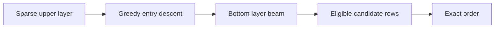

# Module 07 · Navigable graphs and HNSW

> Trace a graph search, tune its beams and keep retired products out of the results.

**Time** 150 minutes · **Level** Intermediate · **Needs** Python 3.12, local CPU and the included catalog. Allow about 8 GB system RAM for the teaching environment. Install the library extra for the native comparison. Docker and online inference are unnecessary. 

**TinyVec and Marlowe Search version 3.** Trace a graph search, tune its beams and keep retired products out of the results. [Measurements and raw evidence](results/README.md).

## Prerequisites

Complete [Module 06](../06_ivf/README.md). Run commands from the repository root. The [Tier 2 vocabulary](../TIER2_TERMS.md) defines terms used across these lessons. Install once with `uv sync --locked --extra libs`. Use `--extra embedded` for sqlite-vec and LanceDB, or `--extra hnswlib` for the optional compiled graph library. The [setup guide](../../docs/SETUP.md) includes the base environment instructions.

## Learning objectives

- Trace a graph search, tune its beams and keep retired products out of the results.
- Trace the candidate IDs through the diagram and identify where an eligible neighbor can be lost.
- Reproduce the measured experiment and distinguish the observed resource cost from an estimate.
- Explain the product decision in the use case using a specific result.

## The big idea

A product graph gives each item a few links. Follow a promising link to approach a query, then inspect alternatives nearby. Hierarchical navigable small worlds (HNSW) give a few items upper-layer links so a search can travel farther in fewer steps. Every item belongs to the bottom layer.

## How it works



Construction samples a level for each item, descends greedily through upper layers and explores a candidate beam on shared layers. M bounds outgoing links. efConstruction limits the candidates considered while inserting a node. efSearch sets the search beam at query time. A wider beam retains alternatives when the first route leads toward a local optimum.

TinyVec selects diverse neighbors and reserves two bounded links per layer for an insertion-order ring. You can reproduce the reason for this teaching choice in the earlier measurements. Keeping only the closest neighbors separated clusters of near-duplicates. The ring guarantees reachability, while a small query beam can still miss a reachable item. Native HNSW implementations use their own neighbor-selection and maintenance policies.

## Build it yourself

Open tinyvec/hnsw.py and trace the frontier heap and the current best heap separately. Only the frontier tells you where to go next. In the Playground select a node and compare its actual outgoing links on different layers. Node IDs identify catalog rows. Their positions in the drawing have no distance meaning. [TinyVec implementation](../../tinyvec/hnsw.py) · [Scratch example](examples/01_from_scratch.py).

```sh
uv run python modules/07_hnsw/examples/01_from_scratch.py
```

## Now in a real database

Compare FAISS IndexHNSWFlat, USearch and optional hnswlib on the same normalized vectors. The Python binding for hnswlib may need a C++ compiler. The native example uses an explicit seed and a single query thread. USearch also exposes removal; the retirement example checks the returned IDs after an actual deletion. [Native example](examples/02_production.py). [hnswlib](examples/04_hnswlib.py) · [deletions](examples/05_deletions.py)

```sh
uv run --extra libs python modules/07_hnsw/examples/02_production.py
```

## Walkthrough

Raise efSearch while holding M and efConstruction fixed. Then rebuild with a different M. The first experiment changes query work; the second changes graph topology and build memory. TinyVec deletes by invalidating its index and rebuilding on the next search. A tombstone, by contrast, can keep an old vertex navigable while suppressing it from results. Tombstones accumulate and eventually cost search work. Open [the notebook](notebook.ipynb), predict the outcome of its last code cell, then change one input and explain what changed. The notebook mirrors the scripts so you can compare each result with a terminal run.

## Measure it

```sh
uv run python modules/07_hnsw/examples/03_measure.py
uv run --extra libs python scripts/run_bench.py configs/bench/tier2/hnsw.yaml --sweep configs/bench/tier2/sweeps/hnsw.yaml
```

The first command isolates one lesson observation. The shared catalog benchmark warms up, repeats shuffled queries five times and scores against independently computed eligible neighbors. Compare query sets, k, hardware and embedding space before comparing QPS. [Module results](results/README.md) · [Benchmark methodology](../../results/README.md).

## When to use it, and when not to

Graph search suits repeated low-latency queries when the links fit in memory. Measure rebuild costs for rapidly changing catalogs. Logical adjacency bytes exclude interpreter objects, vectors and allocator overhead.

## Real-world use case

A seller withdraws the product that ranked first. Remove the listing, repeat the saved query and inspect the rebuilt graph. The withdrawn ID must disappear, while nearby products still need viable routes. [Run the use case](use_case/retire_product.py).

```sh
uv run python modules/07_hnsw/use_case/retire_product.py
```

## Common mistakes

- A connected graph can still miss under a small beam.
- Raising efSearch does not change stored edges.
- Deleting a bridge can disconnect surviving nodes.
- A 32-bit edge count understates process RSS.

## Exercises

### Practice · Greedy graph step

Choose the highest-scoring current node or neighbor. Break ties by smaller node ID. For inputs `[0,[1,2],[0.2,0.1,0.8]]`, expect `2` (JSON notation). Start with the [starter](exercises/01_practice.py) and check your answer with this command. Compare with the [reference solution](solutions/01_practice.py) after trying it.

```sh
uv run python scripts/check_exercise.py modules/07_hnsw/exercises/01_practice.py
```

### Apply · Eligible bridge traversal

Walk reachable links even through ineligible nodes. Return only eligible visited IDs, sorted. For inputs `[[[1],[2],[0],[]],0,[2,3]]`, expect `[2]` (JSON notation). Start with the [starter](exercises/02_apply.py) and check your answer with this command. Compare with the [reference solution](solutions/02_apply.py) after trying it.

```sh
uv run python scripts/check_exercise.py modules/07_hnsw/exercises/02_apply.py
```

### Stretch · Budget adjacency storage

Count one four-byte ID per stored node and per outgoing edge on every layer. For inputs `[[[[1,2],[0]],[[1]]]]`, expect `28` (JSON notation). Start with the [starter](exercises/03_stretch.py) and check your answer with this command. Compare with the [reference solution](solutions/03_stretch.py) after trying it.

```sh
uv run python scripts/check_exercise.py modules/07_hnsw/exercises/03_stretch.py
```

## Quiz

1. Who belongs to layer zero?

<details><summary>Answer</summary>

Every indexed item.

</details>

2. What does M bound?

<details><summary>Answer</summary>

Stored outgoing links per node per layer in this implementation.

</details>

3. Which setting requires rebuilding?

<details><summary>Answer</summary>

Changing M or efConstruction changes construction.

</details>

4. Why keep diverse neighbors?

<details><summary>Answer</summary>

They connect neighborhoods that redundant short links can miss.

</details>

5. Why retain a tombstone as a bridge?

<details><summary>Answer</summary>

Traversal can still reach live neighbors while results suppress the retired item.

</details>

6. Why measure RSS separately?

<details><summary>Answer</summary>

Python objects, vectors and native allocations add to graph link bytes.

</details>

## Key takeaways

- Trace a graph search, tune its beams and keep retired products out of the results.
- Every indexed item.
- Changing M or efConstruction changes construction.
- They connect neighborhoods that redundant short links can miss.
- Python objects, vectors and native allocations add to graph link bytes.

## Clean up

Examples use temporary directories for native stores and mappings. Stop Jupyter or the Playground with Ctrl+C. Diagnostic reports live under `.cache/marlowe/tier2`. To inspect course-owned cleanup paths, run `uv run python scripts/cleanup.py`. The measured evidence linked from this lesson is retained in the repository.

## Go deeper

Read the [primary reference](https://arxiv.org/abs/1603.09320) alongside the [recorded results](results/README.md). Compare [hnswlib API](https://github.com/nmslib/hnswlib) and [USearch API](https://github.com/unum-cloud/usearch).

## Next: Module 08

Continue with [Vector compression and rescoring](../08_quantization/README.md).
