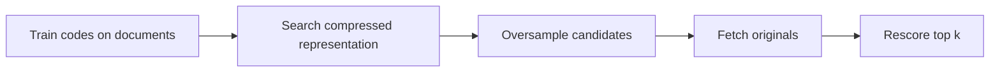

# Module 08 · Vector compression and rescoring

> Measure the recall you buy back when you rescore a longer compressed shortlist.

**Time** 150 minutes · **Level** Intermediate · **Needs** Python 3.12, local CPU and the included catalog. Allow about 8 GB system RAM for the teaching environment. Install the library extra for the native comparison. Docker and online inference are unnecessary. 

**TinyVec and Marlowe Search version 4.** Measure the recall you buy back when you rescore a longer compressed shortlist. [Measurements and raw evidence](results/README.md).

## Prerequisites

Complete [Module 07](../07_hnsw/README.md). Run commands from the repository root. The [Tier 2 vocabulary](../TIER2_TERMS.md) defines terms used across these lessons. Install once with `uv sync --locked --extra libs`. Use `--extra embedded` for sqlite-vec and LanceDB, or `--extra hnswlib` for the optional compiled graph library. The [setup guide](../../docs/SETUP.md) includes the base environment instructions.

## Learning objectives

- Measure the recall you buy back when you rescore a longer compressed shortlist.
- Trace the candidate IDs through the diagram and identify where an eligible neighbor can be lost.
- Reproduce the measured experiment and distinguish the observed resource cost from an estimate.
- Explain the product decision in the use case using a specific result.

## The big idea

Imagine replacing every color in a product photo with a small palette number. A code is cheap to store, but two colors can collapse to the same number. A vector quantizer does something similar to coordinates. The catalog can search smaller codes, fetch extra candidates and use original vectors for a more accurate final order.

## How it works



Scalar quantization gives each dimension a scale and rounds values to int8. Binary quantization packs the sign of each coordinate and ranks by differing bits. Product quantization (PQ) splits a vector into equal subvectors and learns a small codebook for each part. Each row stores one codeword address per part. The query remains in full precision. For each part, look up the dot product between its query slice and every codeword, then sum the entries named by that row's codes.

IVF-PQ first chooses coarse lists and encodes residuals relative to their centers. Misses can arise at either stage. A Matryoshka embedding model trains its prefixes to retain information. This course includes real 1024-dimensional Qwen catalog vectors. Slice and renormalize both query and documents at 512, 256, 64 and 32 dimensions. A top-ten change on one query illustrates loss and does not establish general relevance.

## Build it yourself

Reconstruct one product by concatenating its chosen codewords and compare that approximation with its original. The teaching PQ uses one whole byte per subspace even with 16 centroids. Native FAISS can pack smaller codes. Count the codebook as well as codes when a catalog is small. [TinyVec implementation](../../tinyvec/pq.py) · [Scratch example](examples/01_from_scratch.py).

```sh
uv run python modules/08_quantization/examples/01_from_scratch.py
```

## Now in a real database

Run FAISS scalar, PQ and IVF-PQ. The sqlite-vec example computes a native Hamming distance. Qdrant documents scalar, product and binary quantization as well as its supported low-bit variants. FAISS documents the RaBitQ family. Use those vendors' documentation for supported options; the measured experiments here cover the methods named in the result tables. [Native example](examples/02_production.py). [native codes](examples/04_native_codes.py) · [sqlite binary](examples/05_sqlite_binary.py)

```sh
uv run --extra libs python modules/08_quantization/examples/02_production.py
```

The [LanceDB prefix example](examples/06_lance_prefix.py) stores the 64-dimensional Qwen sample and verifies its nearest products against the NumPy reference.

## Walkthrough

Milvus documents IVF_RABITQ, which encodes residual angular information relative to coarse centers and optionally refines its shortlist. This is a different code from TinyVec’s packed coordinate signs. The database deployment and its performance evaluation belong to the later Milvus lesson. [Milvus IVF_RABITQ documentation](https://milvus.io/docs/ivf-rabitq.md).

For ten million 768-dimensional vectors, raw payload is 30.72 GB at float32, 15.36 GB at float16, 7.68 GB at int8 and 0.96 GB at one bit. Decimal GB divide by 1,000,000,000. At 96 bytes per PQ code, payload is also 0.96 GB before codebooks. Keeping float32 originals in RAM for rescoring adds 30.72 GB. Measure the actual payload on the smaller catalog and inspect peak RSS separately. Open [the notebook](notebook.ipynb), predict the outcome of its last code cell, then change one input and explain what changed. The notebook mirrors the scripts so you can compare each result with a terminal run.

## Measure it

```sh
uv run python modules/08_quantization/examples/03_measure.py
uv run --extra libs python scripts/run_bench.py configs/bench/tier2/pq.yaml --sweep configs/bench/tier2/sweeps/pq.yaml
```

The first command isolates one lesson observation. The shared catalog benchmark warms up, repeats shuffled queries five times and scores against independently computed eligible neighbors. Compare query sets, k, hardware and embedding space before comparing QPS. [Module results](results/README.md) · [Benchmark methodology](../../results/README.md).

## When to use it, and when not to

Compression helps when memory traffic or storage dominates. Exact rescoring helps only for candidates the first stage actually retrieved. For very small collections, codebooks and training may outweigh the savings.

## Real-world use case

Marlowe wants a shortlist index under 100,000 bytes. Compare the candidates that meet the budget by recall. Then add full-vector storage and decide whether those originals belong in RAM or on disk. [Run the use case](use_case/memory_budget.py).

```sh
uv run python modules/08_quantization/use_case/memory_budget.py
```

## Common mistakes

- Ignoring the codebook overstates savings.
- Truncating arbitrary MiniLM vectors is not a trained prefix experiment.
- Scoring unnormalized prefixes changes cosine rankings.
- Rescoring cannot recover a product outside the shortlist.

## Exercises

### Practice · Count packed bytes

Round each packed row up to whole bytes before multiplying by row count. For inputs `[3,10,1]`, expect `6` (JSON notation). Start with the [starter](exercises/01_practice.py) and check your answer with this command. Compare with the [reference solution](solutions/01_practice.py) after trying it.

```sh
uv run python scripts/check_exercise.py modules/08_quantization/exercises/01_practice.py
```

### Apply · Asymmetric lookup

For each subspace, read the score at its codeword address. Return their sum. For inputs `[[[1,5],[2,3]],[1,0]]`, expect `7` (JSON notation). Start with the [starter](exercises/02_apply.py) and check your answer with this command. Compare with the [reference solution](solutions/02_apply.py) after trying it.

```sh
uv run python scripts/check_exercise.py modules/08_quantization/exercises/02_apply.py
```

### Stretch · Rescore candidate IDs

Sort only distinct candidate IDs by their full scores, then by ID. Return at most k. For inputs `[[2,0],[0.9,0.99,0.4],1]`, expect `[0]` (JSON notation). Start with the [starter](exercises/03_stretch.py) and check your answer with this command. Compare with the [reference solution](solutions/03_stretch.py) after trying it.

```sh
uv run python scripts/check_exercise.py modules/08_quantization/exercises/03_stretch.py
```

## Quiz

1. What does an int8 scale encode?

<details><summary>Answer</summary>

The value of one integer step for a coordinate.

</details>

2. What does packed sign search discard?

<details><summary>Answer</summary>

Coordinate magnitude.

</details>

3. Why is PQ lookup asymmetric?

<details><summary>Answer</summary>

The query remains full precision and only catalog vectors use codes.

</details>

4. Which two stages can miss in IVF-PQ?

<details><summary>Answer</summary>

Coarse-list routing and compressed ranking.

</details>

5. What does oversampling buy?

<details><summary>Answer</summary>

More candidates for exact rescoring, at a higher cost.

</details>

6. How should a shortened cosine embedding be used?

<details><summary>Answer</summary>

Slice both sides to the same trained prefix, then renormalize.

</details>

## Key takeaways

- Measure the recall you buy back when you rescore a longer compressed shortlist.
- The value of one integer step for a coordinate.
- The query remains full precision and only catalog vectors use codes.
- Coarse-list routing and compressed ranking.
- Slice both sides to the same trained prefix, then renormalize.

## Clean up

Examples use temporary directories for native stores and mappings. Stop Jupyter or the Playground with Ctrl+C. Diagnostic reports live under `.cache/marlowe/tier2`. To inspect course-owned cleanup paths, run `uv run python scripts/cleanup.py`. The measured evidence linked from this lesson is retained in the repository.

## Go deeper

Read the [primary reference](https://github.com/facebookresearch/faiss/wiki/Faiss-indexes) alongside the [recorded results](results/README.md). See [Qwen model card](https://huggingface.co/Qwen/Qwen3-Embedding-0.6B), [Qdrant quantizers](https://qdrant.tech/documentation/manage-data/quantization/) and [FAISS index families](https://github.com/facebookresearch/faiss/wiki/Faiss-indexes).

## Next: Module 09

Continue with [Disk indexes and large catalogs](../09_disk_scale/README.md).
