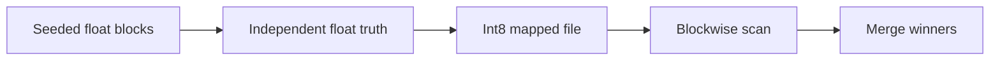

# Module 09 · Disk indexes and large catalogs

> Measure one million rows on disk, then separate measured costs from extrapolations.

**Time** 90 minutes · **Level** Intermediate · **Needs** Python 3.12, local CPU and the included catalog. Allow about 8 GB system RAM for the teaching environment. Install the library extra for the native comparison. Docker and online inference are unnecessary. Allow another 32 MB of temporary disk space for the default million-row experiment.

**TinyVec and Marlowe Search version 4 · disk experiment.** Measure one million rows on disk, then separate measured costs from extrapolations. [Measurements and raw evidence](results/README.md).

## Prerequisites

Complete [Module 08](../08_quantization/README.md). Run commands from the repository root. The [Tier 2 vocabulary](../TIER2_TERMS.md) defines terms used across these lessons. Install once with `uv sync --locked --extra libs`. Use `--extra embedded` for sqlite-vec and LanceDB, or `--extra hnswlib` for the optional compiled graph library. The [setup guide](../../docs/SETUP.md) includes the base environment instructions.

## Learning objectives

- Measure one million rows on disk, then separate measured costs from extrapolations.
- Trace the candidate IDs through the diagram and identify where an eligible neighbor can be lost.
- Reproduce the measured experiment and distinguish the observed resource cost from an estimate.
- Explain the product decision in the use case using a specific result.

## The big idea

A library catalog can stay on shelves while a reader brings only a few pages to a desk. Memory mapping lets an operating system bring file pages into memory on demand. It changes where bytes live. A mapped sequential scan still reads every code needed by its query.

## How it works



Generate independent unit vectors in bounded blocks. Quantize each coordinate to signed int8 and write it to a mapped file. During generation compute float top-ten neighbors for five independently generated queries. Flush, close and reopen the file, then scan one block at a time and merge its winners into a global top ten. The partial last block is a useful correctness case.

DiskANN uses a graph such as Vamana with pruning that retains useful routes. An SSD search can visit a batch of neighbors with asynchronous reads and keep compact routing information in RAM. Random I/O, page layout, cache warmth and read amplification matter. A memory-mapped linear scan demonstrates bounded access and quantization; it follows a different access pattern from Vamana.

## Build it yourself

Use merge_best in tinyvec/mmap.py. Exact top-k within each block is sufficient because a row outside its block's top k already has k better rows. Stable row IDs settle ties. The float truth comes from the same unrounded generated vectors before encoding. [TinyVec implementation](../../tinyvec/mmap.py) · [Scratch example](examples/01_from_scratch.py).

```sh
uv run python modules/09_disk_scale/examples/01_from_scratch.py
```

## Now in a real database

The USearch example saves a real graph, reopens it in view mode and verifies that the same query returns the same IDs. LanceDB's Lance format stores columnar fragments and indexes and can read local files or objects. On object storage, many tiny random requests can dominate latency. Group frequently read fields and measure bytes fetched per result. [Native example](examples/02_production.py). 

```sh
uv run --extra libs python modules/09_disk_scale/examples/02_production.py
```

The [page reader](examples/04_page_reads.py) follows actual on-disk adjacency records with a 40-read budget, then models two object fragment sizes over those same reads.

## Walkthrough

Run the million-row command and inspect file bytes, peak RSS, five recalls and per-query durations. A 32-dimensional int8 matrix has 32 MB of code payload per million rows before the file header. At ten million rows payload becomes 320 MB under the same assumptions. Query time depends on caching and bandwidth and needs fresh measurements. The operating system controls page residency; a reopened file can still be warm. Open [the notebook](notebook.ipynb), predict the outcome of its last code cell, then change one input and explain what changed. The notebook mirrors the scripts so you can compare each result with a terminal run.

## Measure it

```sh
uv run python modules/09_disk_scale/examples/03_measure.py
uv run python scripts/measure_disk_scale.py --rows 1000000
```

Use the five independent queries to inspect quantization errors as well as elapsed time. The generator includes float-reference computation in its build timing. [Module results](results/README.md) · [Benchmark methodology](../../results/README.md).

## When to use it, and when not to

Use mapped data when the full collection cannot stay in application memory. A cold object store request and a warm local SSD access have different costs. Keep platform, hardware, cache state and bytes read alongside timing.

## Real-world use case

Partition a regional catalog into eight balanced shards. A strict region predicate may route to one shard, while a global query needs all shards and a top-k merge. A replicated product ID should appear once after merging. Compare this predictable routing with randomly probing storage pages. [Run the use case](use_case/shard_budget.py).

```sh
uv run python modules/09_disk_scale/use_case/shard_budget.py
```

## Common mistakes

- A file header adds to raw code bytes.
- Memory mapping alone does not build a graph.
- Reopening a file does not evict OS pages.
- A payload estimate cannot predict SSD latency.

## Exercises

### Practice · Bound each scan block

Return half-open block ranges covering every row once, including the final short block. For inputs `[9,4]`, expect `[[0,4],[4,8],[8,9]]` (JSON notation). Start with the [starter](exercises/01_practice.py) and check your answer with this command. Compare with the [reference solution](solutions/01_practice.py) after trying it.

```sh
uv run python scripts/check_exercise.py modules/09_disk_scale/exercises/01_practice.py
```

### Apply · Count touched pages

Count unique pages touched by a byte interval, including intervals crossing a page boundary. For inputs `[4095,2,4096]`, expect `2` (JSON notation). Start with the [starter](exercises/02_apply.py) and check your answer with this command. Compare with the [reference solution](solutions/02_apply.py) after trying it.

```sh
uv run python scripts/check_exercise.py modules/09_disk_scale/exercises/02_apply.py
```

### Stretch · Merge shard winners

Merge shard results by descending score, keeping the best score per ID and breaking ties by ID. For inputs `[[[[1,0.5],[2,0.2]],[[1,0.6],[3,0.9]]],2]`, expect `[3,1]` (JSON notation). Start with the [starter](exercises/03_stretch.py) and check your answer with this command. Compare with the [reference solution](solutions/03_stretch.py) after trying it.

```sh
uv run python scripts/check_exercise.py modules/09_disk_scale/exercises/03_stretch.py
```

## Quiz

1. Why stream generation?

<details><summary>Answer</summary>

To bound temporary float allocations.

</details>

2. Why compute truth before rounding?

<details><summary>Answer</summary>

To measure what the compressed representation loses.

</details>

3. What is read amplification?

<details><summary>Answer</summary>

Bytes fetched divided by bytes actually useful to the query.

</details>

4. Why keep k winners per block?

<details><summary>Answer</summary>

A discarded row already has k better rows in that block.

</details>

5. What is a shard?

<details><summary>Answer</summary>

An independently searched partition of the collection.

</details>

6. Which figures can be extrapolated directly?

<details><summary>Answer</summary>

Fixed-width payload with a known row count and dimension.

</details>

## Key takeaways

- Measure one million rows on disk, then separate measured costs from extrapolations.
- To bound temporary float allocations.
- Bytes fetched divided by bytes actually useful to the query.
- A discarded row already has k better rows in that block.
- Fixed-width payload with a known row count and dimension.

## Clean up

Examples use temporary directories for native stores and mappings. Stop Jupyter or the Playground with Ctrl+C. Diagnostic reports live under `.cache/marlowe/tier2`. To inspect course-owned cleanup paths, run `uv run python scripts/cleanup.py`. The measured evidence linked from this lesson is retained in the repository.

## Go deeper

Read the [primary reference](https://www.microsoft.com/en-us/research/publication/diskann-fast-accurate-billion-point-nearest-neighbor-search-on-a-single-node/) alongside the [recorded results](results/README.md). Compare [Lance format](https://lance.org/) and [USearch views](https://github.com/unum-cloud/usearch).

## Next: Module 10

Continue with [Filtered, hybrid and multi-vector retrieval](../10_filtering_hybrid/README.md).
