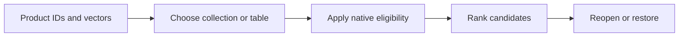

# Module 11: Embedded databases

> After this module you can choose between an embedded vector collection and an analytical SQL table, then restore its search results.

**Time:** ~150 minutes · **Level:** Intermediate · **Needs:** 8 GB RAM, about 2 GB disk for the environment, no Docker. **Downloads:** initial package and container installation need network access. The core workload uses the included product and query vectors. 

**TinyVec v5 and Marlowe Search v1.** The catalog now runs through a native database. [Measured results](results/README.md).

## Prerequisites

Complete [Module 10](../10_filtering_hybrid/README.md) and the [Tier 2 checkpoint](../../checkpoints/tier2/README.md). Run all commands from the repository root. Use the [database terminology table](../../docs/TERMS_ACROSS_DATABASES.md) for new terms and the [setup guide](../../docs/SETUP.md) for port and connection settings.

The embedded examples run in the Python process. Prepare optional VSS with `uv run --extra embedded python scripts/prepare_duckdb_vss.py`.

## Learning objectives

- Choose between an embedded vector collection and an analytical SQL table, then restore its search results.
- Trace a product ID through a native write, query and restore.
- Measure eligible-neighbor recall, judged relevance and p95 retrieval latency.
- Explain which operational requirement would change your database choice.

## The big idea

Imagine a shopkeeper who keeps the catalog beside the till. One application can open the catalog file, search it and update it. An embedded database works this way: the library runs inside your process, so a second service is unnecessary. The file still has a format, a schema and rules about who can write. A nearby copy of an open file can be an inconsistent backup.

## How it works



Chroma stores IDs, vectors, documents and metadata in a collection. Give it explicit vectors and the same embedding space on every query. LanceDB stores a typed Arrow table with a fixed-width vector field. A write creates a new table version. A full-text index can supply lexical candidates while an IVF-PQ index supplies dense candidates. SQLite-vec adds distance functions and vector tables to SQLite. DuckDB can scan fixed-size arrays with SQL or build an HNSW index using its separately installed VSS extension.

## Build it yourself

Save TinyVec before deleting a winning product. Compare the result IDs before deletion with those from a fresh store loaded from the snapshot. This checks that storage preserves both identity and ranking. Follow the three lines that save the records, mutate the live store and load the backup. If you only search the original object twice, you have tested neither persistence nor recovery. Start with the [scratch example](examples/01_from_scratch.py). Predict its result, change one input, then explain why the output changed.

## Now in a real database

The Chroma script closes and reopens a persistent client, filters on a changed region and deletes the item. The LanceDB script deletes a region, checks out an earlier version, restores it and builds both full-text and IVF-PQ indexes. SQLite binds vectors as binary float values. DuckDB declares the dimension in its SQL type. Its VSS extension is optional and the lesson reports whether it ran. Prepare it explicitly with the command below. For portable predicates the comparison computes eligible IDs from session metadata and supplies them to the native query before taking k. The native scripts also exercise field filters directly. Logical snapshots read rows back from the database before writing a portable snapshot. Native backups are marked separately.


## Walkthrough

| Example | Run | Expected observation |
|---|---|---|
| [01_from_scratch](examples/01_from_scratch.py) | `uv run python modules/11_embedded/examples/01_from_scratch.py` | same IDs after restore |
| [02_production](examples/02_production.py) | `uv run --extra embedded python modules/11_embedded/examples/02_production.py` | Chroma reopened IDs and updated region |
| [03_measure](examples/03_measure.py) | `uv run --extra embedded python modules/11_embedded/examples/03_measure.py` | reproducible local benchmark |
| [04_lancedb](examples/04_lancedb.py) | `uv run --extra embedded python modules/11_embedded/examples/04_lancedb.py` | restored version, IVF-PQ and northern hybrid IDs |
| [05_sqlite_vec](examples/05_sqlite_vec.py) | `uv run --extra embedded python modules/11_embedded/examples/05_sqlite_vec.py` | five SQLite distances |
| [06_duckdb](examples/06_duckdb.py) | `uv run --extra embedded python modules/11_embedded/examples/06_duckdb.py` | exact SQL and optional HNSW scan |

The [notebook](notebook.ipynb) mirrors the example scripts. Its server cells check `MARLOWE_NOTEBOOK_PROFILES`. Set that environment variable to a comma-separated list of running profiles before starting Jupyter. Standalone scripts use the indicated local service directly.

## Measure it

Run `uv run --extra embedded python modules/11_embedded/examples/03_measure.py` for the shorter lesson experiment. For the common workload use `uv run --extra embedded python scripts/checkpoint_tier3.py --backends chroma`. The published comparison uses 500 products, 50 held-out queries, k=10, twenty warm-ups and five repetitions. Compare with the matched exact SQLite or DuckDB row. Tier 2’s 1,000-product experiments have different inputs. [Module results and figures](results/README.md) · [Central leaderboard](../../results/leaderboard.md).

## When to use it, and when not to

Choose embedded storage for local tools, single-user catalogs or reproducible analysis. Choose the database whose data model fits the job: a SQL join, historical columnar versions or a vector collection can be decisive. Reassess when several independent processes need concurrent writes, remote access or centralized access controls.

## Real-world use case

A catalog editor retires the top mug-warmer result and needs yesterday’s search for an audit. Export three embedded databases, mutate them and restore each into a different collection. Verify that all five original product IDs return in the same order. [Use-case script](use_case/catalog_recovery.py).

```sh
uv run --extra embedded python modules/11_embedded/use_case/catalog_recovery.py
```

## Common mistakes

- A new model with the same dimension can silently return meaningless neighbors. Check the embedding-space ID.
- An empty Chroma result after an update can mean the filter still uses the old value. Read the record by ID before changing k.
- A Lance checkout is a historical view. Restore the version explicitly before writing again.
- If DuckDB reports a missing VSS extension, prepare the signed matching binary or run the exact array example.

## Exercises

### Practice · Keep the newest record for each ID

Apply updates in arrival order. Return the final value for each stable ID. For inputs `[[["a",1],["a",2],["b",3]]]`, expect `{"a":2,"b":3}`. Edit the [starter](exercises/01_practice.py), run its check and compare with the [solution](solutions/01_practice.py).

```sh
uv run python scripts/check_exercise.py modules/11_embedded/exercises/01_practice.py
```

### Apply · Check a reopened collection's identity

Require the same dimensions, embedding space and metric before mixing collections. For inputs `[{"dim":3,"space":"a","metric":"cosine"},{"dim":3,"space":"b","metric":"cosine"}]`, expect `false`. Edit the [starter](exercises/02_apply.py), run its check and compare with the [solution](solutions/02_apply.py).

```sh
uv run python scripts/check_exercise.py modules/11_embedded/exercises/02_apply.py
```

### Stretch · Detect lost or changed rows after restore

Return sorted IDs for missing, unexpected or changed rows. For inputs `[{"a":1,"b":2},{"b":3,"c":4}]`, expect `["a","b","c"]`. Edit the [starter](exercises/03_stretch.py), run its check and compare with the [solution](solutions/03_stretch.py).

```sh
uv run python scripts/check_exercise.py modules/11_embedded/exercises/03_stretch.py
```

## Quiz

1. Where does an embedded engine execute?

<details><summary>Answer</summary>

Inside the calling process.

</details>

2. What fixes Lance vector dimensions?

<details><summary>Answer</summary>

Its Arrow field declares a fixed-size list.

</details>

3. What must survive a logical export?

<details><summary>Answer</summary>

IDs, vectors, metadata, text and the collection’s embedding-space contract.

</details>

4. Why bind SQL values?

<details><summary>Answer</summary>

Binding preserves value types and separates values from SQL syntax.

</details>

5. What does a Lance version preserve?

<details><summary>Answer</summary>

A readable historical table state until retention or cleanup removes its files.

</details>

6. Why publish DuckDB exact and VSS separately?

<details><summary>Answer</summary>

A scalar array scan and an approximate graph have different execution plans.

</details>

## Key takeaways

- Inside the calling process.
- Its Arrow field declares a fixed-size list.
- IDs, vectors, metadata, text and the collection’s embedding-space contract.
- A readable historical table state until retention or cleanup removes its files.
- A scalar array scan and an approximate graph have different execution plans.

## Clean up

Stop Jupyter or the Playground with Ctrl+C. The example collections are private to the run and are dropped at the end. Preview course-owned data with `uv run python scripts/cleanup.py` before using its removal option. 

## Go deeper

Compare the [primary documentation](https://docs.trychroma.com/reference/python) with the [recorded results](results/README.md). See also [LanceDB](https://docs.lancedb.com/), [sqlite-vec](https://alexgarcia.xyz/sqlite-vec/) and [DuckDB VSS](https://duckdb.org/docs/stable/core_extensions/vss.html).

## Next: Module 12

Continue to [pgvector inside PostgreSQL](../12_pgvector/README.md).
