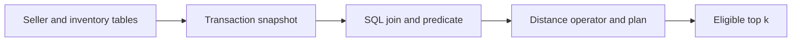

# Module 12: pgvector inside PostgreSQL

> After this module you can combine product vectors with seller joins, transactions and eligibility rules in SQL.

**Time:** ~180 minutes · **Level:** Intermediate · **Needs:** 16 GB system RAM recommended, about 2 GB free disk, Docker profile pgvector. **Downloads:** initial package and container installation need network access. The core workload uses the included product and query vectors. 

**TinyVec v5 and Marlowe Search v1.** The catalog now runs through a native database. [Measured results](results/README.md).

## Prerequisites

Complete [Module 11](../11_embedded/README.md) and the [Tier 2 checkpoint](../../checkpoints/tier2/README.md). Run all commands from the repository root. Use the [database terminology table](../../docs/TERMS_ACROSS_DATABASES.md) for new terms and the [setup guide](../../docs/SETUP.md) for port and connection settings.

Start the local profile with `docker compose -f docker/compose.yaml --profile pgvector up -d`. Check it with `docker compose -f docker/compose.yaml --profile pgvector ps`. Allow the service to become ready before connecting the client.

## Learning objectives

- Combine product vectors with seller joins, transactions and eligibility rules in SQL.
- Trace a product ID through a native write, query and restore.
- Measure eligible-neighbor recall, judged relevance and p95 retrieval latency.
- Explain which operational requirement would change your database choice.

## The big idea

The checkout system already knows which sellers are active and which products are in stock. Moving those facts to another service may give search a stale view. PostgreSQL can store a product vector in the same row as its price and join that row to the seller table in a single transaction.

## How it works



A full vector stores float coordinates. Halfvec stores lower-precision coordinates, and bit data represents binary decisions. The operator must match the index: <=> is cosine distance, <-> Euclidean distance, <#> negative inner product and <~> Hamming distance for bits. PostgreSQL orders distance ascending. The portable adapter reports 1 minus cosine distance. HNSW and IVFFlat use different access paths; an SQL planner may still choose an exact scan for a small table.

## Build it yourself

The scratch query builds a set of allowed seller IDs, filters products by membership and price, then ranks only those rows. Trace the difference between eligible positions and their original row IDs. If you pick five global neighbors before the join, you can discard a nearby eligible product. Start with the [scratch example](examples/01_from_scratch.py). Predict its result, change one input, then explain why the output changed.

## Now in a real database

The native example creates two temporary tables, joins them and compares full-vector, half-vector and binary distances. A savepoint lets the transaction roll back a deletion. An HNSW index can visit candidates before a strict SQL filter is applied; iterative scans can continue work when too few rows survive. Use SET LOCAL hnsw.iterative_scan = 'strict_order' inside a transaction and inspect EXPLAIN before attributing an observed result to the graph. For portable predicates the comparison computes eligible IDs from session metadata and supplies them to the native query before taking k. The native scripts also exercise field filters directly. Logical snapshots read rows back from the database before writing a portable snapshot. Native backups are marked separately.

The [PostgreSQL archive drill](../../docker/init/pg_restore_drill.sh) uses pg_dump and pg_restore in two disposable databases. Commands for Windows and Unix are in the [setup guide](../../docs/SETUP.md).

## Walkthrough

| Example | Run | Expected observation |
|---|---|---|
| [01_from_scratch](examples/01_from_scratch.py) | `uv run python modules/12_pgvector/examples/01_from_scratch.py` | eligible joined product |
| [02_production](examples/02_production.py) | `uv run --extra pgvector python modules/12_pgvector/examples/02_production.py` | SQL join, halfvec, Hamming distance and rollback |
| [03_measure](examples/03_measure.py) | `uv run --extra pgvector python modules/12_pgvector/examples/03_measure.py` | flat / HNSW / IVFFlat timings |
| [04_hybrid_sql](examples/04_hybrid_sql.py) | `uv run --extra pgvector python modules/12_pgvector/examples/04_hybrid_sql.py` | ranked SKU hits |
| [05_pgvectorscale](examples/05_pgvectorscale.py) | `uv run --extra pgvector python modules/12_pgvector/examples/05_pgvectorscale.py` | optional extension discovery |

The [notebook](notebook.ipynb) mirrors the example scripts. Its server cells check `MARLOWE_NOTEBOOK_PROFILES`. Set that environment variable to a comma-separated list of running profiles before starting Jupyter. Standalone scripts use the indicated local service directly.

## Measure it

Run `uv run --extra pgvector python modules/12_pgvector/examples/03_measure.py` for the shorter lesson experiment. For the common workload use `uv run --extra pgvector python scripts/checkpoint_tier3.py --backends pgvector`. The published comparison uses 500 products, 50 held-out queries, k=10, twenty warm-ups and five repetitions. Compare with the matched exact SQLite or DuckDB row. Tier 2’s 1,000-product experiments have different inputs. [Module results and figures](results/README.md) · [Central leaderboard](../../results/leaderboard.md).

## When to use it, and when not to

PostgreSQL is a strong candidate when vector search participates in the same constraints, permissions or transaction as the catalog. Measure planner choices and index maintenance under your actual filter selectivity. A dedicated service can be worth evaluating when index or throughput requirements dominate those relational benefits.

## Real-world use case

A shopper wants a replacement in the north, under $35 and available now. Apply the region, price and stock clauses before returning results. The audited IDs and prices show exactly what a buyer could order at that snapshot. [Use-case script](use_case/regional_inventory.py).

```sh
uv run --extra pgvector python modules/12_pgvector/use_case/regional_inventory.py
```

## Common mistakes

- An unexpected sequence scan can be the correct small-table plan. Inspect EXPLAIN and then increase representative data.
- Ordering cosine distance descending returns far neighbors. Use ascending distance or convert to similarity.
- With strict filters, an ANN scan may underfill k. Test iterative scans and an exact filtered reference.
- A file copy during writes can be inconsistent. Test a pg_dump archive by restoring it into another database.

## Exercises

### Practice · Join eligible seller IDs before limiting

Filter by seller, sort by decreasing score then ID, and only then take k rows. For inputs `[[["x","other",1],["b","s",0.9],["a","s",0.9]],["s"],1]`, expect `["a"]`. Edit the [starter](exercises/01_practice.py), run its check and compare with the [solution](solutions/01_practice.py).

```sh
uv run python scripts/check_exercise.py modules/12_pgvector/exercises/01_practice.py
```

### Apply · Choose a metric-matched SQL distance operator

Return the pgvector distance operator for cosine, negative inner product, L2 or Hamming. For inputs `["cosine"]`, expect `"<=>"`. Edit the [starter](exercises/02_apply.py), run its check and compare with the [solution](solutions/02_apply.py).

```sh
uv run python scripts/check_exercise.py modules/12_pgvector/exercises/02_apply.py
```

### Stretch · Recover a transaction at its savepoint

Return the changed state on commit, and the unmodified saved state on rollback. For inputs `[{"a":1},{"a":2,"b":3},false]`, expect `{"a":1}`. Edit the [starter](exercises/03_stretch.py), run its check and compare with the [solution](solutions/03_stretch.py).

```sh
uv run python scripts/check_exercise.py modules/12_pgvector/exercises/03_stretch.py
```

## Quiz

1. What does a savepoint allow?

<details><summary>Answer</summary>

Undo part of a transaction without discarding the entire transaction.

</details>

2. Which operator orders cosine neighbors?

<details><summary>Answer</summary>

<=>, with ascending distance.

</details>

3. Why is inner product negative in <#>?

<details><summary>Answer</summary>

The index access path orders ascending values.

</details>

4. What can iterative scanning recover?

<details><summary>Answer</summary>

Additional eligible candidates after a post-index condition removes early hits.

</details>

5. Why compare lexical and dense ranks?

<details><summary>Answer</summary>

SKU spelling and semantic intent provide different evidence.

</details>

6. What does an extension listing prove?

<details><summary>Answer</summary>

It establishes availability or installation, not that an index was built or used.

</details>

## Key takeaways

- Undo part of a transaction without discarding the entire transaction.
- <=>, with ascending distance.
- The index access path orders ascending values.
- SKU spelling and semantic intent provide different evidence.
- It establishes availability or installation, not that an index was built or used.

## Clean up

Stop the service with `docker compose -f docker/compose.yaml --profile pgvector down`. Named volumes retain data for the next session. Preview course-owned data with `uv run python scripts/cleanup.py` before using its removal option. 

## Go deeper

Compare the [primary documentation](https://github.com/pgvector/pgvector) with the [recorded results](results/README.md). 

## Next: Module 13

Continue to [Qdrant collections, payloads and hybrid queries](../13_qdrant/README.md).
