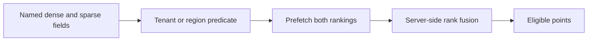

# Module 13: Qdrant collections, payloads and hybrid queries

> After this module you can search named dense and sparse vectors while preserving a seller’s eligibility constraint.

**Time:** ~150 minutes · **Level:** Intermediate · **Needs:** 16 GB system RAM recommended, about 2 GB free disk, Docker profile qdrant. **Downloads:** initial package and container installation need network access. The core workload uses the included product and query vectors. 

**TinyVec v5 and Marlowe Search v1.** The catalog now runs through a native database. [Measured results](results/README.md).

## Prerequisites

Complete [Module 12](../12_pgvector/README.md) and the [Tier 2 checkpoint](../../checkpoints/tier2/README.md). Run all commands from the repository root. Use the [database terminology table](../../docs/TERMS_ACROSS_DATABASES.md) for new terms and the [setup guide](../../docs/SETUP.md) for port and connection settings.

Start the local profile with `docker compose -f docker/compose.yaml --profile qdrant up -d`. Check it with `docker compose -f docker/compose.yaml --profile qdrant ps`. Allow the service to become ready before connecting the client.

## Learning objectives

- Search named dense and sparse vectors while preserving a seller’s eligibility constraint.
- Trace a product ID through a native write, query and restore.
- Measure eligible-neighbor recall, judged relevance and p95 retrieval latency.
- Explain which operational requirement would change your database choice.

## The big idea

Think of a product listing as an address with several catalogs attached. One catalog describes meaning, another indexes exact terms, and the address carries facts such as seller and region. Qdrant calls the addressed item a point, its descriptive fields a payload and the enclosing group a collection.

## How it works



A collection declares vector names, dimensions and distance functions. A dense field represents meaning. A sparse field stores only present terms and weights. The lesson hashes term counts deterministically for the sparse branch. A payload index helps select eligible points. The Query API can prefetch from multiple named fields and fuse their rank positions. A multivector field instead keeps multiple vectors per item and uses MaxSim to score separate query-token matches.

## Build it yourself

Build a posting list for region=north and combine it with a price range. Check that the same IDs pass a full predicate scan. The application must derive the tenant condition from a trusted context, then apply it to every prefetch branch; a form field alone cannot authorize a tenant. Start with the [scratch example](examples/01_from_scratch.py). Predict its result, change one input, then explain why the output changed.

## Now in a real database

The native example creates an indexed payload field, configures int8 quantization and requests rescoring on original vectors. The hybrid example fuses named dense and sparse rankings and separately stores two vectors for one point. The recovery example downloads a native collection snapshot, uploads it into a new collection and compares its nearest IDs. For portable predicates the comparison computes eligible IDs from session metadata and supplies them to the native query before taking k. The native scripts also exercise field filters directly. Logical snapshots read rows back from the database before writing a portable snapshot. Native backups are marked separately.


## Walkthrough

| Example | Run | Expected observation |
|---|---|---|
| [01_from_scratch](examples/01_from_scratch.py) | `uv run python modules/13_qdrant/examples/01_from_scratch.py` | north-region row IDs |
| [02_production](examples/02_production.py) | `uv run --extra qdrant python modules/13_qdrant/examples/02_production.py` | native payload index and quantized search |
| [03_measure](examples/03_measure.py) | `uv run --extra qdrant python modules/13_qdrant/examples/03_measure.py` | filtered and keyword query sweep |
| [04_hybrid_multivector](examples/04_hybrid_multivector.py) | `uv run --extra qdrant python modules/13_qdrant/examples/04_hybrid_multivector.py` | named-vector fusion and MaxSim |
| [05_snapshots_tenants](examples/05_snapshots_tenants.py) | `uv run --extra qdrant python modules/13_qdrant/examples/05_snapshots_tenants.py` | restored native snapshot IDs |

The [notebook](notebook.ipynb) mirrors the example scripts. Its server cells check `MARLOWE_NOTEBOOK_PROFILES`. Set that environment variable to a comma-separated list of running profiles before starting Jupyter. Standalone scripts use the indicated local service directly.

## Measure it

Run `uv run --extra qdrant python modules/13_qdrant/examples/03_measure.py` for the shorter lesson experiment. For the common workload use `uv run --extra qdrant python scripts/checkpoint_tier3.py --backends qdrant`. The published comparison uses 500 products, 50 held-out queries, k=10, twenty warm-ups and five repetitions. Compare with the matched exact SQLite or DuckDB row. Tier 2’s 1,000-product experiments have different inputs. [Module results and figures](results/README.md) · [Central leaderboard](../../results/leaderboard.md).

## When to use it, and when not to

Consider Qdrant when payload-selective search and multiple vector representations are central. Measure how often filters leave fewer than k eligible points. Snapshot files, membership rules and payload indexing have operational costs beyond query time.

## Real-world use case

Two sellers may use similar descriptions or equivalent product codes. Search the first seller’s assortment while supplying a SKU from the other seller. Assert that both retrieval branches respect the seller and record exactly which IDs passed. [Use-case script](use_case/seller_isolation.py).

```sh
uv run --extra qdrant python modules/13_qdrant/use_case/seller_isolation.py
```

## Common mistakes

- An unnamed query against a named collection can fail. Set using to the actual field name.
- A sparse payload is a list of indexes and weights, not a zero-padded dense vector. Keep indexes sorted with aligned values.
- Filtering only the final list can suppress good eligible matches. Put the restriction in each prefetch as well.
- A snapshot creation response alone proves little. Restore into another collection and repeat the query.

## Exercises

### Practice · Build a region payload posting

Return sorted distinct IDs from the requested region. For inputs `[[["c","south"],["b","north"],["a","north"]],"north"]`, expect `["a","b"]`. Edit the [starter](exercises/01_practice.py), run its check and compare with the [solution](solutions/01_practice.py).

```sh
uv run python scripts/check_exercise.py modules/13_qdrant/exercises/01_practice.py
```

### Apply · Apply a tenant filter to every prefetch

Remove forbidden IDs from every dense or sparse ranking without changing order. For inputs `[[["a","b"],["b","c"]],["a","c"]]`, expect `[["a"],["c"]]`. Edit the [starter](exercises/02_apply.py), run its check and compare with the [solution](solutions/02_apply.py).

```sh
uv run python scripts/check_exercise.py modules/13_qdrant/exercises/02_apply.py
```

### Stretch · Compare multi-vector similarity

Each query token selects its own best document-token score, then contributes it to the sum. For inputs `[[[1,0],[0,1]]]`, expect `2`. Edit the [starter](exercises/03_stretch.py), run its check and compare with the [solution](solutions/03_stretch.py).

```sh
uv run python scripts/check_exercise.py modules/13_qdrant/exercises/03_stretch.py
```

## Quiz

1. What is a point?

<details><summary>Answer</summary>

An ID with one or more vector representations and optional payload.

</details>

2. Why index region?

<details><summary>Answer</summary>

The database can locate eligible points without inspecting every payload.

</details>

3. How does RRF combine branches?

<details><summary>Answer</summary>

It awards each result a contribution determined by rank.

</details>

4. Where should a tenant predicate be applied?

<details><summary>Answer</summary>

In the trusted request and each retrieval branch.

</details>

5. What does scalar rescoring require?

<details><summary>Answer</summary>

Access to the original vectors for shortlisted points.

</details>

6. What does the native snapshot drill verify?

<details><summary>Answer</summary>

A different collection restores the same ranked IDs.

</details>

## Key takeaways

- An ID with one or more vector representations and optional payload.
- The database can locate eligible points without inspecting every payload.
- It awards each result a contribution determined by rank.
- Access to the original vectors for shortlisted points.
- A different collection restores the same ranked IDs.

## Clean up

Stop the service with `docker compose -f docker/compose.yaml --profile qdrant down`. Named volumes retain data for the next session. Preview course-owned data with `uv run python scripts/cleanup.py` before using its removal option. 

## Go deeper

Compare the [primary documentation](https://qdrant.tech/documentation/concepts/collections/) with the [recorded results](results/README.md). 

## Next: Module 14

Continue to [Weaviate collections and hybrid weighting](../14_weaviate/README.md).
