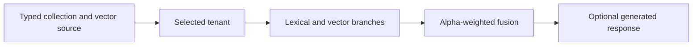

# Module 14: Weaviate collections and hybrid weighting

> After this module you can choose a hybrid weight, isolate tenants and restore a collection from a native backup.

**Time:** ~120 minutes · **Level:** Intermediate · **Needs:** 16 GB system RAM recommended, about 2 GB free disk for the base server, Docker profile weaviate. **Downloads:** initial package and container installation need network access. The core workload uses the included product and query vectors. Optional generation also needs an Ollama image and about 522 MB for the local Qwen model.

**TinyVec v5 and Marlowe Search v1.** The catalog now runs through a native database. [Measured results](results/README.md).

## Prerequisites

Complete [Module 13](../13_qdrant/README.md) and the [Tier 2 checkpoint](../../checkpoints/tier2/README.md). Run all commands from the repository root. Use the [database terminology table](../../docs/TERMS_ACROSS_DATABASES.md) for new terms and the [setup guide](../../docs/SETUP.md) for port and connection settings.

Start the local profile with `docker compose -f docker/compose.yaml --profile weaviate up -d`. Check it with `docker compose -f docker/compose.yaml --profile weaviate ps`. Allow the service to become ready before connecting the client.

## Learning objectives

- Choose a hybrid weight, isolate tenants and restore a collection from a native backup.
- Trace a product ID through a native write, query and restore.
- Measure eligible-neighbor recall, judged relevance and p95 retrieval latency.
- Explain which operational requirement would change your database choice.

## The big idea

An exact SKU can be decisive even when its title barely resembles the query. A paraphrase can be semantically useful without sharing any particular term. Weaviate exposes a hybrid weight, alpha, that lets the application balance those sources of evidence.

## How it works



With self-provided vectors, the application owns the embedding model, revision and query preprocessing. A configured vectorizer instead turns selected properties into vectors through its provider. Weaviate’s v4 client creates collections, declares property types and sends data and searches via the local HTTP and gRPC endpoints. In hybrid search alpha=0 emphasizes the lexical branch and alpha=1 the vector branch. Equal weighting can change the winning object after score normalization.

## Build it yourself

Normalize two short score lists independently, then multiply the dense score by alpha and the lexical score by 1-alpha. Keep a constant-score branch at zero to avoid division by zero. This small calculation predicts a ranking reversal and illustrates the weighting intuition. The native database computes its own scores on real documents. Start with the [scratch example](examples/01_from_scratch.py). Predict its result, change one input, then explain why the output changed.

## Now in a real database

The native client uses self-provided vectors and an HNSW index. It creates two tenants and intentionally reuses the same UUID with different text. A filesystem backup is restored after the disposable source collection is removed. The optional generative example sends a retrieved title to a local Ollama model. Retrieval and generation remain separate steps; check the returned wording against the source title. For portable predicates the comparison computes eligible IDs from session metadata and supplies them to the native query before taking k. The native scripts also exercise field filters directly. Logical snapshots read rows back from the database before writing a portable snapshot. Native backups are marked separately.

For generation, start `docker compose -f docker/compose.yaml --profile weaviate-generation up -d`. Run `docker compose -f docker/compose.yaml exec ollama ollama pull qwen3:0.6b`, then `docker compose -f docker/compose.yaml exec ollama ollama create marlowe-caption -f /course/Modelfile`. The caption preset limits context, output and CPU threads. Compare the generated wording with the retrieved title.

## Walkthrough

| Example | Run | Expected observation |
|---|---|---|
| [01_from_scratch](examples/01_from_scratch.py) | `uv run python modules/14_weaviate/examples/01_from_scratch.py` | different alpha winners |
| [02_production](examples/02_production.py) | `uv run --extra weaviate python modules/14_weaviate/examples/02_production.py` | native near-vector filter and alpha sweep |
| [03_measure](examples/03_measure.py) | `uv run --extra weaviate python modules/14_weaviate/examples/03_measure.py` | judged hybrid workloads |
| [04_tenants_generation](examples/04_tenants_generation.py) | `uv run --extra weaviate python modules/14_weaviate/examples/04_tenants_generation.py` | tenant-specific titles |
| [05_backup](examples/05_backup.py) | `uv run --extra weaviate python modules/14_weaviate/examples/05_backup.py` | filesystem backup and restored IDs |
| [06_local_generation](examples/06_local_generation.py) | `uv run --extra weaviate python modules/14_weaviate/examples/06_local_generation.py` | optional generated title |

The [notebook](notebook.ipynb) mirrors the example scripts. Its server cells check `MARLOWE_NOTEBOOK_PROFILES`. Set that environment variable to a comma-separated list of running profiles before starting Jupyter. Standalone scripts use the indicated local service directly.

## Measure it

Run `uv run --extra weaviate python modules/14_weaviate/examples/03_measure.py` for the shorter lesson experiment. For the common workload use `uv run --extra weaviate python scripts/checkpoint_tier3.py --backends weaviate`. The published comparison uses 500 products, 50 held-out queries, k=10, twenty warm-ups and five repetitions. Compare with the matched exact SQLite or DuckDB row. Tier 2’s 1,000-product experiments have different inputs. [Module results and figures](results/README.md) · [Central leaderboard](../../results/leaderboard.md).

## When to use it, and when not to

Use a collection with tenants when the product needs explicit resource separation, and measure hybrid alpha with representative intents. Use self-provided vectors when their revision must match other systems. A configured generative provider adds model startup time and a separate resource budget.

## Real-world use case

A shopper alternates between a SKU and a phrase. Repeat both requests at alpha 0, 0.5 and 1. Record changed IDs before choosing a default. The exercise makes the decision inspectable even when aggregate latency is similar. [Use-case script](use_case/sku_or_meaning.py).

```sh
uv run --extra weaviate python modules/14_weaviate/use_case/sku_or_meaning.py
```

## Common mistakes

- HTTP readiness with a blocked gRPC port can still break the v4 client. Expose both local ports.
- Missing tenant context can reject a request or select the wrong resource. Obtain the tenant-bound collection handle first.
- Combining raw lexical and cosine scores directly changes units. Compare rank or normalized scores.
- A timeout on local generation can be model startup or excessive output. Use the short caption preset and a measured timeout.

## Exercises

### Practice · Mix two normalized scores

Combine normalized scores using alpha as the dense weight. For inputs `[1,0,0.75]`, expect `0.75`. Edit the [starter](exercises/01_practice.py), run its check and compare with the [solution](solutions/01_practice.py).

```sh
uv run python scripts/check_exercise.py modules/14_weaviate/exercises/01_practice.py
```

### Apply · Separate tenant objects with repeated IDs

Return only the selected tenant's ID-to-value mapping. For inputs `[[["north","1","mug"],["south","1","chair"]],"north"]`, expect `{"1":"mug"}`. Edit the [starter](exercises/02_apply.py), run its check and compare with the [solution](solutions/02_apply.py).

```sh
uv run python scripts/check_exercise.py modules/14_weaviate/exercises/02_apply.py
```

### Stretch · Decide whether generation can run

Require both the configured generative module and a reachable local model endpoint. For inputs `[["text2vec-ollama"],true]`, expect `false`. Edit the [starter](exercises/03_stretch.py), run its check and compare with the [solution](solutions/03_stretch.py).

```sh
uv run python scripts/check_exercise.py modules/14_weaviate/exercises/03_stretch.py
```

## Quiz

1. Who owns the embedding space in self-provided mode?

<details><summary>Answer</summary>

The application that embeds documents and queries.

</details>

2. What does alpha=0 emphasize?

<details><summary>Answer</summary>

Lexical matching.

</details>

3. Why reuse the same UUID in two tenants?

<details><summary>Answer</summary>

It demonstrates that tenant context changes object identity.

</details>

4. What restores the data after deleting the collection?

<details><summary>Answer</summary>

The completed filesystem backup, restored under its original collection name.

</details>

5. Does a generative module replace retrieval?

<details><summary>Answer</summary>

No. It receives the retrieved fields and a prompt.

</details>

6. Why examine multiple query types?

<details><summary>Answer</summary>

A SKU and a paraphrase can favor opposite weights.

</details>

## Key takeaways

- The application that embeds documents and queries.
- Lexical matching.
- It demonstrates that tenant context changes object identity.
- No. It receives the retrieved fields and a prompt.
- A SKU and a paraphrase can favor opposite weights.

## Clean up

Stop the service with `docker compose -f docker/compose.yaml --profile weaviate down`. Named volumes retain data for the next session. Preview course-owned data with `uv run python scripts/cleanup.py` before using its removal option. Stop the optional provider with `docker compose -f docker/compose.yaml --profile weaviate-generation down`.

## Go deeper

Compare the [primary documentation](https://docs.weaviate.io/weaviate/client-libraries/python) with the [recorded results](results/README.md). 

## Next: Module 15

Continue to [Milvus schemas, indexes and consistency](../15_milvus/README.md).
