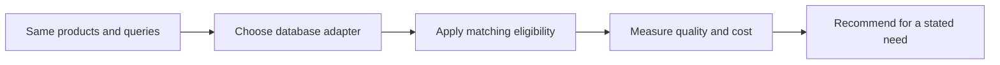

# Module 16: The wider database landscape

> After this module you can make a database recommendation from matched measurements and operating requirements.

**Time:** ~90 minutes · **Level:** Intermediate · **Needs:** 16 GB system RAM recommended, allow roughly 10 GB free disk across the optional images, run one profile at a time. **Downloads:** initial package and container installation need network access. The core workload uses the included product and query vectors. 

**TinyVec v5 and Marlowe Search v1.** The catalog now runs through a native database. [Measured results](results/README.md).

## Prerequisites

Complete [Module 15](../15_milvus/README.md) and the [Tier 2 checkpoint](../../checkpoints/tier2/README.md). Run all commands from the repository root. Use the [database terminology table](../../docs/TERMS_ACROSS_DATABASES.md) for new terms and the [setup guide](../../docs/SETUP.md) for port and connection settings.

Start the local profile with `docker compose -f docker/compose.yaml --profile redis up -d`. Check it with `docker compose -f docker/compose.yaml --profile redis ps`. For each landscape example substitute its profile name. Deploy the Vespa schema with `uv run python scripts/deploy_vespa_schema.py` when its config server is ready.

## Learning objectives

- Make a database recommendation from matched measurements and operating requirements.
- Trace a product ID through a native write, query and restore.
- Measure eligible-neighbor recall, judged relevance and p95 retrieval latency.
- Explain which operational requirement would change your database choice.

## The big idea

A leaderboard can make a slower service look fast by changing the question. One vendor may measure cached requests with many clients while another measures a single request with an eligibility filter. Before judging the engines, check whether they did the same work and returned equally useful results.

## How it works



Elasticsearch puts a dense vector beside searchable text. Redis Search indexes vector fields in hashes or JSON and can combine tag constraints with KNN. Atlas Local builds a vector search index separately from the transactional collection, so the application must check search visibility. Vespa deploys an application schema, tensor type and ranking expression together. FAISS provides a library; building a service around it adds request handling, storage, synchronization and recovery.

## Build it yourself

Compare two workload descriptions field by field. The sample changes concurrency and the recall target. A faster number from that run cannot answer which engine meets the original requirement. Repeat this check on the dataset hashes, query hashes and hardware IDs in the reference checkpoint. Start with the [scratch example](examples/01_from_scratch.py). Predict its result, change one input, then explain why the output changed.

## Now in a real database

The native scripts issue a keyword query and vector query in Elasticsearch and Redis, wait for Atlas Local's index, read a Vespa document and compare native tensor scores. A FastAPI app exposes FAISS through HTTP and saves a recoverable snapshot. The loopback experiment includes serialization and transport in its measured time. The managed-cost worksheet uses hypothetical prices so every learner can run it without an account. For portable predicates the comparison computes eligible IDs from session metadata and supplies them to the native query before taking k. The native scripts also exercise field filters directly. Logical snapshots read rows back from the database before writing a portable snapshot. Native backups are marked separately.

The [managed service worksheet](../../docs/MANAGED_DATABASES.md) lists pricing units, free-plan boundaries and teardown steps. Its cost exercise runs locally.

## Walkthrough

| Example | Run | Expected observation |
|---|---|---|
| [01_from_scratch](examples/01_from_scratch.py) | `uv run python modules/16_landscape/examples/01_from_scratch.py` | two workload mismatches |
| [02_production](examples/02_production.py) | `uv run --extra apps --extra libs python modules/16_landscape/examples/02_production.py` | FAISS API lifecycle |
| [03_measure](examples/03_measure.py) | `uv run --extra embedded python modules/16_landscape/examples/03_measure.py` | two matched embedded databases |
| [04_elasticsearch](examples/04_elasticsearch.py) | `uv run --extra landscape python modules/16_landscape/examples/04_elasticsearch.py` | Elasticsearch dense and text hits |
| [05_redis](examples/05_redis.py) | `uv run --extra landscape python modules/16_landscape/examples/05_redis.py` | Redis tag and KNN |
| [06_mongodb](examples/06_mongodb.py) | `uv run --extra landscape python modules/16_landscape/examples/06_mongodb.py` | Atlas Local queryable index |
| [07_vespa](examples/07_vespa.py) | `uv run --extra landscape python modules/16_landscape/examples/07_vespa.py` | Vespa tensor score |
| [08_faiss_service](examples/08_faiss_service.py) | `uv run --extra apps --extra libs python modules/16_landscape/examples/08_faiss_service.py` | loopback HTTP timings |
| [09_managed_cost](examples/09_managed_cost.py) | `uv run python modules/16_landscape/examples/09_managed_cost.py` | hypothetical cost floor |

The [notebook](notebook.ipynb) mirrors the example scripts. Its server cells check `MARLOWE_NOTEBOOK_PROFILES`. Set that environment variable to a comma-separated list of running profiles before starting Jupyter. Standalone scripts use the indicated local service directly.

## Measure it

Run `uv run --extra embedded python modules/16_landscape/examples/03_measure.py` for the shorter lesson experiment. For the common workload use `uv run --extra landscape python scripts/checkpoint_tier3.py --backends redis`. The published comparison uses 500 products, 50 held-out queries, k=10, twenty warm-ups and five repetitions. Compare with the matched exact SQLite or DuckDB row. Tier 2’s 1,000-product experiments have different inputs. [Module results and figures](results/README.md) · [Central leaderboard](../../results/leaderboard.md).

## When to use it, and when not to

Start from the application’s constraints: a relational transaction, a document query, a search index, a ranking expression or an existing operational stack. Then compare engines meeting the same quality floor and latency budget. Storage minimums, replication and idle capacity can dominate a managed-service bill even at low traffic.

## Real-world use case

A team wants recall at least 0.95 and p95 at most 20 ms for the published catalog workload. The script reads measured reports, checks their workload identities and lists qualifying systems. A choice among them needs an explicit operational reason, such as already maintaining PostgreSQL or needing offline embedded storage. [Use-case script](use_case/select_a_database.py).

```sh
uv run python modules/16_landscape/use_case/select_a_database.py
```

## Common mistakes

- An index reporting ready can still lag recent Atlas writes. Wait for the current revision to enter search.
- A Vespa tensor dimension must match the deployed schema. Normalize and pad only within the documented 384 dimensions.
- A library call excludes HTTP overhead. Measure the loopback service separately.
- A trial with a billing minimum can cost money. Complete the managed comparison locally unless an explicitly free plan is available.

## Exercises

### Practice · Find workload mismatches

Return sorted names of changed or missing workload controls. For inputs `[{"k":10,"threads":1},{"k":5,"threads":1}]`, expect `["k"]`. Edit the [starter](exercises/01_practice.py), run its check and compare with the [solution](solutions/01_practice.py).

```sh
uv run python scripts/check_exercise.py modules/16_landscape/exercises/01_practice.py
```

### Apply · Apply a recall and latency budget

Return engines meeting both the recall floor and p95 ceiling. For inputs `[[["A",0.9,7],["B",0.85,1],["C",1,10]],0.9,8]`, expect `["A"]`. Edit the [starter](exercises/02_apply.py), run its check and compare with the [solution](solutions/02_apply.py).

```sh
uv run python scripts/check_exercise.py modules/16_landscape/exercises/02_apply.py
```

### Stretch · Estimate read and storage cost

Compute storage GiB-months plus read units at supplied hypothetical prices. Return the total. For inputs `[2,3,4,5,2]`, expect `34`. Edit the [starter](exercises/03_stretch.py), run its check and compare with the [solution](solutions/03_stretch.py).

```sh
uv run python scripts/check_exercise.py modules/16_landscape/exercises/03_stretch.py
```

## Quiz

1. Which controls should match in a performance comparison?

<details><summary>Answer</summary>

Dataset, query split, metric, k, concurrency, quality target and hardware.

</details>

2. Why wait after a MongoDB write?

<details><summary>Answer</summary>

Search index visibility can lag the primary collection.

</details>

3. What defines Vespa’s score?

<details><summary>Answer</summary>

The deployed ranking profile and its tensor expression.

</details>

4. What does a FAISS service add?

<details><summary>Answer</summary>

A request boundary, validation, durability policy and concurrency ownership.

</details>

5. What can invalidate a managed cost estimate?

<details><summary>Answer</summary>

A minimum charge, extra replicas, egress or different billed query units.

</details>

6. Why keep raw results?

<details><summary>Answer</summary>

They identify the actual workload and let another reader reproduce the recommendation.

</details>

## Key takeaways

- Dataset, query split, metric, k, concurrency, quality target and hardware.
- Search index visibility can lag the primary collection.
- The deployed ranking profile and its tensor expression.
- A minimum charge, extra replicas, egress or different billed query units.
- They identify the actual workload and let another reader reproduce the recommendation.

## Clean up

Stop the service with `docker compose -f docker/compose.yaml --profile redis down`. Substitute the database profile you started. Named volumes retain data for the next session. Preview course-owned data with `uv run python scripts/cleanup.py` before using its removal option. 

## Go deeper

Compare the [primary documentation](https://docs.vespa.ai/en/querying/nearest-neighbor-search-guide.html) with the [recorded results](results/README.md). 

## Next: Module 17 after the checkpoint

Complete the [Tier 3 checkpoint](../../checkpoints/tier3/README.md) before moving on to the applications tier.
