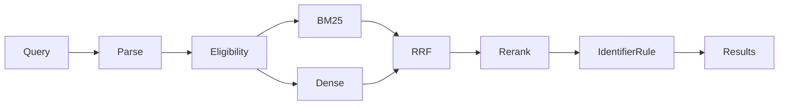

# Module 17: Semantic and hybrid product search

> After this module you can parse supported price, stock and region constraints with explicit boundaries.

**Time:** ~180 min · **Level:** Intermediate · **Needs:** 8 GB RAM for frozen-vector examples, 16 GB recommended for one live model · **Docker:** No for local databases; local Ollama for generation · **Downloads:** included vector fixtures; optional MiniLM ~91 MB, reranker ~91 MB, Qwen embeddings ~1.19 GB, SigLIP ~1.50 GB, Ollama Qwen ~523 MB. Load large models individually.

**Marlowe Search v2:** Semantic and hybrid product search. [Measured results and limitations](results/README.md).

## Prerequisites

Complete [Module 16](../16_landscape/README.md) and understand the [Tier 3 database contract](../../common/README.md). Read [application setup](../../docs/TIER4_APPLICATIONS.md). Included real-model artifacts support the default examples without downloads. Native examples require `uv sync --extra qdrant`. Custom inputs need the relevant cached model. Open [the cleared notebook](notebook.ipynb) to explore the same scripts interactively.

## Learning objectives

- Parse supported price, stock and region constraints with explicit boundaries.
- Fuse eligible lexical and semantic candidates, then rerank a bounded set.
- Compare typo and multilingual performance by query family.
- Protect exact identifiers and explain where an English reranker fails.

## The big idea

A shopper might describe a purpose, type a catalog number, or ask for something under a budget. Those are different kinds of evidence. Think of a shop assistant who first checks what can be sold, then finds candidates, then orders the shelf. A price limit is a rule. A description is a clue. An exact SKU is an identifier. Keep those roles separate so a beautifully matched item cannot escape the customer's budget.

## How it works



`parse_query` recognizes a deliberately small English grammar and returns the remaining text, typed clauses and warnings. Strict 'under' becomes `<`; 'at most' becomes `<=`. Both BM25 and vector retrieval apply the same eligibility. Reciprocal rank fusion assigns each branch a vote of `1/(60+rank)`. A cross encoder reads query and candidate text together. It can reorder only retrieved candidates. A final exact-SKU rule preserves a literal identifier regardless of the model's score. Spelling correction changes only the lexical branch and is shown to the user. Qwen replaces both document and query embeddings in a separate 500-product comparison space.

## Build it yourself

Read `01_from_scratch.py` from top to bottom. The parser returns a data object rather than modifying the caller's text. `parse_filter` validates it. The two `matches` calls differ only at the $100 boundary. The final ambiguous query produces a warning rather than an invented boolean expression. In `common/apps/product_search.py`, follow `eligible`, both candidate branches, `fuse`, the bounded reranking call, and the stable identifier promotion in that order.

## Now in a real database

The production example runs the official Qdrant client's local engine. Application BM25/RRF is compared with native Qdrant Query API sparse-count/dense fusion. These lexical scorers differ, so matching their scores is not an acceptance condition. Local mode is a real database client implementation but does not exercise server HNSW, networking or distributed behavior. For a server choose `--backend qdrant` in the checkpoint after starting its Tier 3 profile.

## Walkthrough

### Inspect typed constraints

```text
uv run python modules/17_product_search/examples/01_from_scratch.py
```

Expected: `three clauses, strict boundary false`. [Read the script](examples/01_from_scratch.py).

### Compare application and native hybrid search

```text
uv run --extra qdrant python modules/17_product_search/examples/02_production.py
```

Expected: `eligible mug-warmer results`. [Read the script](examples/02_production.py).

### Compare dense, lexical and hybrid SKU ranks

```text
uv run python modules/17_product_search/examples/03_measure.py
```

Expected: `IDs, nDCG10 and retrieval timings`. [Read the script](examples/03_measure.py).

### Score candidate pairs using the cached model

```text
uv run --extra models python modules/17_product_search/examples/04_reranking.py
```

Expected: `literal SKU remains first`. [Read the script](examples/04_reranking.py).

### Compare English and multilingual spaces

```text
uv run python modules/17_product_search/examples/05_multilingual.py
```

Expected: `MiniLM and Qwen held-out nDCG`. [Read the script](examples/05_multilingual.py).

## Measure it

[Results](results/README.md) link immutable run JSON, hardware, exact model revisions and a comparison plot. Run `uv run --extra qdrant python scripts/checkpoint_tier4.py --backend qdrant-local --part search` to reproduce this part. Add `--rerank` for the cached cross encoder or `--generate` for a running local Ollama where relevant.

Keep development and test families separate. The retrieval benchmark records warmups and repeated held-out requests. Model and application diagnostics have their own timing scopes and sample counts; do not mix them into an ANN database leaderboard. A tiny synthetic corpus can expose implementation errors but cannot establish production quality.

## When to use it, and when not to

Use this implementation to understand the decision, reproduce the saved evidence, and experiment with one policy at a time. Move to a representative, independently judged dataset before making business claims. Frozen queries make an offline demonstration repeatable; they do not support arbitrary new text without inference. The checkpoint's local database session is disposable and its data is recreated from source artifacts.

## Real-world use case

Marlowe Search v2 takes a shopper's sentence, displays the applied filters and spelling suggestions, and returns eligible products. The shared service backs both the API and the UI. A real marketplace would gather consented judgments and test query categories separately before replacing a ranking policy.

```text
uv run python modules/17_product_search/use_case/marlowe.py
uv run --extra apps streamlit run playground/marlowe.py
```

Expected: actual retrieved products or policy passages from the integrated service. [Use-case script](use_case/marlowe.py).

## Common mistakes

- **An expensive item leaks into the result.** Apply eligibility before truncation in both branches.
- **A correct SKU falls after reranking.** Use an explicit identifier rule after model scoring.
- **Spanish queries score poorly.** Use a multilingual encoder for both documents and queries; do not mix spaces.
- **An ambiguous sentence silently filters out items.** Display parser warnings and provide explicit filter controls.
- **A reranker appears better on every query.** Keep candidate recall and per-type relevance visible; the recorded initial SKU failure is retained.

## Exercises

- **Practice: preserve strict price boundaries:** Return eligible IDs in input order. Under is strict, at most is inclusive. Missing prices are excluded. [Starter](exercises/01_practice.py) · [Solution](solutions/01_practice.py)
- **Apply: filter both hybrid branches:** Remove IDs outside the eligible set from every ranking before returning the first k fused IDs. Use reciprocal rank fusion with constant 60. [Starter](exercises/02_apply.py) · [Solution](solutions/02_apply.py)
- **Stretch: protect identifiers after reranking:** Move an exact case-insensitive SKU match to the front without changing other ranks. Do not insert ineligible IDs. [Starter](exercises/03_stretch.py) · [Solution](solutions/03_stretch.py)

Starters run with a simpler policy. Acceptance checks intentionally demand more. Run a starter directly, then run `uv run python scripts/check_exercise.py modules/17_product_search/exercises/01_practice.py`. Substitute the other exercise name as needed. The same tests pass for reference solutions. Use `--smoke` to check only that a starter executes.

## Quiz

<details>
<summary>1. Why is price not a similarity feature?</summary>

A hard maximum requires a boolean comparison, including a precise boundary.

</details>

<details>
<summary>2. Why filter both branches?</summary>

An ineligible lexical candidate can otherwise re-enter through fusion.

</details>

<details>
<summary>3. Can reranking increase candidate recall?</summary>

No. It only reorders the candidates it receives.

</details>

<details>
<summary>4. Does typo correction change saved dense vectors?</summary>

No. This lesson corrects the lexical branch only.

</details>

<details>
<summary>5. Can a Qwen query search MiniLM documents?</summary>

No. Both sides must use the same declared space.

</details>

<details>
<summary>6. Why retain the initial reranking failure?</summary>

It demonstrates that model scores can harm exact identifier retrieval and justifies the general SKU policy.

</details>

## Key takeaways

- Eligibility is a hard constraint.
- Ranks can be fused without pretending raw scores are calibrated.
- A cross encoder cannot recover missing candidates.
- Exact identifiers need a business rule.
- Model language coverage must be measured on a matched corpus.

## Clean up

Each example closes its owned database session. In the UI, select **Release application data**. Stop a course Ollama profile with `docker compose -f docker/compose.yaml --profile weaviate-generation stop ollama` if you started it. For the native Ollama app, `ollama stop qwen3:0.6b` unloads the model. Run `uv run python scripts/cleanup.py` to inspect owned caches before choosing what to remove. Included artifacts and shared model caches are not automatic deletion targets.

## Go deeper

- [Retrieve and rerank](https://sbert.net/examples/sentence_transformer/applications/retrieve_rerank/README.html)
- [Qwen embedding model](https://huggingface.co/Qwen/Qwen3-Embedding-0.6B)
- [Qdrant hybrid queries](https://qdrant.tech/documentation/search/hybrid-queries/)

## Next: Module 18

Continue to [Module 18](../18_rag/README.md).
