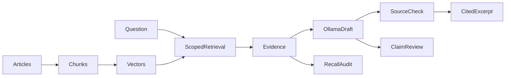

# Module 18: RAG with a vector database

> After this module you can chunk help articles without losing source passage identity.

**Time:** ~210 min · **Level:** Intermediate · **Needs:** 8 GB RAM for frozen-vector examples, 16 GB recommended for one live model · **Docker:** No for local databases; local Ollama for generation · **Downloads:** included vector fixtures; optional MiniLM ~91 MB, reranker ~91 MB, Qwen embeddings ~1.19 GB, SigLIP ~1.50 GB, Ollama Qwen ~523 MB. Load large models individually.

**Marlowe Search v3:** RAG with a vector database. [Measured results and limitations](results/README.md).

## Prerequisites

Complete [Module 17](../17_product_search/README.md) and understand the [Tier 3 database contract](../../common/README.md). Read [application setup](../../docs/TIER4_APPLICATIONS.md). Included real-model artifacts support the default examples without downloads. Native examples require `uv sync --extra qdrant`. Custom inputs need the relevant cached model. Open [the cleared notebook](notebook.ipynb) to explore the same scripts interactively.

## Learning objectives

- Chunk help articles without losing source passage identity.
- Retrieve passages within the requested role and region.
- Generate with local Ollama and separate draft quality from delivered excerpts.
- Measure exact, IVF and narrow-LSH passage recall and audit factual claims.

## The big idea

Retrieval-augmented generation is like answering a customer while holding the policy manual open. Retrieval finds the pages. Generation phrases an answer. A citation names a page, but it does not prove the sentence is on that page. The small local model used here actually produced a contradiction about payment credentials. The lesson preserves that draft, inspects it against the source, and demonstrates a conservative delivery policy that falls back to a cited excerpt when generated wording cannot be verified.

## How it works



Chunking advances by `words-overlap`, retaining the final tail exactly once. Each window has a unique chunk ID and a stable `article#passage` ID. Text vectors index the title plus passage text. Role and region filters narrow retrieval before top-k. Retrieved text is passed as evidence to Ollama with temperature zero, a fixed seed and four CPU threads. The application accepts only an exact approved excerpt or an explicit abstention. Otherwise it returns a cited source excerpt and records the draft separately. This checks textual support, not whether retrieval selected the right answer. Passage recall and claim support remain different metrics.

## Build it yourself

In `01_from_scratch.py`, set a small window so overlap is visible. Notice that the chunk offsets differ while `passage_id` remains fixed. Read `chunk_article` and identify the stopping condition. In `RagAssistant.answer`, locate the no-evidence early return, model call, citation parsing, and conservative delivery check. A generated citation can be valid even when its claim is false. The source-check fallback makes that distinction executable.

## Now in a real database

`02_production.py` stores real MiniLM passage vectors in Qdrant local mode, with article, passage, role and region metadata. `04_generation.py` calls a real local Ollama service. It never substitutes a mock for a recorded generation. `03_measure.py` compares exact retrieval with the educational IVF and LSH indexes from Tier 2. Approximation is tested on the same vectors and scope filters.

## Walkthrough

### Inspect overlap and source IDs

```text
uv run python modules/18_rag/examples/01_from_scratch.py
```

Expected: `multiple windows sharing help-000#procedure`. [Read the script](examples/01_from_scratch.py).

### Retrieve scoped database passages

```text
uv run --extra qdrant python modules/18_rag/examples/02_production.py
```

Expected: `buyer/north source IDs`. [Read the script](examples/02_production.py).

### Compare actual candidate indexes

```text
uv run python modules/18_rag/examples/03_measure.py
```

Expected: `exact, IVF and LSH passage recall`. [Read the script](examples/03_measure.py).

### Generate and inspect a cited answer

```text
uv run --extra rag python modules/18_rag/examples/04_generation.py
```

Expected: `draft, delivered excerpt, citations and timing`. [Read the script](examples/04_generation.py).

### Handle empty evidence

```text
uv run python modules/18_rag/examples/05_abstention.py
```

Expected: `abstained=True without generation`. [Read the script](examples/05_abstention.py).

## Measure it

[Results](results/README.md) link immutable run JSON, hardware, exact model revisions and a comparison plot. Run `uv run --extra qdrant python scripts/checkpoint_tier4.py --backend qdrant-local --part rag` to reproduce this part. Add `--rerank` for the cached cross encoder or `--generate` for a running local Ollama where relevant.

Keep development and test families separate. The retrieval benchmark records warmups and repeated held-out requests. Model and application diagnostics have their own timing scopes and sample counts; do not mix them into an ANN database leaderboard. A tiny synthetic corpus can expose implementation errors but cannot establish production quality.

## When to use it, and when not to

Use this implementation to understand the decision, reproduce the saved evidence, and experiment with one policy at a time. Move to a representative, independently judged dataset before making business claims. Frozen queries make an offline demonstration repeatable; they do not support arbitrary new text without inference. The checkpoint's local database session is disposable and its data is recreated from source artifacts.

## Real-world use case

Marlowe Search v3 helps customers find the relevant synthetic policy. Retrieval works offline. Generation is opt-in and local. The UI shows the delivered answer and expandable source text. For a real support application, assess correctness on independently judged questions and current policies, then add authorization and operational controls in Tier 5.

```text
uv run python modules/18_rag/use_case/marlowe.py
uv run --extra apps streamlit run playground/marlowe.py
```

Expected: actual retrieved products or policy passages from the integrated service. [Use-case script](use_case/marlowe.py).

## Common mistakes

- **Citation validity is 100% but a claim is false.** Review each claim against the actual quoted passage.
- **The answer gives another region's policy.** Filter role and region in retrieval.
- **The model invents an answer with empty context.** Return an explicit abstention before calling the model.
- **High vector-neighbor recall is called answer faithfulness.** Measure passage coverage, citation validity, support and correctness separately.
- **A large context causes slow CPU generation.** Bound retrieved passages, output tokens and model threads.

## Exercises

- **Practice: overlapping windows:** Return word windows of at most size with overlap. Stop after the final complete tail to avoid repeated tiny suffixes. [Starter](exercises/01_practice.py) · [Solution](solutions/01_practice.py)
- **Apply: count passage coverage once:** Return the fraction of relevant passage IDs covered by retrieved chunks. Duplicate chunks from a passage earn no extra credit. Empty relevance returns zero. [Starter](exercises/02_apply.py) · [Solution](solutions/02_apply.py)
- **Stretch: separate citation validity and support:** Return invalid IDs, whether every claim has a supporting source according to supplied review labels, and whether the answer lacks citations. Valid IDs cannot substitute for claim support. [Starter](exercises/03_stretch.py) · [Solution](solutions/03_stretch.py)

Starters run with a simpler policy. Acceptance checks intentionally demand more. Run a starter directly, then run `uv run python scripts/check_exercise.py modules/18_rag/exercises/01_practice.py`. Substitute the other exercise name as needed. The same tests pass for reference solutions. Use `--smoke` to check only that a starter executes.

## Quiz

<details>
<summary>1. Why overlap chunks?</summary>

It reduces boundary loss, at the cost of duplicate retrieval evidence.

</details>

<details>
<summary>2. Why keep passage IDs?</summary>

They let multiple chunks cite the same stable source passage.

</details>

<details>
<summary>3. What does passage recall measure?</summary>

The fraction of independently labeled source passages represented in retrieved chunks.

</details>

<details>
<summary>4. Is a cited claim necessarily faithful?</summary>

No. The stored refund draft contradicts a source despite a valid citation.

</details>

<details>
<summary>5. Why compare narrow LSH with exact retrieval?</summary>

To observe how missed candidates remove evidence and can cause abstention.

</details>

<details>
<summary>6. What does the fallback prove?</summary>

The delivered words occur in the retrieved source. It does not prove the source answers the question.

</details>

## Key takeaways

- Chunk identity and source identity serve different purposes.
- Retrieval errors cannot be repaired by confident prose.
- Valid citation syntax does not prove support.
- A conservative excerpt fallback is transparent about its limits.
- Small model quality needs real evaluation.

## Clean up

Each example closes its owned database session. In the UI, select **Release application data**. Stop a course Ollama profile with `docker compose -f docker/compose.yaml --profile weaviate-generation stop ollama` if you started it. For the native Ollama app, `ollama stop qwen3:0.6b` unloads the model. Run `uv run python scripts/cleanup.py` to inspect owned caches before choosing what to remove. Included artifacts and shared model caches are not automatic deletion targets.

## Go deeper

- [RAG paper](https://arxiv.org/abs/2005.11401)
- [Ollama chat API](https://docs.ollama.com/api/chat)
- [Qdrant filtering](https://qdrant.tech/documentation/concepts/filtering/)

A full RAG course should extend this foundation with document permissions, ingestion updates, question decomposition, retrieval/reranker evaluation, context budgeting, adversarial documents and independent human judging. Tier 5 addresses operational boundaries here.

## Next: Module 19

Continue to [Module 19](../19_recommendations/README.md).
