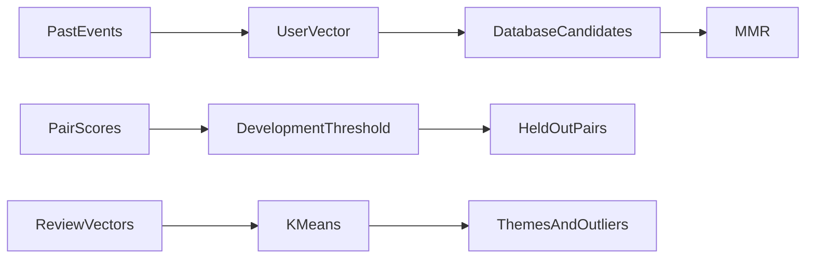

# Module 19: Recommendations, deduplication and clustering

> After this module you can build user vectors from events strictly before a cutoff.

**Time:** ~180 min · **Level:** Intermediate · **Needs:** 8 GB RAM for frozen-vector examples, 16 GB recommended for one live model · **Docker:** No for local databases; local Ollama for generation · **Downloads:** included vector fixtures; optional MiniLM ~91 MB, reranker ~91 MB, Qwen embeddings ~1.19 GB, SigLIP ~1.50 GB, Ollama Qwen ~523 MB. Load large models individually.

**Marlowe Search v4:** Recommendations, deduplication and clustering. [Measured results and limitations](results/README.md).

## Prerequisites

Complete [Module 18](../18_rag/README.md) and understand the [Tier 3 database contract](../../common/README.md). Read [application setup](../../docs/TIER4_APPLICATIONS.md). Included real-model artifacts support the default examples without downloads. Native examples require `uv sync --extra qdrant`. Custom inputs need the relevant cached model. Open [the cleared notebook](notebook.ipynb) to explore the same scripts interactively.

## Learning objectives

- Build user vectors from events strictly before a cutoff.
- Retrieve item neighbors and diversify them with greedy MMR.
- Calibrate a duplicate threshold on development families only.
- Inspect review themes and distance-based outliers.

## The big idea

Similarity can help several different jobs, but the decision changes with the job. A recommendation shelf should offer useful variety. A duplicate detector should flag pairs for review. A review analyst wants recurring themes and unusual comments. Imagine arranging a shop: putting ten near-identical mugs together is different from noticing two listings are copies. The vector supplies evidence, while a clear policy turns that evidence into a decision.

## How it works



Views, carts and purchases receive weights 1, 3 and 5. Their normalized weighted sum becomes a user query vector, using only events before a fixed timestamp. Seen products are excluded. MMR repeatedly maximizes `lambda*query_similarity - (1-lambda)*max_similarity_to_selected`. Duplicate pair cosine scores are calibrated by development F1, then precision and threshold tie-breaks. The chosen threshold is frozen for disjoint test families. Review vectors are clustered with seeded scikit-learn K-means. TF-IDF words and a central review describe each cluster. Distance to the assigned center supplies an inspection priority.

## Build it yourself

`01_from_scratch.py` gives two almost identical mugs and a different cup. With relevance weight 1 the second mug wins. At 0.2 the cup wins because it adds variety. Read the greedy loop in `mmr`: selected items change the next redundancy penalty. `03_measure.py` builds pair scores, checks family separation, fits the threshold on development rows, then evaluates test rows once.

## Now in a real database

The production example searches real Qdrant local collections with an event-derived vector. Scikit-learn supplies the actual K-means implementation in the review lesson. Original generated events are preserved and audited, but their repeated seen items and one action type per user yield no eligible unseen-purchase cases in the first 100-user cutoff audit. A separate reproducible 700-event fixture supplies 100 users with five past interactions and two distinct future purchases, selected by product kind independently of embeddings. This is a labeled teaching fixture, not evidence of conversion lift.

## Walkthrough

### Inspect greedy MMR

```text
uv run python modules/19_recommendations/examples/01_from_scratch.py
```

Expected: `different second item at low relevance weight`. [Read the script](examples/01_from_scratch.py).

### Query with a user profile

```text
uv run --extra qdrant python modules/19_recommendations/examples/02_production.py
```

Expected: `no seen-product IDs in results`. [Read the script](examples/02_production.py).

### Tune and freeze a duplicate threshold

```text
uv run python modules/19_recommendations/examples/03_measure.py
```

Expected: `development/test precision and recall`. [Read the script](examples/03_measure.py).

### Inspect clusters and outliers

```text
uv run python modules/19_recommendations/examples/04_review_themes.py
```

Expected: `six themes with real review text`. [Read the script](examples/04_review_themes.py).

## Measure it

[Results](results/README.md) link immutable run JSON, hardware, exact model revisions and a comparison plot. Run `uv run --extra qdrant python scripts/checkpoint_tier4.py --backend qdrant-local --part recommendations` to reproduce this part. Add `--rerank` for the cached cross encoder or `--generate` for a running local Ollama where relevant.

Keep development and test families separate. The retrieval benchmark records warmups and repeated held-out requests. Model and application diagnostics have their own timing scopes and sample counts; do not mix them into an ANN database leaderboard. A tiny synthetic corpus can expose implementation errors but cannot establish production quality.

## When to use it, and when not to

Use this implementation to understand the decision, reproduce the saved evidence, and experiment with one policy at a time. Move to a representative, independently judged dataset before making business claims. Frozen queries make an offline demonstration repeatable; they do not support arbitrary new text without inference. The checkpoint's local database session is disposable and its data is recreated from source artifacts.

## Real-world use case

Marlowe Search v4 offers a similar-items shelf and flags potentially duplicated listings for a person to compare. The UI's threshold is an exploration control. The published held-out evaluation uses the calibrated development threshold. A production marketplace would evaluate both relevance and diversity with real feedback, and keep duplicate review separate from automatic deletion.

```text
uv run python modules/19_recommendations/use_case/marlowe.py
uv run --extra apps streamlit run playground/marlowe.py
```

Expected: actual retrieved products or policy passages from the integrated service. [Use-case script](use_case/marlowe.py).

## Common mistakes

- **Recommendations look impossibly accurate.** Check whether future events leaked into the profile.
- **The shelf repeats the seed product.** Exclude seen and seed IDs before final selection.
- **Duplicate precision is measured on tuning pairs.** Split by family and freeze the threshold before testing.
- **An outlier is called fraudulent.** Distance is an inspection heuristic, not a ground-truth label.
- **A benchmark reports a mean over no eligible users.** Record skipped users and provide a valid temporal fixture explicitly.

## Exercises

- **Practice: split before profiling:** Return only events strictly earlier than the cutoff and with recognized positive actions. Do not include future purchases. [Starter](exercises/01_practice.py) · [Solution](solutions/01_practice.py)
- **Apply: greedy diversity:** Use each row's relevance and a redundancy matrix. Repeatedly maximize weight*relevance - (1-weight)*maximum similarity to already selected rows. Break ties by index. [Starter](exercises/02_apply.py) · [Solution](solutions/02_apply.py)
- **Stretch: calibrate without test leakage:** Return the development threshold maximizing F1. Break ties by higher precision then higher threshold. Test labels are intentionally not an input. [Starter](exercises/03_stretch.py) · [Solution](solutions/03_stretch.py)

Starters run with a simpler policy. Acceptance checks intentionally demand more. Run a starter directly, then run `uv run python scripts/check_exercise.py modules/19_recommendations/exercises/01_practice.py`. Substitute the other exercise name as needed. The same tests pass for reference solutions. Use `--smoke` to check only that a starter executes.

## Quiz

<details>
<summary>1. Why exclude future purchases from user vectors?</summary>

Otherwise the evaluation answer is already present in the query.

</details>

<details>
<summary>2. What happens when MMR lambda is 1?</summary>

Ranking uses only query relevance.

</details>

<details>
<summary>3. Why split duplicates by group?</summary>

Related copies must not leak across development and test.

</details>

<details>
<summary>4. Can a cosine threshold transfer automatically between models?</summary>

No. It must be calibrated on the new score distribution.

</details>

<details>
<summary>5. Are distant reviews necessarily negative?</summary>

No. Distance measures unusual embedding position, not sentiment or truth.

</details>

<details>
<summary>6. Why add a separate event fixture?</summary>

The original generator has no evaluable unseen-purchase cases at the audited cutoff, which must not be disguised as a successful metric.

</details>

## Key takeaways

- Use an explicit time boundary.
- MMR changes relevance and redundancy together.
- Duplicate thresholds depend on the data and model.
- Cluster descriptions require inspecting examples.
- Synthetic evaluation does not establish business impact.

## Clean up

Each example closes its owned database session. In the UI, select **Release application data**. Stop a course Ollama profile with `docker compose -f docker/compose.yaml --profile weaviate-generation stop ollama` if you started it. For the native Ollama app, `ollama stop qwen3:0.6b` unloads the model. Run `uv run python scripts/cleanup.py` to inspect owned caches before choosing what to remove. Included artifacts and shared model caches are not automatic deletion targets.

## Go deeper

- [MMR paper](https://doi.org/10.1145/290941.291025)
- [Scikit-learn clustering](https://scikit-learn.org/stable/modules/clustering.html)
- [Precision and recall](https://scikit-learn.org/stable/modules/model_evaluation.html#precision-recall-f-measure-metrics)

## Next: Module 20

Continue to [Module 20](../20_multimodal/README.md).
