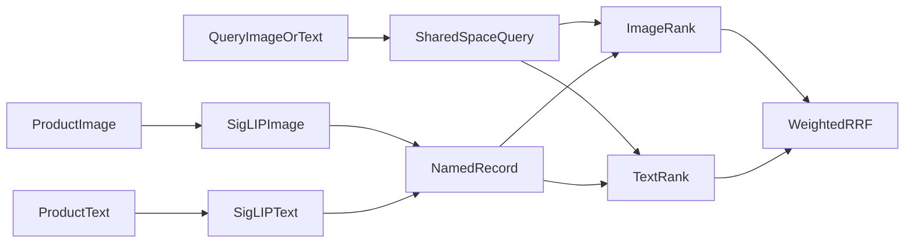

# Module 20: Multimodal search

> After this module you can encode images and text in one declared siglip space.

**Time:** ~150 min · **Level:** Intermediate · **Needs:** 8 GB RAM for frozen-vector examples, 16 GB recommended for one live model · **Docker:** No for local databases; local Ollama for generation · **Downloads:** included vector fixtures; optional MiniLM ~91 MB, reranker ~91 MB, Qwen embeddings ~1.19 GB, SigLIP ~1.50 GB, Ollama Qwen ~523 MB. Load large models individually.

**Marlowe Search v5:** Multimodal search. [Measured results and limitations](results/README.md).

## Prerequisites

Complete [Module 19](../19_recommendations/README.md) and understand the [Tier 3 database contract](../../common/README.md). Read [application setup](../../docs/TIER4_APPLICATIONS.md). Included real-model artifacts support the default examples without downloads. Native examples require `uv sync --extra qdrant`. Custom inputs need the relevant cached model. Open [the cleared notebook](notebook.ipynb) to explore the same scripts interactively.

## Learning objectives

- Encode images and text in one declared SigLIP space.
- Search a gallery using text or another image.
- Store named image and text vectors with one product payload.
- Compare rank-fusion weights and evaluate with self matches excluded.

## The big idea

A photo and a sentence describe a product in different ways. A joint image/text encoder learns a shared coordinate system where those descriptions can be compared. Think of two maps drawn with the same landmarks and scale. MiniLM is a different map, even if some coordinates happen to look alike. The application keeps image and text vectors named and checks the model space at query time.

## How it works



SigLIP 2 uses its image processor and fixed-length text preprocessing. Both outputs are normalized before cosine search. Each product has an image vector, a text vector from the same model, and one metadata payload. Qdrant stores both native named vectors on one point. Other supported engines demonstrate explicit separate collections on the same backend. Weighted reciprocal rank fusion combines branches, avoiding uncalibrated raw-score addition. The gallery has 200 synthetic Pillow drawings. Photo evaluation excludes the exact query image ID, while noting that repeated drawing templates still make the task easier than real photographs.

## Build it yourself

In `01_from_scratch.py`, load genuine frozen image and text-query vectors. Check model-space identity, normalize each side, compute dot products, then order by score and ID. In `04_fusion.py`, inspect two rankings that disagree. Weight 1 uses the image branch only; weight 0 uses text only. The balanced case demonstrates deterministic ties. Neither branch is allowed to introduce IDs when its weight is zero.

## Now in a real database

`02_production.py` inspects Qdrant's actual collection schema and asserts that image and text are named vectors on the same point. The native query chooses a named vector with `using`. The shared application also works on TinyVec or SQLite through explicitly separate modality collections. These implementations should not be described as native named-vector support when the engine lacks it.

## Walkthrough

### Score real shared-space vectors

```text
uv run python modules/20_multimodal/examples/01_from_scratch.py
```

Expected: `image IDs and cosine scores`. [Read the script](examples/01_from_scratch.py).

### Inspect native named vectors

```text
uv run --extra qdrant python modules/20_multimodal/examples/02_production.py
```

Expected: `image/text schema and retrieved products`. [Read the script](examples/02_production.py).

### Evaluate all photo query families

```text
uv run python modules/20_multimodal/examples/03_measure.py
```

Expected: `three modes, self excluded, held-out nDCG`. [Read the script](examples/03_measure.py).

### Inspect weighting endpoints

```text
uv run python modules/20_multimodal/examples/04_fusion.py
```

Expected: `top item changes with the active branch`. [Read the script](examples/04_fusion.py).

## Measure it

[Results](results/README.md) link immutable run JSON, hardware, exact model revisions and a comparison plot. Run `uv run --extra qdrant python scripts/checkpoint_tier4.py --backend qdrant-local --part photo` to reproduce this part. Add `--rerank` for the cached cross encoder or `--generate` for a running local Ollama where relevant.

Keep development and test families separate. The retrieval benchmark records warmups and repeated held-out requests. Model and application diagnostics have their own timing scopes and sample counts; do not mix them into an ANN database leaderboard. A tiny synthetic corpus can expose implementation errors but cannot establish production quality.

## When to use it, and when not to

Use this implementation to understand the decision, reproduce the saved evidence, and experiment with one policy at a time. Move to a representative, independently judged dataset before making business claims. Frozen queries make an offline demonstration repeatable; they do not support arbitrary new text without inference. The checkpoint's local database session is disposable and its data is recreated from source artifacts.

## Real-world use case

Marlowe Search v5 accepts a saved gallery example, a text description, or an uploaded photo. Saved examples work from included vectors. New images and text descriptions require the cached SigLIP model. The Tier 4 checkpoint combines this with search, RAG, recommendations and listing review on one chosen backend. Real retail deployment would require representative photographs, robust evaluation and a larger gallery.

```text
uv run python modules/20_multimodal/use_case/marlowe.py
uv run --extra apps streamlit run playground/marlowe.py
```

Expected: actual retrieved products or policy passages from the integrated service. [Use-case script](use_case/marlowe.py).

## Common mistakes

- **Vectors have matching dimensions but bad results.** Check model revision and preprocessing, not only shape.
- **Photo recall is perfect.** Remove the exact query image and inspect repeated templates.
- **Raw image and text scores are added directly.** Calibrate on development data or use an explicit rank-fusion rule.
- **A local comparison is called a server benchmark.** Label Qdrant local mode and its limits.
- **The UI loads every model at startup.** Use saved vectors and lazy model loading for custom input.

## Exercises

- **Practice: vector-space identity:** Return true only when model, revision, dimensions and preprocessing all match. Missing identity fields cannot establish compatibility. [Starter](exercises/01_practice.py) · [Solution](solutions/01_practice.py)
- **Apply: rank fusion endpoints:** Combine image/text rankings with the supplied image weight. Return IDs in score order. A zero-weight branch must not introduce extra IDs. [Starter](exercises/02_apply.py) · [Solution](solutions/02_apply.py)
- **Stretch: self-match-free relevance:** Remove the query ID from rankings and relevance before computing recall@k over all eligible relevant IDs. Deduplicate retrieved IDs. Return null when no relevant items remain. [Starter](exercises/03_stretch.py) · [Solution](solutions/03_stretch.py)

Starters run with a simpler policy. Acceptance checks intentionally demand more. Run a starter directly, then run `uv run python scripts/check_exercise.py modules/20_multimodal/exercises/01_practice.py`. Substitute the other exercise name as needed. The same tests pass for reference solutions. Use `--smoke` to check only that a starter executes.

## Quiz

<details>
<summary>1. Can MiniLM text directly search SigLIP images?</summary>

No. Use SigLIP's own text tower.

</details>

<details>
<summary>2. Why normalize both query and gallery?</summary>

Then their dot product represents cosine similarity.

</details>

<details>
<summary>3. What does a named vector add?</summary>

A distinct vector field and query target on one record.

</details>

<details>
<summary>4. Why exclude the source image ID?</summary>

An identical file is a trivial nearest neighbor.

</details>

<details>
<summary>5. Does exclusion remove every shortcut?</summary>

No. Repeated synthetic templates can remain highly similar.

</details>

<details>
<summary>6. What does weight zero mean?</summary>

The branch contributes no scores and introduces no candidate IDs.

</details>

## Key takeaways

- Shared space must be established by the encoder.
- Named vectors keep modality identity explicit.
- Rank fusion exposes a useful policy control.
- Self-match exclusion is necessary but not sufficient.
- Drawings do not validate performance on photographs.

## Clean up

Each example closes its owned database session. In the UI, select **Release application data**. Stop a course Ollama profile with `docker compose -f docker/compose.yaml --profile weaviate-generation stop ollama` if you started it. For the native Ollama app, `ollama stop qwen3:0.6b` unloads the model. Run `uv run python scripts/cleanup.py` to inspect owned caches before choosing what to remove. Included artifacts and shared model caches are not automatic deletion targets.

## Go deeper

- [SigLIP 2 model documentation](https://huggingface.co/docs/transformers/model_doc/siglip2)
- [SigLIP 2 model card](https://huggingface.co/google/siglip2-base-patch16-224)
- [Qdrant named vectors](https://qdrant.tech/documentation/manage-data/vectors/)

## Next: Module 21

Complete the [Tier 4 application checkpoint](../../checkpoints/tier4/README.md). Module 21's production data modeling and operations are planned for Phase 7.
