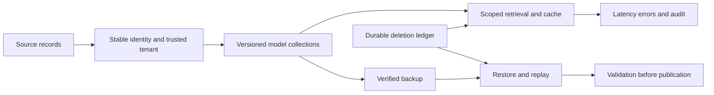

# Module 21: Operations

> After this module you can design collection boundaries around model space, tenant trust and lifecycle.

**Time:** ~210 min · **Level:** Advanced · **Needs:** 2 GB RAM for local drills; 8 GB for optional containers · **Docker/Podman:** optional native labs · **Downloads:** no models; pinned database and monitoring images for native labs.

**Marlowe Search v6:** [Measured evidence](results/README.md) and [operating runbook](../../docs/TIER5_RUNBOOK.md).

## Prerequisites

Complete [Module 20](../20_multimodal/README.md). Keep the included frozen embeddings. Read the [Tier 5 runbook](../../docs/TIER5_RUNBOOK.md) before starting TLS services. The [notebook](notebook.ipynb) mirrors the examples and keeps native execution opt-in.

## Learning objectives

- Design collection boundaries around model space, tenant trust and lifecycle.
- Retry ingestion without creating duplicate identities, and bound outstanding batches.
- Explain why deletion visibility precedes physical storage reclamation.
- Perform gated model migration, rollback and deletion-aware restore.

## The big idea

An index is a derived view of changing business records. Think of a shop inventory ledger: the listing ID stays the same when its price changes, while an old inventory copy must not bring a withdrawn item back. Stable identity, durable deletion intent and a declared model space make that lifecycle understandable.

## How it works

One collection per tenant gives a clear operational boundary but grows collection overhead. A shared collection with a mandatory tenant predicate uses fewer collections but makes every query branch responsible for isolation. A partition or shard helps route work; it does not authenticate a caller. Marlowe v6 derives tenant-owned collections from a trusted seller identity and also adds an AND tenant predicate to product search. Public help articles remain shared.

`ingest` caps pending batches and propagates write failures. Replaying the same tenant/source IDs is idempotent for replacement writes. Multiple workers can reorder updates to the same ID; use the default single worker or enforce source sequence numbers before enabling parallel writes. The scratch log keeps obsolete versions until compaction. Native SQLite DELETE frees pages for reuse, while VACUUM rewrites the file and returns unused space. Neither operation is a durability benchmark.

## Build it yourself

The first script writes 100 stable IDs twice. There are 200 physical versions but only 100 live records. It deletes ten identities, captures the live view, then compacts and checks that the live view is unchanged. Change the source ID on retry to see why a deduplication key must survive transport retries.

## Now in a real database

The native script loads 500 real MiniLM and Qwen vectors into different collections, replays a deletion in both, switches a Qdrant alias, rejects the old dimensionality, rolls back and restores a server snapshot. Alias switching alone does not switch an encoder. `ModelRouter` publishes collection and model-space identity together; a separate process exits immediately after publication and the next process reloads the complete route. Its quality scores are fixture gate inputs, not a semantic comparison of the two encoders. A production gate also needs relevance, compatibility, watermark, error-budget and canary checks.

## Walkthrough

1. Run `uv run python modules/21_operations/examples/01_from_scratch.py`. Predict the assertions, then inspect the policy or arithmetic printed.
2. Run `uv run --extra qdrant python modules/21_operations/examples/02_production.py`. Start the secure Qdrant profile first; it creates and removes UUID-named experiment collections.
3. Run `uv run python modules/21_operations/examples/03_measure.py`. Keep the reported sample sizes and failure counts with the timings.
4. Run `uv run python modules/21_operations/use_case/marlowe.py` and explain which inventory or seller boundary the assertions protect.

[Scratch source](examples/01_from_scratch.py) · [Native source](examples/02_production.py) · [Measurement source](examples/03_measure.py) · [Use case](use_case/marlowe.py).

## Measure it

Compare logical row counts with physical bytes. The fresh-process restore intentionally loses five writes acknowledged after the backup and preserves a later deletion by replaying a separately durable ledger. Report this as a five-write recovery gap, not an invented time-based RPO. RTO here includes process startup and restore until checked data is available; it excludes DNS changes, operator response and traffic ramp-up.

Run `uv run python scripts/checkpoint_tier5.py` for local measured diagnostics, or add `--native` after preparing secure Qdrant. Raw observations carry hardware and source provenance. See [results](results/README.md), [memory math](../../docs/MEMORY_MATH.md) and [the checkpoint](../../checkpoints/tier5/README.md).

## When to use it, and when not to

Use these drills to expose operational failure modes and test assumptions before deploying a larger system. The corpus is small and synthetic, and timings are laptop observations. Do not infer production availability, legal compliance, realistic customer relevance or cloud capacity from a successful local test. A single process and an immutable public source fixture simplify the teaching application; distributed mutation and retention need additional design.

## Real-world use case

A seller withdraws a listing after yesterday's backup. `use_case/marlowe.py` restores the earlier inventory, applies the withdrawal before exposing results, and then purges owned snapshots containing the item. The v6 API backs up the primary text collection; other derived indexes rebuild from the source plus the separate deletion ledger.

## Common mistakes

- Generating a fresh ID on every retry produces duplicate business records.
- Acknowledging a job before a batch is durable confuses accepted work with completed work.
- Switching the collection without its encoder mixes embedding spaces.
- Restoring the data backup without a newer deletion ledger resurrects withdrawn records.
- Assuming DELETE shrinks the file immediately confuses visibility with reclamation.

## Exercises

Each starter runs before completion; its placeholder is intentionally insufficient. Run `uv run python scripts/check_exercise.py modules/21_operations/exercises/01_practice.py` to see the acceptance failure, then implement the contract. Substitute the second and third paths as you progress. Reference solutions have independent acceptance cases.

- **Practice:** Stable identity replay. Keep the last value for each (tenant, source_id), and return sorted [tenant, source_id, value] rows. An update replaces a value; two tenants may reuse the same source ID. [Starter](exercises/01_practice.py) · [Solution](solutions/01_practice.py).
- **Apply:** Replay deletions on restore. Return sorted live IDs from [tenant,id] rows after applying [tenant,id] tombstones. A tombstone from a different tenant must not remove a row. [Starter](exercises/02_apply.py) · [Solution](solutions/02_apply.py).
- **Stretch:** Gate model publication. Return new only when readiness is true and 0 <= minimum <= measured <= 1; otherwise preserve old. Do not confuse dimensional compatibility with model-space identity. [Starter](exercises/03_stretch.py) · [Solution](solutions/03_stretch.py).

## Quiz

1. Why include tenant in a stable ID?

Answer

Different sellers may use the same source ID without owning the same listing.

2. Does idempotence guarantee ordered updates?

Answer

No. Concurrent retries can overwrite newer values unless sequence checks or ordering prevent it.

3. What must move with a collection alias?

Answer

The query encoder, preprocessing and declared space, coordinated by the application.

4. Why retain the blue collection briefly?

Answer

It permits rollback after failed canary or relevance checks, subject to retention and deletion policy.

5. What can a checksum prove?

Answer

Byte integrity against the recorded digest, not authenticity, completeness or business correctness.

6. How can an old snapshot safely restore?

Answer

Verify integrity, replay later mutations and deletions from an independently durable source, validate, then publish.

## Key takeaways

- Identity is a business decision, not a random retry token.
- Bound pending work and make partial failure visible.
- Deletion visibility and physical reclamation are different steps.
- Publish encoder and collection generation together.
- A tested restore requires independent mutation and deletion history.

## Clean up

Local examples close stores and remove their own temporary directories. Native examples remove only their UUID collections; cluster and monitoring drills remove their own UUID pod. For a manually started secure profile run `docker compose --env-file .cache/marlowe/tier5/runtime/compose.env -f docker/compose.tier5.yaml down`. Stop the API/UI with Ctrl+C. Preview `uv run python scripts/cleanup.py` before removing ignored course data. Keep needed deletion history before retiring any backup.

## Go deeper

[Qdrant aliases and collections](https://qdrant.tech/documentation/concepts/collections/), [Qdrant snapshots](https://qdrant.tech/documentation/operations/snapshots/), [SQLite VACUUM](https://www.sqlite.org/lang_vacuum.html). These sources explain native behavior; the saved local evidence establishes only what was actually executed here.

## Next: Module 22

Continue to [Module 22](../22_performance/README.md).
