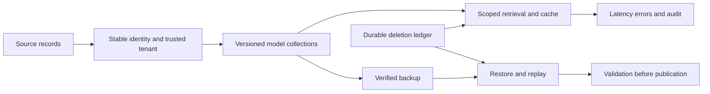

# Module 22: Performance and capacity

> After this module you can calculate vector, graph, metadata, replica and headroom budgets.

**Time:** ~180 min · **Level:** Advanced · **Needs:** 2 GB RAM for local drills; 8 GB for optional containers · **Docker/Podman:** optional native labs · **Downloads:** no models; pinned database and monitoring images for native labs.

**Marlowe Search v6:** [Measured evidence](results/README.md) and [operating runbook](../../docs/TIER5_RUNBOOK.md).

## Prerequisites

Complete [Module 21](../21_operations/README.md). Keep the included frozen embeddings. Read the [Tier 5 runbook](../../docs/TIER5_RUNBOOK.md) before starting TLS services. The [notebook](notebook.ipynb) mirrors the examples and keeps native execution opt-in.

## Learning objectives

- Calculate vector, graph, metadata, replica and headroom budgets.
- Choose an index setting against explicit development targets and report held-out performance.
- Separate sharding, replication, lag and consistency decisions.
- Measure cache behavior, concurrency, errors and recovery using real requests.
- Compare complete cost assumptions and recognize when a server adds little value.

## The big idea

A fast single query says little about an overloaded service. Picture a checkout counter: adding shoppers increases the waiting line until more requests fail or the queue grows. Index tuning reduces one part of the work; storage, authentication, audit writes, model inference and scheduling still consume time.

## How it works

The capacity worksheet separates payload arithmetic from measured process memory. Ten million 768-dimensional float32 vectors occupy 30.72 GB before graph links, metadata or replicas. Two replicas, estimated 32 eight-byte graph links per row, 256 metadata bytes per row and 30% spare capacity produce a 102.4 GB planning budget. This excludes allocator, WAL and temporary build overhead. Compression may require full vectors for rescoring; a smaller code does not imply every copy disappears.

`target_tuning` fits a 32-cell IVF partition using scikit-learn, sweeps nprobe on q000–q009 and reports q010–q019 once after selection. It computes exact top-10 neighbors as ground truth and repeats each request three times. The target is recall at least 0.90 and p95 no more than 50 ms. This is ANN approximation quality, not a judgement that results satisfy a customer.

## Build it yourself

The first example calculates storage at several numeric widths, simulates a stale replica, advances replication and demonstrates an unavailable quorum. Hash-based sharding distributes keys but may skew tenant load. The simulation teaches order and failure choices; its ticks are not seconds and are never mixed with measured server timings.

## Now in a real database

The second example uses the native clustering library over genuine frozen MiniLM vectors. The separate `scripts/cluster_tier5.py` starts three pinned Qdrant peers with two shards, three replicas and write consistency factor two. It stops one peer, writes another point, records whether an immediate majority read succeeds (and explicitly tries consistency=1 if it fails), restarts the peer and waits until both local shards are active and contain both points. Three peers on one laptop do not establish multi-zone resilience.

## Walkthrough

1. Run `uv run python modules/22_performance/examples/01_from_scratch.py`. Predict the assertions, then inspect the policy or arithmetic printed.
2. Run `uv run python modules/22_performance/examples/02_production.py`. This uses local included vectors and scikit-learn.
3. Run `uv run python modules/22_performance/examples/03_measure.py`. Keep the reported sample sizes and failure counts with the timings.
4. Run `uv run python modules/22_performance/use_case/marlowe.py` and explain which inventory or seller boundary the assertions protect.

[Scratch source](examples/01_from_scratch.py) · [Native source](examples/02_production.py) · [Measurement source](examples/03_measure.py) · [Use case](use_case/marlowe.py).

## Measure it

Run `scripts/load_tier5.py` for Locust runs at 1, 8 and 32 users plus an API process interruption. The saved workload uses two reader identities, repeated frozen text queries and filters, and verifies successful product results against seller ownership. It includes cache warming and startup effects; report all completed requests, failures, p50/p95/p99 and actual duration. Small samples make p99 unstable. API admission permits four operations, but upstream HTTP and worker queues still exist. Durable audit writes run in a worker thread but are awaited; their serialized file access and the single shared service lock can limit throughput; no horizontal scaling claim is made.

`monitor_tier5.py` verifies live authenticated TLS Qdrant scraping by Prometheus and provisions Grafana. API metrics are captured separately by the load runner. Cross-VM live API scraping is not claimed; the runbook provides the same-host scrape configuration. The dashboard includes request rate, p95 and overload rejection panels.

Run `uv run python scripts/checkpoint_tier5.py` for local measured diagnostics, or add `--native` after preparing secure Qdrant. Raw observations carry hardware and source provenance. See [results](results/README.md), [memory math](../../docs/MEMORY_MATH.md) and [the checkpoint](../../checkpoints/tier5/README.md).

## When to use it, and when not to

Use these drills to expose operational failure modes and test assumptions before deploying a larger system. The corpus is small and synthetic, and timings are laptop observations. Do not infer production availability, legal compliance, realistic customer relevance or cloud capacity from a successful local test. A single process and an immutable public source fixture simplify the teaching application; distributed mutation and retention need additional design.

## Real-world use case

Marlowe expects ten million products but initially runs a much smaller catalog. The use case compares replica and compression assumptions plus compute, storage and operator costs. Values are hypothetical USD inputs, not current vendor quotes. A static, single-process catalog can use an exact library; durable local updates can use an embedded database; shared writes, routing and operational requirements can justify a server.

## Common mistakes

- Tuning on test queries makes the reported test result optimistic.
- A warm cache benchmark is not an embedding-inference benchmark.
- Removing 429 errors from the denominator hides saturation.
- Multiplying vector bytes alone misses metadata, graph, replicas and rebuild space.
- Putting all replicas on one host leaves a shared failure domain.

## Exercises

Each starter runs before completion; its placeholder is intentionally insufficient. Run `uv run python scripts/check_exercise.py modules/22_performance/exercises/01_practice.py` to see the acceptance failure, then implement the contract. Substitute the second and third paths as you progress. Reference solutions have independent acceptance cases.

- **Practice:** Vector capacity arithmetic. Return raw vector bytes for positive integer inputs. This deliberately excludes metadata, graph links and headroom; return 0 if any input is nonpositive. [Starter](exercises/01_practice.py) · [Solution](solutions/01_practice.py).
- **Apply:** Select a feasible operating point. Each trial is [nprobe,recall,p95_ms]. Return the smallest nprobe satisfying both targets; return null/None if none is feasible. Only development trials belong here. [Starter](exercises/02_apply.py) · [Solution](solutions/02_apply.py).
- **Stretch:** Count failed requests honestly. Return [total,failed,overloaded], counting every non-2xx response as failed and status429 as overloaded. Errors are not removed from the denominator. [Starter](exercises/03_stretch.py) · [Solution](solutions/03_stretch.py).

## Quiz

1. What is the raw float32 payload for 10M × 768?

Answer

30,720,000,000 bytes, approximately 28.61 GiB.

2. Does int8 storage automatically preserve recall?

Answer

No. Quantization and rescoring must be evaluated on the chosen workload.

3. What happens if no trial meets both targets?

Answer

Report infeasibility and revisit the design; do not pick a failure and call it a pass.

4. Why put tenant and generation in the cache key?

Answer

To separate authorization scope and invalidate results after data or model changes.

5. Are replicas a backup?

Answer

No. Bad writes and deletions can propagate to every replica.

6. What does p99 from 64 requests establish?

Answer

Very little about the long-run tail; include sample count, raw observations and repeated larger runs.

## Key takeaways

- Plan full resource cost, then measure actual usage.
- Select on development data and preserve a test split.
- Report failures alongside throughput and latency.
- Cache correctness includes tenant, filter, model and data generation.
- Replicas, backups and sharding solve different problems.

## Clean up

Local examples close stores and remove their own temporary directories. Native examples remove only their UUID collections; cluster and monitoring drills remove their own UUID pod. For a manually started secure profile run `docker compose --env-file .cache/marlowe/tier5/runtime/compose.env -f docker/compose.tier5.yaml down`. Stop the API/UI with Ctrl+C. Preview `uv run python scripts/cleanup.py` before removing ignored course data. Keep needed deletion history before retiring any backup.

## Go deeper

[Qdrant distributed deployment](https://qdrant.tech/documentation/distributed_deployment/), [Qdrant consistency](https://qdrant.tech/documentation/scaling/consistency-guarantees/), [Locust](https://docs.locust.io/en/stable/), [Prometheus metrics](https://prometheus.io/docs/instrumenting/exposition_formats/). These sources explain native behavior; the saved local evidence establishes only what was actually executed here.

## Next: Module 23

Continue to [Module 23](../23_security_reliability/README.md).
