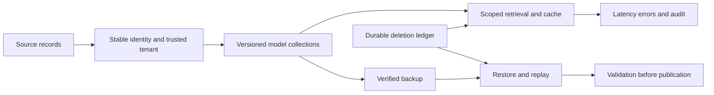

# Module 23: Security and reliability

> After this module you can bind a server-authenticated identity to every private query branch.

**Time:** ~210 min · **Level:** Advanced · **Needs:** 2 GB RAM for local drills; 8 GB for optional containers · **Docker/Podman:** optional native labs · **Downloads:** no models; pinned database and monitoring images for native labs.

**Marlowe Search v6:** [Measured evidence](results/README.md) and [operating runbook](../../docs/TIER5_RUNBOOK.md).

## Prerequisites

Complete [Module 22](../22_performance/README.md). Keep the included frozen embeddings. Read the [Tier 5 runbook](../../docs/TIER5_RUNBOOK.md) before starting TLS services. The [notebook](notebook.ipynb) mirrors the examples and keeps native execution opt-in.

## Learning objectives

- Bind a server-authenticated identity to every private query branch.
- Distinguish transport encryption, authentication and authorization.
- Test malicious tenant filters, foreign listing IDs, roles and cached responses.
- Minimize private data in audit events and understand embedding disclosure risk.
- Delete derived data and test recovery without resurrecting withdrawn listings.

## The big idea

A vector match is not permission to see a record. Think of a building where the address helps you find a room, but your badge determines which doors open. Similarity finds candidates; a trusted identity controls which candidates may enter the result.

## How it works

An opaque bearer credential maps on the server to subject, seller and role. Clients cannot submit their own trusted tenant. Reader, writer and administrator permissions are distinct. Product search applies the seller constraint with AND, and every private derived collection is built only from that seller's records. Similarity, duplicate review, multilingual search and photo retrieval all inherit that scope. The help-center corpus contains public marketplace policy articles and is intentionally shared.

TLS verifies the server and encrypts transport; it does not authorize a seller. A Qdrant database-wide read key can still read different sellers when a filter is omitted. The native negative example demonstrates that fact. Keep database ports internal in deployment and allow only the application boundary to receive seller traffic. This lab publishes database REST only on loopback; its three-node failure lab uses a separate unencrypted local pod network.

## Build it yourself

The first script authenticates an identity, demonstrates reader permission limits, wraps a hostile filter and writes an allowlisted audit event. Audit records retain time, subject, tenant, action, outcome and request ID. They omit credentials, raw query text, vectors and private payloads. Those remaining identifiers still require access controls and retention policies.

## Now in a real database

The second script uses a real TLS Qdrant service. Requests without a key fail, a read-only key cannot create a collection, the untrusted local CA fails verification, and explicit tenant filtering returns one of two otherwise visible points. The third script runs the real FastAPI routes with an in-process test client, checks authentication and private result ownership, takes a backup, deletes a listing and starts a fresh application instance to check persistence. The comprehensive suite repeats private route checks on TinyVec, SQLite-vec and Qdrant local.

## Walkthrough

1. Run `uv run python modules/23_security_reliability/examples/01_from_scratch.py`. Predict the assertions, then inspect the policy or arithmetic printed.
2. Run `uv run --extra qdrant python modules/23_security_reliability/examples/02_production.py`. Start the secure Qdrant profile first; it creates and removes UUID-named experiment collections.
3. Run `uv run --extra apps python modules/23_security_reliability/examples/03_measure.py`. Keep the reported sample sizes and failure counts with the timings.
4. Run `uv run python modules/23_security_reliability/use_case/marlowe.py` and explain which inventory or seller boundary the assertions protect.

[Scratch source](examples/01_from_scratch.py) · [Native source](examples/02_production.py) · [Measurement source](examples/03_measure.py) · [Use case](use_case/marlowe.py).

## Measure it

Run the negative tests before trusting positive examples. Test missing and malformed credentials, client-supplied tenant fields, hostile OR filters, foreign photo/similarity/duplicate IDs, cache hits after another seller's request, reader mutation attempts, deletion after backup and restart. The restore drill intentionally retains a newer deny ledger outside the data backup. A real recovery plan must store that ledger and keys in a separately protected failure domain and test their recovery too.

Run `uv run python scripts/checkpoint_tier5.py` for local measured diagnostics, or add `--native` after preparing secure Qdrant. Raw observations carry hardware and source provenance. See [results](results/README.md), [memory math](../../docs/MEMORY_MATH.md) and [the checkpoint](../../checkpoints/tier5/README.md).

## When to use it, and when not to

Use these drills to expose operational failure modes and test assumptions before deploying a larger system. The corpus is small and synthetic, and timings are laptop observations. Do not infer production availability, legal compliance, realistic customer relevance or cloud capacity from a successful local test. A single process and an immutable public source fixture simplify the teaching application; distributed mutation and retention need additional design.

## Real-world use case

Marlowe v6 offers all five user flows through an authenticated HTTPS API and a token-based Streamlit interface. Deletion writes its deny decision first, evicts derived tenant services, clears the application cache and purges owned primary-text snapshots containing that seller's item. Frozen public teaching fixtures are unchanged. This is a single-worker reference application, not a complete distributed identity or retention service.

## Common mistakes

- Trusting a tenant ID from a request lets callers choose their own scope.
- Filtering only the dense branch can leak lexical, reranked or image results.
- Treating embeddings as anonymous ignores possible disclosure through inversion or similarity.
- Deleting the live index without handling snapshots allows later resurrection.
- Disabling certificate verification makes a successful HTTPS request an inadequate TLS test.

## Exercises

Each starter runs before completion; its placeholder is intentionally insufficient. Run `uv run python scripts/check_exercise.py modules/23_security_reliability/exercises/01_practice.py` to see the acceptance failure, then implement the contract. Substitute the second and third paths as you progress. Reference solutions have independent acceptance cases.

- **Practice:** Trust the server principal. Return sorted IDs for [id,tenant] rows belonging to the trusted principal. An empty principal sees nothing. [Starter](exercises/01_practice.py) · [Solution](solutions/01_practice.py).
- **Apply:** Authorize actions. Return true only for reader:read, writer:read/write, admin:read/write/admin. Unknown roles and actions are denied. [Starter](exercises/02_apply.py) · [Solution](solutions/02_apply.py).
- **Stretch:** Minimize audit data. Keep only subject, tenant, action, outcome and request_id from a supplied event. Never copy query, token, text or vector fields. [Starter](exercises/03_stretch.py) · [Solution](solutions/03_stretch.py).

## Quiz

1. Can a database read-only key enforce seller isolation?

Answer

Not by itself; it limits operations, not seller ownership.

2. Where should tenant identity originate?

Answer

From a validated credential mapped by the trusted server, not a body field.

3. Why test foreign IDs even when search is scoped?

Answer

Direct lookup, similar-item and photo endpoints can bypass search filters.

4. Are embeddings guaranteed to hide personal data?

Answer

No. Research demonstrates reconstruction and sensitive-information disclosure under particular models and attack settings.

5. Why persist deletion intent before dropping indexes?

Answer

A crash between steps must still prevent the deleted item from reappearing after restart.

6. What does this audit log not provide?

Answer

It is not an immutable remote audit service and has no distributed writer coordination or automatic retention.

## Key takeaways

- Authenticate first and derive scope from trusted identity.
- Enforce ownership on every private branch and direct-ID route.
- Verify TLS instead of disabling verification.
- Minimize stored data and treat embeddings as potentially sensitive.
- Practice restore with deletion replay and measured recovery gaps.

## Clean up

Local examples close stores and remove their own temporary directories. Native examples remove only their UUID collections; cluster and monitoring drills remove their own UUID pod. For a manually started secure profile run `docker compose --env-file .cache/marlowe/tier5/runtime/compose.env -f docker/compose.tier5.yaml down`. Stop the API/UI with Ctrl+C. Preview `uv run python scripts/cleanup.py` before removing ignored course data. Keep needed deletion history before retiring any backup.

## Go deeper

[Qdrant security](https://qdrant.tech/documentation/operations/security/), [Embedding inversion research](https://arxiv.org/abs/2310.06816), [Qdrant snapshots](https://qdrant.tech/documentation/operations/snapshots/). These sources explain native behavior; the saved local evidence establishes only what was actually executed here.

## Next: Module B1 and the finishing projects

Complete the [Tier 5 checkpoint](../../checkpoints/tier5/README.md). Phase 8 adds the bonus modules and full capstone projects.
