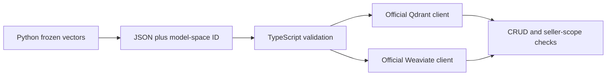

# Module B1: Vector search in TypeScript

> After this module you can preserve vector dimensions and model identity across a JSON boundary.

**Time:** ~120 min · **Level:** Advanced · **Needs:** 2–4 GB RAM, up to 1 GB disk · **Docker:** Yes for native Qdrant/Weaviate · **Downloads:** pinned npm packages and database images.

**TinyVec/Marlowe extension:** [Measured evidence](results/README.md); use the [cleared notebook](notebook.ipynb) for the same scripts.

## Prerequisites

Complete [Module 13](../../13_qdrant/README.md), then read the [feature map](../../../docs/FEATURE_MAP.md). Run `uv run python scripts/prepare_bonus.py`, then `cd modules/bonus/B1_other_languages`, `npm ci`, `npm run build`, and `npm test`. Return to the repository root. Start the qdrant and weaviate profiles from docker/compose.yaml before the native examples. Stop the TLS Qdrant profile first if it owns port 6333.

## Learning objectives

- Preserve vector dimensions and model identity across a JSON boundary.
- Use the official Qdrant and Weaviate TypeScript clients with explicit vectors.
- Map stable business identities to native IDs and verify replacement and deletion.
- Compile strict contracts and test seller-filtered retrieval.

## The big idea

A vector is a numeric message, not a Python object. Think of a shipping label: its meaning must survive a change of language or carrier. The vector's model space, dimensions, business ID and seller metadata must arrive together.

## How it works



Python exports 200 genuine frozen MiniLM vectors and a saved query through common data/embedding helpers. TypeScript checks dimensions, finite values and nonzero norms before sending explicit vectors. Qdrant uses numeric point IDs with business IDs in payload; Weaviate uses deterministic UUIDs. Both clients create only UUID-named lesson collections, replace the first object without increasing the count, apply a seller filter, verify a deletion, and remove their collection in finally blocks. These database-wide clients do not authenticate a seller; the trusted application boundary from Module 23 is still required.

## Build it yourself

Inspect src/contract.ts: vector validation precedes dot products; filtering precedes ranking; score ties use ID order. The Python scratch example shows that JSON numbers round-trip back to the original float32 values. JavaScript Number arithmetic is not a promise that every native engine returns identical tie order.

## Now in a real database

The pinned packages are @qdrant/js-client-rest 1.20.0 and weaviate-client 3.15.3, with TypeScript 7.0.2 and @types/node 26.6.6. Node 24.18.0 was used locally; the project requires Node 22+. package-lock.json fixes transitive resolution. The build uses strict checking and noEmitOnError. Neither client invokes an embedding provider.

## Walkthrough

### Preserve vector identity across a JSON boundary.

```text
uv run python modules/bonus/B1_other_languages/examples/01_from_scratch.py
```

Expected: assertions pass, then the printed diagnostic or measured record. [Source](examples/01_from_scratch.py). 

### Use the official Qdrant TypeScript client on genuine frozen vectors.

```text
uv run python modules/bonus/B1_other_languages/examples/02_production.py
```

Expected: assertions pass, then the printed diagnostic or measured record. [Source](examples/02_production.py). Use the optional setup listed above before this native comparison.

### Repeat CRUD, replacement, scope and deletion through the official Weaviate client.

```text
uv run python modules/bonus/B1_other_languages/examples/03_weaviate.py
```

Expected: assertions pass, then the printed diagnostic or measured record. [Source](examples/03_weaviate.py). Use the optional setup listed above before this native comparison.

### Compile strict TypeScript and execute the offline contract tests.

```text
uv run python modules/bonus/B1_other_languages/examples/04_measure.py
```

Expected: assertions pass, then the printed diagnostic or measured record. [Source](examples/04_measure.py). 

## Measure it

The native observations report whole-script latency including collection creation, writes, searches and cleanup. They do not compare retrieval-only throughput between Python and TypeScript. Each run asserts 200 records after replacement, seller-scoped hits and absence after deletion. Offline Node tests separately exercise invalid shapes, zero vectors, empty scope and deterministic ties.

[Results and raw records](results/README.md) retain the observed outcomes, including accuracy gaps. Timings include their declared scopes. Do not compare a full client lifecycle with retrieval-only latency or treat a successful local test as a production guarantee.

## When to use it, and when not to

Use this lesson to test one bounded design or research claim. Start with an exact baseline and introduce complexity only when the measured problem needs it. Do not deploy a teaching service without the operational controls from Tier 5, or transfer a tiny synthetic measurement to a larger production workload without new evidence.

## Real-world use case

A Marlowe team can keep model inference in Python while a Node seller dashboard sends the same stored vectors to a database. The use case compiles and tests the shared contract. To evaluate custom user text, call the same approved encoder and preprocessing pipeline rather than inventing a JavaScript embedding substitute.

```text
uv run python modules/bonus/B1_other_languages/use_case/marlowe.py
```

Expected: the documented invariant and an explained result. [Use-case source](use_case/marlowe.py).

## Common mistakes

- A dimension error appears when a query comes from another encoder: preserve the declared space and regenerate both sides.
- A stale compiled file hides a type failure: build with noEmitOnError and stop on a nonzero exit.
- Duplicate objects appear after retries with random IDs: retain stable source-to-native identity mapping.
- A seller filter does not create authentication: obtain seller identity from a trusted server before querying.

## Exercises

- **Practice:** Validate an explicit vector: return true only for the declared positive dimension, finite numbers and nonzero norm. [Starter](exercises/01_practice.py) · [Solution](solutions/01_practice.py).
- **Apply:** Map business IDs to native IDs. Return a dictionary, rejecting duplicate business IDs or mismatched lengths. [Starter](exercises/02_apply.py) · [Solution](solutions/02_apply.py).
- **Stretch:** Return sorted IDs from rows [id,seller] belonging to a nonempty trusted seller. [Starter](exercises/03_stretch.py) · [Solution](solutions/03_stretch.py).

Run `uv run python scripts/check_exercise.py modules/bonus/B1_other_languages/exercises/01_practice.py`, substituting the other exercise paths as you progress. Starters run independently but intentionally do not meet acceptance until implemented.

## Quiz

1. Why export model-space identity?

<details><summary>Answer</summary>

Dimensions alone do not identify preprocessing or the encoder.

</details>

2. Why keep business IDs when the DB requires UUIDs?

<details><summary>Answer</summary>

Business identity must remain stable independently of a database's ID format.

</details>

3. What does replace test beyond insertion?

<details><summary>Answer</summary>

The same native identity is updated without increasing row count.

</details>

4. Does explicit-vector insertion download a model?

<details><summary>Answer</summary>

No; these clients receive numeric vectors from the saved fixture.

</details>

5. Why avoid timing only one end-to-end call as a query benchmark?

<details><summary>Answer</summary>

Setup, networking, mutations and cleanup dominate different parts of that timing.

</details>

## Key takeaways

- A vector contract crosses language boundaries.
- Validate shape and numeric values before transport.
- Keep native and business identities distinct.
- Test replacement, deletion and scope on real servers.
- A native filter remains separate from authentication.

## Clean up

Examples remove only their own temporary directories or UUID-named collections. Stop services with `docker compose -f docker/compose.yaml --profile qdrant --profile weaviate down`. Preview `uv run python scripts/cleanup.py` before removing generated cache or benchmark data. Keep committed fixtures, source and shared package caches. The optional Node node_modules directory is local build tooling; remove it only when intentionally retiring that toolchain.

## Go deeper

[Official Qdrant JS SDK](https://github.com/qdrant/qdrant-js) · [Official Weaviate TypeScript API](https://weaviate.github.io/typescript-client/)

## Next: Module B2

Continue to [TinyVec as a durable service](../B2_tinyvec_service/README.md).
