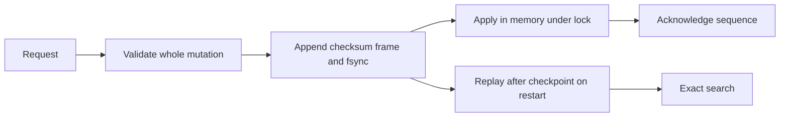

# Module B2: TinyVec as a durable service

> After this module you can log validated writes before acknowledging them.

**Time:** ~120 min · **Level:** Advanced · **Needs:** 2–4 GB RAM, up to 1 GB disk · **Docker:** No · **Downloads:** none beyond optional Python extras.

**TinyVec/Marlowe extension:** [Measured evidence](results/README.md); use the [cleared notebook](notebook.ipynb) for the same scripts.

## Prerequisites

Complete [Module 23](../../23_security_reliability/README.md), then read the [feature map](../../../docs/FEATURE_MAP.md). Install `uv sync --extra apps`. To run the service manually use `uv run --extra apps uvicorn tinyvec.service:app --host 127.0.0.1 --port 8450 --workers 1`. The default collection has two hand-designed dimensions and space hand-v1; the HTTP example uses a disposable directory.

## Learning objectives

- Log validated writes before acknowledging them.
- Recover a contiguous log and repair only an incomplete final frame.
- Publish checkpoints without discarding required mutation history.
- Serve concurrent HTTP requests safely with a single writer process.

## The big idea

An in-memory change can vanish with the process. A write-ahead log is a numbered receipt book: the receipt must be durable before the service says the order succeeded. A checkpoint is a photographed inventory page, and later receipts explain how to update that photograph.

## How it works



Each complete newline-delimited frame contains a sequence, operation, data and SHA-256 checksum of canonical JSON. Recovery rejects a corrupt complete frame or sequence gap, but truncates an incomplete final frame. A process lock prevents a second writer, while an RLock serializes mutations and lazy-index reads among concurrent callers. Validated batches are fsynced before applying their memory update. Failed acknowledgement can still leave an operation durable, so retries use stable IDs. Checkpoint publication stores an immutable TinyVec snapshot followed by an atomic pointer and sequence watermark; the complete WAL is retained.

## Build it yourself

Follow tinyvec/wal.py from replay through append. Validate the complete mutation batch before appending. Follow tinyvec/durable.py from schema validation to checkpoint loading and replay of later sequences. The scratch example appends an incomplete tail and proves that the earlier acknowledged row is recovered. Tests also terminate a real child process after fsync.

## Now in a real database

The SQLite example sets journal_mode=WAL and synchronous=FULL, commits a row, exits the process abruptly and reads the committed row in a new connection. SQLite provides a mature transaction implementation; the teaching log omits its locking, indexing, multi-process reader behavior and crash-recovery machinery. A process-exit test does not simulate sudden power loss or every filesystem guarantee.

## Walkthrough

### Inspect write-ahead ordering and incomplete-tail recovery.

```text
uv run python modules/bonus/B2_tinyvec_service/examples/01_from_scratch.py
```

Expected: assertions pass, then the printed diagnostic or measured record. [Source](examples/01_from_scratch.py). 

### Compare an acknowledged write with native SQLite transaction recovery.

```text
uv run python modules/bonus/B2_tinyvec_service/examples/02_production.py
```

Expected: assertions pass, then the printed diagnostic or measured record. [Source](examples/02_production.py). Use the optional setup listed above before this native comparison.

### Send concurrent operations through the durable HTTP service and restart it.

```text
uv run python modules/bonus/B2_tinyvec_service/examples/03_measure.py
```

Expected: assertions pass, then the printed diagnostic or measured record. [Source](examples/03_measure.py). 

## Measure it

The HTTP drill sends 20 writes from four concurrent callers, checks unique acknowledgement sequences, restarts the application and verifies sequence 20. Requests are safe but storage work is serialized, so this is not parallel read scaling. Native SQLite and TinyVec process-exit tests measure different mechanisms; no durability ranking is inferred from elapsed seconds.

[Results and raw records](results/README.md) retain the observed outcomes, including accuracy gaps. Timings include their declared scopes. Do not compare a full client lifecycle with retrieval-only latency or treat a successful local test as a production guarantee.

## When to use it, and when not to

Use this lesson to test one bounded design or research claim. Start with an exact baseline and introduce complexity only when the measured problem needs it. Do not deploy a teaching service without the operational controls from Tier 5, or transfer a tiny synthetic measurement to a larger production workload without new evidence.

## Real-world use case

A seller withdraws a listing after the last checkpoint. The use case persists the withdrawal in the log and restores without resurrecting that listing. A real service also needs authenticated access, capacity limits, replicated durability and an operator-controlled retention policy. Use Marlowe v6 for the authenticated application boundary.

```text
uv run python modules/bonus/B2_tinyvec_service/use_case/marlowe.py
```

Expected: the documented invariant and an explained result. [Use-case source](use_case/marlowe.py).

## Common mistakes

- An acknowledged write vanishes after a crash: append and fsync before sending success.
- A corrupt middle frame is silently skipped: fail closed instead of inventing missing history.
- Newer mutations disappear after checkpoint cleanup: retain the log until a tested atomic generation protocol exists.
- Two writer processes interleave log frames: enforce the ownership lock and run one worker.

## Exercises

- **Practice:** Return true only if complete WAL sequence numbers start at one and have no gaps or duplicates. [Starter](exercises/01_practice.py) · [Solution](solutions/01_practice.py).
- **Apply:** Given [sequence,value] entries, return values strictly after a checkpoint watermark. [Starter](exercises/02_apply.py) · [Solution](solutions/02_apply.py).
- **Stretch:** Return the complete newline-terminated prefix of a WAL string. Do not silently repair a corrupt complete record. [Starter](exercises/03_stretch.py) · [Solution](solutions/03_stretch.py).

Run `uv run python scripts/check_exercise.py modules/bonus/B2_tinyvec_service/exercises/01_practice.py`, substituting the other exercise paths as you progress. Starters run independently but intentionally do not meet acceptance until implemented.

## Quiz

1. What is the acknowledgement boundary?

<details><summary>Answer</summary>

The validated operation's complete log frame has been fsynced before it becomes visible and the call returns.

</details>

2. Which truncated data may recovery discard?

<details><summary>Answer</summary>

Only an incomplete final frame, never a corrupt complete frame.

</details>

3. Can a timed-out client assume its write never happened?

<details><summary>Answer</summary>

No. The operation may be durable even if the acknowledgement was lost.

</details>

4. Why retain the whole log in this lesson?

<details><summary>Answer</summary>

It avoids unsafe truncation across separately published checkpoint and log generations.

</details>

5. Does four-client success establish scalable parallel reads?

<details><summary>Answer</summary>

No. The reference serializes storage access and proves safety, not horizontal scalability.

</details>

## Key takeaways

- Validate first, log second, acknowledge last.
- Treat retries as potentially repeated operations.
- Distinguish incomplete tails from corruption.
- Publish checkpoints with an explicit watermark.
- Document serialization and filesystem limits.

## Clean up

Examples remove only their own temporary directories or UUID-named collections. Stop a manually launched service with Ctrl+C. Preview `uv run python scripts/cleanup.py` before removing generated cache or benchmark data. Keep committed fixtures, source and shared package caches. The optional Node node_modules directory is local build tooling; remove it only when intentionally retiring that toolchain.

## Go deeper

[SQLite write-ahead logging](https://www.sqlite.org/wal.html) · [SQLite atomic commit](https://www.sqlite.org/atomiccommit.html)

## Next: Module B3

Continue to [Reading and reproducing ANN research](../B3_research_benchmarks/README.md).
