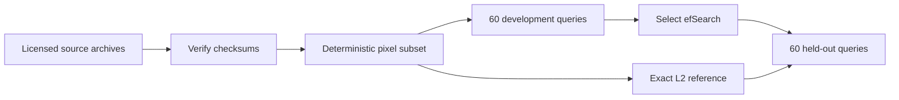

# Module B3: Reading and reproducing ANN research

> After this module you can prepare a pinned public dataset with license and byte checksums.

**Time:** ~120 min · **Level:** Advanced · **Needs:** 2–4 GB RAM, up to 1 GB disk · **Docker:** No · **Downloads:** optional 31 MB public dataset.

**TinyVec/Marlowe extension:** [Measured evidence](results/README.md); use the [cleared notebook](notebook.ipynb) for the same scripts.

## Prerequisites

Complete [Module 04](../../04_benchmarking/README.md), then read the [feature map](../../../docs/FEATURE_MAP.md). Run `uv sync --extra libs`, then explicitly prepare the data with `uv run python scripts/download_benchmarks.py --download`. Downloads total about 31 MB and stay under data/benchmarks; the prepared default subset needs roughly 80 MB disk. Without --download the preparation command only accepts already cached, verified files. Native examples require the public-benchmark notebook profile to opt in.

## Learning objectives

- Prepare a pinned public dataset with license and byte checksums.
- Compute exact ground truth independently of the approximate index.
- Select a search parameter on development queries and report held-out results.
- Distinguish protocol reproduction from a paper's full performance claim.

## The big idea

A benchmark is an experiment with a recipe. Reusing a chart without its ingredients is like comparing cooking times for different meals. Dataset selection, metric, hardware, threads, query split, warmup and failure handling all belong in the recipe.

## How it works



The optional Fashion-MNIST preparation downloads pinned image archives and a license, verifies every checksum, and produces a deterministic subset. The experiment uses 3,000 base vectors and 120 queries with 784 scaled pixel coordinates. It computes exact squared-L2 neighbors with FAISS flat, tunes HNSW efSearch on the first 60 selected queries, then reports the other 60 with three timing repetitions. Ties count against the exact distance boundary. This is nearest-neighbor approximation in pixel space, not a semantic image-retrieval evaluation.

## Build it yourself

The scratch script computes squared distances directly and demonstrates recall 0.5 for a candidate set missing one exact neighbor. Distinguish the number of distinct queries from repeated request samples. The third example bootstraps deliberately labeled illustrative query-level recall values; it does not relabel those values as public-dataset results.

## Now in a real database

The native experiment uses IndexFlatL2 as the reference and IndexHNSWFlat with M=24 and efConstruction=80. It tries efSearch 10, 32 and 64 against a 0.95 development recall target. FAISS uses one thread and its default HNSW random generator; dataset sampling seeds and the source manifest are recorded. If no development setting passes, the result reports no selected configuration.

## Walkthrough

### Compute an independent distance boundary and distinguish approximation from relevance.

```text
uv run python modules/bonus/B3_research_benchmarks/examples/01_from_scratch.py
```

Expected: assertions pass, then the printed diagnostic or measured record. [Source](examples/01_from_scratch.py). 

### Evaluate native HNSW on a checksummed, licensed Fashion-MNIST subset.

```text
uv run python modules/bonus/B3_research_benchmarks/examples/02_production.py
```

Expected: assertions pass, then the printed diagnostic or measured record. [Source](examples/02_production.py). Use the optional setup listed above before this native comparison.

### Show uncertainty and why repeated timings are not independent queries.

```text
uv run python modules/bonus/B3_research_benchmarks/examples/03_measure.py
```

Expected: assertions pass, then the printed diagnostic or measured record. [Source](examples/03_measure.py). 

## Measure it

The report keeps per-request latencies, actual sample counts, build time, serialized index bytes, hardware and dataset SHA-256. Sixty unique held-out queries do not establish universal tail performance. A new machine, dataset slice, distance metric or filter workload creates a new experiment. Repeated requests on one query are not independent evidence of semantic quality.

[Results and raw records](results/README.md) retain the observed outcomes, including accuracy gaps. Timings include their declared scopes. Do not compare a full client lifecycle with retrieval-only latency or treat a successful local test as a production guarantee.

## When to use it, and when not to

Use this lesson to test one bounded design or research claim. Start with an exact baseline and introduce complexity only when the measured problem needs it. Do not deploy a teaching service without the operational controls from Tier 5, or transfer a tiny synthetic measurement to a larger production workload without new evidence.

## Real-world use case

Marlowe wants to compare an index before buying more memory. This public pixel-space experiment exercises the benchmarking protocol, while the use case calculates its capacity and explains why SigLIP retrieval must be evaluated separately. A real company should add its own representative queries and independent relevance judgments.

```text
uv run python modules/bonus/B3_research_benchmarks/use_case/marlowe.py
```

Expected: the documented invariant and an explained result. [Use-case source](use_case/marlowe.py).

## Common mistakes

- A stale downloaded archive changes the dataset: fail on checksum mismatch.
- An ANN result looks correct because it generated its own ground truth: use an exact independent reference.
- A tuned test score looks unusually strong: select parameters on development queries only.
- A laptop subset is presented as the paper's headline reproduction: state the differences in data, hardware and implementation.

## Exercises

- **Practice:** Compute set recall with duplicate found IDs ignored; return null if ground truth is empty. [Starter](exercises/01_practice.py) · [Solution](solutions/01_practice.py).
- **Apply:** Given [parameter,recall] development trials, select the smallest parameter meeting target or null. [Starter](exercises/02_apply.py) · [Solution](solutions/02_apply.py).
- **Stretch:** Return [distinct_queries,total_requests], preserving the difference between samples and repeated measurements. [Starter](exercises/03_stretch.py) · [Solution](solutions/03_stretch.py).

Run `uv run python scripts/check_exercise.py modules/bonus/B3_research_benchmarks/exercises/01_practice.py`, substituting the other exercise paths as you progress. Starters run independently but intentionally do not meet acceptance until implemented.

## Quiz

1. Why store a dataset license beside the cache?

<details><summary>Answer</summary>

It preserves the source's reuse conditions with the downloaded artifact.

</details>

2. What does held-out mean here?

<details><summary>Answer</summary>

Those queries were not used to select efSearch.

</details>

3. Is pixel-space recall a photo-relevance metric?

<details><summary>Answer</summary>

No. It compares approximate and exact numeric neighbors.

</details>

4. Why record source and subset hashes?

<details><summary>Answer</summary>

The same dataset name can refer to different bytes or samples.

</details>

5. Should repeated timestamps be bootstrapped as independent queries?

<details><summary>Answer</summary>

No. Uncertainty about query quality must respect the query-level sampling unit.

</details>

## Key takeaways

- Treat the complete protocol as the experiment.
- Keep downloaded data licensed and checksummed.
- Compute independent ground truth.
- Select on development data and report holdout honestly.
- Reproduce a bounded claim, not an unexplained headline.

## Clean up

Examples remove only their own temporary directories or UUID-named collections. Stop a manually launched service with Ctrl+C. Preview `uv run python scripts/cleanup.py` before removing generated cache or benchmark data. Keep committed fixtures, source and shared package caches. The optional Node node_modules directory is local build tooling; remove it only when intentionally retiring that toolchain.

## Go deeper

[Fashion-MNIST official repository](https://github.com/zalandoresearch/fashion-mnist) · [HNSW paper](https://arxiv.org/abs/1603.09320) · [ANN-Benchmarks](https://github.com/erikbern/ann-benchmarks)

## Next: Module B4

Continue to [RaBitQ and current quantization implementations](../B4_whats_new/README.md).
