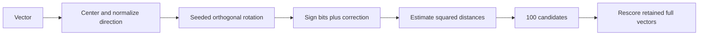

# Module B4: RaBitQ and current quantization implementations

> After this module you can implement a centered random-rotation sign quantizer with a correction factor.

**Time:** ~120 min · **Level:** Advanced · **Needs:** 2–4 GB RAM, up to 1 GB disk · **Docker:** No · **Downloads:** none beyond optional Python extras.

**TinyVec/Marlowe extension:** [Measured evidence](results/README.md); use the [cleared notebook](notebook.ipynb) for the same scripts.

## Prerequisites

Complete [Module 08](../../08_quantization/README.md), then read the [feature map](../../../docs/FEATURE_MAP.md). The scratch examples use included frozen MiniLM vectors and NumPy. Install `uv sync --extra libs` for FAISS. No model downloads or containers are needed. CPU experiments use one numerical-library thread and three scratch seeds.

## Learning objectives

- Implement a centered random-rotation sign quantizer with a correction factor.
- Measure raw approximate ranking and exact candidate rescoring separately.
- Compare the scratch method with native one-bit and four-bit FAISS indexes.
- Account for codes, rotation, correction values and retained full vectors.

## The big idea

A one-bit sign sketch is an extremely compact description of a direction. RaBitQ adds a correction that estimates the original inner product after a random rotation. Think of reading a compressed map with a scale legend: the signs alone lose information, and the correction tells you how to interpret their geometry.

## How it works



The teaching implementation centers each vector, records its norm, applies a seeded orthogonal rotation and packs the signs. It retains the inner product between the signed unit code and the rotated unit direction. At query time it divides the code/query dot product by this correction and reconstructs squared L2 distance. It uses dense unpacking for clarity; it omits SIMD query quantization, pruning and a proof of the published error bound. The algebraic self-distance and orthogonal rotation are tested.

## Build it yourself

Inspect tinyvec/rabitq.py. The correction line is the central difference from a plain Hamming-distance sketch. Zero residuals at the centroid receive an exact norm-based treatment. Estimated distances may be negative because they are estimates; the lesson does not hide estimator error by claiming exact distances. Inspect packed-code bytes separately from rotation and correction overhead.

## Now in a real database

The installed FAISS 1.15.1 supports Flat, RR384,RaBitQ and RR384,RaBitQ4 factory strings. RR384 explicitly provides random rotation; the four-bit variant spends more storage to retain more information. Native and teaching implementations have different query paths and seeds, so their timings are not interchangeable. The method originated in 2024; this lesson verifies its currently installed native implementation rather than calling the paper newly published.

## Walkthrough

### Estimate distances with one-bit RaBitQ and an explicit correction term.

```text
uv run python modules/bonus/B4_whats_new/examples/01_from_scratch.py
```

Expected: assertions pass, then the printed diagnostic or measured record. [Source](examples/01_from_scratch.py). 

### Compare FAISS flat, rotated one-bit and four-bit RaBitQ.

```text
uv run python modules/bonus/B4_whats_new/examples/02_production.py
```

Expected: assertions pass, then the printed diagnostic or measured record. [Source](examples/02_production.py). Use the optional setup listed above before this native comparison.

### Measure seed variability and the accuracy cost before exact rescoring.

```text
uv run python modules/bonus/B4_whats_new/examples/03_measure.py
```

Expected: assertions pass, then the printed diagnostic or measured record. [Source](examples/03_measure.py). 

## Measure it

The experiment uses 1,000 catalog vectors and 40 frozen queries, reporting distance-boundary recall, average distance error, build time and stored payload bytes. It compares raw approximate top ten with a 100-candidate exact rerank. Full float32 vectors remain available for rescoring and are counted separately. These descriptive queries do not constitute untouched model-selection data or a general benchmark victory.

[Results and raw records](results/README.md) retain the observed outcomes, including accuracy gaps. Timings include their declared scopes. Do not compare a full client lifecycle with retrieval-only latency or treat a successful local test as a production guarantee.

## When to use it, and when not to

Use this lesson to test one bounded design or research claim. Start with an exact baseline and introduce complexity only when the measured problem needs it. Do not deploy a teaching service without the operational controls from Tier 5, or transfer a tiny synthetic measurement to a larger production workload without new evidence.

## Real-world use case

A Marlowe catalog may use compressed codes to select candidates and retain full vectors for final scoring. The use case returns actual product IDs after this two-stage path. Choose the candidate budget against a separate development workload, test on held-out queries, and budget the full-vector storage before claiming a memory saving.

```text
uv run python modules/bonus/B4_whats_new/use_case/marlowe.py
```

Expected: the documented invariant and an explained result. [Use-case source](use_case/marlowe.py).

## Common mistakes

- Unrotated signs give poor accuracy: use a shared random orthogonal transform on records and queries.
- The code returns Hamming distance as a calibrated cosine score: apply the correction and declared metric.
- A tiny code-size claim ignores rotation and retained float vectors: report total resident and persisted structures.
- A rescored result is labeled raw quantizer quality: publish both stages and the candidate budget.

## Exercises

- **Practice:** Return sign codes with zero assigned to +1, matching the reference quantizer. [Starter](exercises/01_practice.py) · [Solution](solutions/01_practice.py).
- **Apply:** Return bytes for packed sign codes only, rounding dimension bits up for each row. [Starter](exercises/02_apply.py) · [Solution](solutions/02_apply.py).
- **Stretch:** Exact-rerank only the supplied unique candidate IDs; return the k smallest squared distances, breaking ties by ID. [Starter](exercises/03_stretch.py) · [Solution](solutions/03_stretch.py).

Run `uv run python scripts/check_exercise.py modules/bonus/B4_whats_new/exercises/01_practice.py`, substituting the other exercise paths as you progress. Starters run independently but intentionally do not meet acceptance until implemented.

## Quiz

1. What information supplements the sign bits?

<details><summary>Answer</summary>

The center, rotation, residual norm and per-vector correction factor.

</details>

2. Why apply the same rotation to a query?

<details><summary>Answer</summary>

Record codes and query coordinates must describe the same transformed space.

</details>

3. Why can an estimated squared distance be negative?

<details><summary>Answer</summary>

The estimator is approximate; nonnegativity of exact distance does not constrain every estimate.

</details>

4. Does exact rescoring recover a neighbor absent from candidates?

<details><summary>Answer</summary>

No. It only reranks the candidates it receives.

</details>

5. Does this reproduce the paper's optimized implementation?

<details><summary>Answer</summary>

No. It teaches the estimator and compares it with the installed native FAISS implementation.

</details>

## Key takeaways

- Random rotation is part of the representation.
- A sign sketch needs a calibrated interpretation.
- Report raw and rescored accuracy separately.
- Count retained vectors and global overhead.
- Verify modern APIs against the installed release.

## Clean up

Examples remove only their own temporary directories or UUID-named collections. Stop a manually launched service with Ctrl+C. Preview `uv run python scripts/cleanup.py` before removing generated cache or benchmark data. Keep committed fixtures, source and shared package caches. The optional Node node_modules directory is local build tooling; remove it only when intentionally retiring that toolchain.

## Go deeper

[RaBitQ original paper](https://arxiv.org/abs/2405.12497) · [FAISS index factory](https://github.com/facebookresearch/faiss/wiki/The-index-factory) · [Native RaBitQ implementation](https://github.com/facebookresearch/faiss/blob/main/faiss/IndexRaBitQ.h)

## Next: Module Capstone projects

Choose a [capstone](../../../capstones/README.md), then check the [definition of done](../../../docs/DEFINITION_OF_DONE.md).
