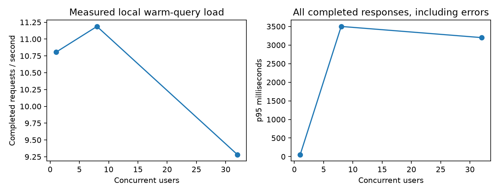

# Tier 5 measured operations

These are operational diagnostics, not a cross-database throughput ranking. Raw files retain actual hardware, package versions and source provenance. Earlier runs and observed failures are preserved.

## Recovery and index operations

[Checkpoint raw data](checkpoint-9fb32499.json) · [three-node raw data](cluster-b11e9f65.json) · [monitoring raw data](monitoring-0bbc7257.json)

| Observation | Measured result |
|---|---|
| Duplicate replay | 1,000 unique live IDs; at most 2 pending batches |
| Scratch compaction | 2,000 physical versions to 900 live rows, with identical live view |
| SQLite bytes, delete, VACUUM | 8,220,672 → 8,220,672 → 2,056,192 |
| Fresh-process restore | 0.612 s; 99 restored rows; five acknowledged writes lost; zero resurrected deletions |
| Native Qdrant snapshot | 1,665,536 bytes; 3.157 s restore; 499 rows after deletion |
| One peer down | Write acknowledged in 0.539 s |
| Peer rejoin | 2.857 s until both local shards active and both points present |
| Auth/TLS | Unauthenticated request rejected, read key cannot write, untrusted CA rejected |
| Monitoring | Live TLS scrape up=1; 26 observed series; 4 provisioned panels |

The corrected cluster drill passes read consistency as an HTTP query parameter. Its immediate majority read returned 500 during the outage; an explicit single-replica read returned both points, and majority reads returned both after recovery. Earlier cluster records put consistency in the request body and do not establish majority-read behavior. This is a transient observation, not a general claim that majority reads cannot tolerate one failed peer. The native migration used 500 MiniLM and Qwen vectors, deleted one point in each generation, changed a real collection alias and rolled it back. The separate application router couples encoder and collection identity. A checksum establishes byte integrity, not backup authenticity. Replica recovery uses three peers on one host, not independent failure zones.

## Target tuning and cache

Development queries selected nprobe=4 against recall≥0.90 and p95≤50 ms. Held-out recall@10 was **1.000**, p95 **0.200 ms**. There are only ten distinct held-out queries, each repeated three times. This measures ANN recall against exact neighbors, not semantic usefulness. No confidence interval over independent datasets is claimed.

The in-process cache experiment used 50 paired samples: cold median 0.0326 ms and cached median 0.0020 ms. It excludes HTTP, authentication, audit and model inference; do not compare it directly with the following table.

## HTTP load and recovery

[Raw report and sibling CSV/log files](load-2b761bee/report.json)

| Users | Interrupted | Requests | Failed | Failed % | Requests/s | p50 ms | p95 ms | p99 ms |
|---:|---|---:|---:|---:|---:|---:|---:|---:|
| 1 | False | 207 | 0 | 0.0 | 10.80 | 35 | 55 | 1300 |
| 8 | False | 225 | 5 | 2.2 | 11.19 | 210 | 3500 | 5400 |
| 32 | False | 174 | 0 | 0.0 | 9.28 | 960 | 3200 | 11000 |
| 8 | True | 161 | 12 | 7.5 | 8.01 | 240 | 4900 | 7900 |

The injected process outage took **12.909 s** from after termination through an intentional two-second pause, restart and successful health response. Readiness is not the same as complete cache rewarming. Each run lasted about 20 seconds; Locust buckets percentiles and counts completed requests. Small samples and startup effects limit tail estimates. Errors include 429 admission rejection and connection failures during interruption.

Compare throughput and tail latency together: this single-worker application retains a common service lock and serialized durable audit writes. Audit I/O now runs in a worker thread and is awaited before returning the response; the event loop remains available. Request timing includes that audit wait. Earlier runs exposed blocking audit I/O. The experiments do not isolate all remaining bottlenecks. Requests use frozen queries and a warm application cache, with no live embedding inference. Successful unfiltered results are checked for seller ownership; comprehensive endpoint/filter isolation is separately covered by the test suite.

An earlier load run intentionally remains available with rejected q005 text requests: q005 is an image-query fixture and was removed from the corrected text workload. An earlier native isolation assertion incorrectly required tied results in a fixed order; the corrected assertion checks membership and its rerun passed. Failed evidence is never overwritten.

## Capacity, cost and verification limits

The [memory worksheet](../../docs/MEMORY_MATH.md) calculates a 102.4 GB planning budget from explicit assumptions for 10M × 768 float32 vectors, two replicas and headroom. No 10-million-vector deployment was measured. Cost inputs are hypothetical, not vendor quotes. Native server memory was not sampled in these drills.

Live Qdrant metrics scraping and Grafana provisioning passed. API metrics were captured by the load test; cross-VM live API scraping and browser dashboard interaction were not executed. The [runbook](../../docs/TIER5_RUNBOOK.md) identifies the additional same-host API target. Hosted CI and other operating systems were not run locally.

See [Phase 7 verification](../../docs/PHASE_7_REPORT.md) and the [Tier 5 checkpoint](../../checkpoints/tier5/README.md).
